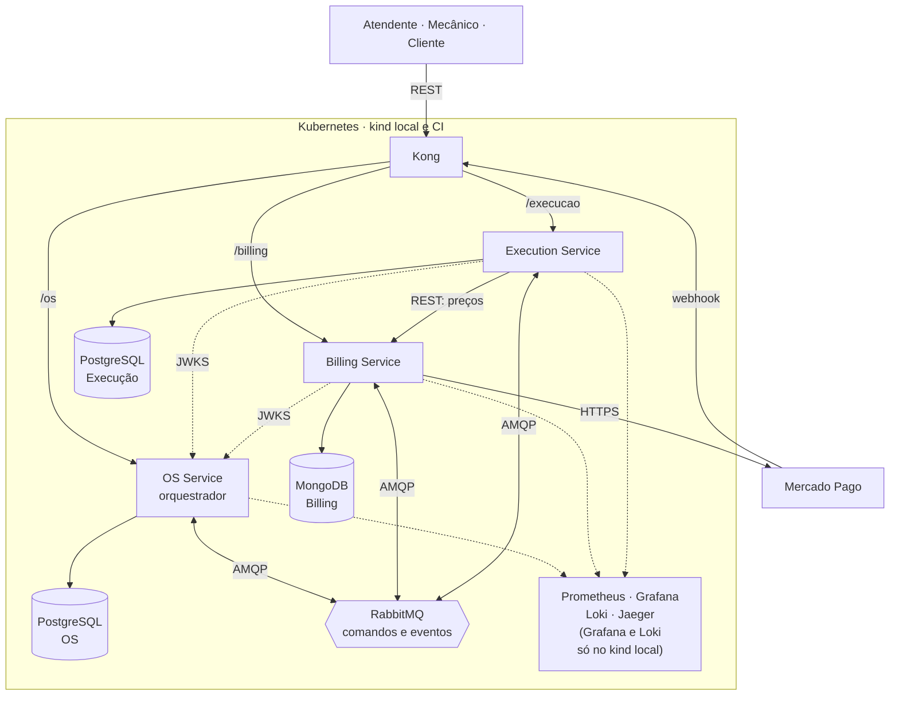

# PytStop Platform

Base compartilhada da fase 4 do PytStop, o sistema de gestão de oficina mecânica do Tech Challenge (FIAP Pós Tech, Software Architecture, 15SOAT), refatorado em microsserviços com Saga Pattern, mensageria assíncrona, CI/CD por serviço e deploy automatizado em Kubernetes. Quem avalia a entrega começa pelo [índice da entrega](INDICE-DA-ENTREGA.md), que liga os quatro repositórios, os requisitos e as evidências.

Os três serviços (OS Service, Billing Service e Execution Service) têm cada um o próprio repositório, banco e namespace (`pytstop-os`, `pytstop-billing` e `pytstop-execucao`), e os manifests deles ficam lá. Este repositório não é um quarto microsserviço: não tem código de domínio nem banco. Reúne o que os três compartilham e que não pertence a nenhum:

- o RabbitMQ, o gateway Kong, o Mailpit e a observabilidade (Prometheus, Grafana, Loki, Promtail, Jaeger e kube-state-metrics), no namespace `pytstop-plataforma`, mais o metrics-server do kind;
- o kind local, os overlays de Kubernetes e a stack docker compose para desenvolver um serviço;
- o catálogo de comandos e eventos da saga em AsyncAPI e JSON Schema;
- o E2E com BDD, o Newman e o ZAP, e o CD reutilizável dos serviços;
- os documentos da entrega (RFC-004, ADRs 034 a 043 e matriz de rastreabilidade).

O desenho geral está em [Arquitetura da fase 4](#arquitetura-da-fase-4), e o mapa das pastas, em [docs/papel-e-conteudo.md](docs/papel-e-conteudo.md#conteúdo).

**Sumário**: [Como subir](#como-subir), [Como testar](#como-testar), [Contratos](#contratos), [Observabilidade](#observabilidade), [CI/CD](#cicd), [Segurança](#segurança) e [Entrega e decisões](#entrega-e-decisões).

**Documentos em `docs/`**: [papel e conteúdo do repositório](docs/papel-e-conteudo.md), [como subir](docs/como-subir.md), [componentes e versões](docs/componentes-e-versoes.md), [contrato com os serviços](docs/contrato-com-os-servicos.md), [endereços e variáveis](docs/enderecos-e-variaveis.md), [RabbitMQ](docs/rabbitmq.md), [contratos de mensageria](docs/contratos-de-mensageria.md), [gateway](docs/gateway.md), [segredos](docs/segredos.md), [E2E da saga](docs/e2e-da-saga.md), [Newman](docs/newman.md), [ZAP](docs/zap.md), [Mercado Pago na sandbox](docs/mercado-pago-na-sandbox.md), [CI/CD](docs/ci-cd.md) e [decisões e limites](docs/decisoes-e-limites.md).

## Como subir

Requisitos: Docker, [kind](https://kind.sigs.k8s.io/) 0.31.0, kubectl (1.34 a 1.36), jq, curl e openssl, com as portas 80 e 443 livres no loopback. O `smoke` e o E2E pedem também o [uv](https://docs.astral.sh/uv/). A tabela de pré-requisitos de cada alvo está em [docs/como-subir.md](docs/como-subir.md#pré-requisitos).

```bash
make kind-up
make deploy
make smoke
```

O `make kind-up` cria o cluster `pytstop-p4`. O `make deploy` gera os segredos, aplica as CRDs do Kong e o overlay `kind`, espera os rollouts, roda o Job de usuários do RabbitMQ e termina no `kong-check`. O `make smoke` prova a borda, o Kong, o RabbitMQ, os dashboards e os pods e sai com status 1 se uma prova não valer; ele só roda num cluster com a plataforma e sem os serviços, porque recusa um namespace de serviço com Ingress. O `make status` lista pods, serviços, volumes e filas, o `make port-forward` abre as interfaces (ver [Observabilidade](#observabilidade)) e o `make kind-down` apaga o cluster.

**Overlays**: `kind` (o padrão), `kind-ci` (o kind sem Loki, Promtail e Grafana e com o Prometheus efêmero, para o runner do CI: `make kind-up deploy smoke OVERLAY=kind-ci`) e `k3s` (cluster persistente, fora do estado entregue). O `make up` sobe uma stack docker compose para desenvolver um serviço, sem o Kong. Senhas dos admins, portas e a diferença entre os ambientes estão em [docs/como-subir.md](docs/como-subir.md).

### Componentes e versões

Toda imagem tem tag fixa, e a mesma versão roda no kind, no k3s e no compose: RabbitMQ 4.3.6, Kong 3.9.3, Prometheus v2.54.1, Grafana 11.1.0, Loki 2.9.8, Promtail 3.6.11, Jaeger 1.76.0, PostgreSQL 16.15, MongoDB 7.0.43, OWASP ZAP 2.17.0 e as demais. A tabela completa, com o que cada uma faz e o endereço no cluster, está em [docs/componentes-e-versoes.md](docs/componentes-e-versoes.md), e o `make manifests` reprova imagem fora dela.

### Contrato com os serviços

No `deploy-kind` do CD de um serviço, o [`deploy-kind.sh`](scripts/ci/deploy-kind.sh) sobe a plataforma e gera os Secrets, o [`implantar-servicos.sh`](scripts/ci/implantar-servicos.sh) implanta os três serviços e o [`smoke-servicos.sh`](scripts/ci/smoke-servicos.sh) confere cada namespace. Localmente, com os três repositórios clonados ao lado deste e a plataforma de pé:

```bash
scripts/ci/implantar-servicos.sh --overlay kind \
  os-service=../postech-sw-arch-p4-os-service \
  billing-service=../postech-sw-arch-p4-billing-service \
  execution-service=../postech-sw-arch-p4-execution-service
scripts/ci/smoke-servicos.sh
```

O que cada serviço precisa ter (nome, namespace, prefixo na borda, banco, papéis, NetworkPolicy e exemplo de borda), o que o smoke confere e o que a plataforma entrega estão em [docs/contrato-com-os-servicos.md](docs/contrato-com-os-servicos.md). O ensaio com os três serviços reais, com tempo, memória e CPU por pod, está em [docs/operacao/ensaio-integrado.md](docs/operacao/ensaio-integrado.md).

## Como testar

```bash
make check
```

O `make check` roda os mesmos gates do CI (`lint`, `test`, `prova-retry` e `manifests`) e pede Docker, uv, Node 24, kubectl e jq:

- **Lint**: ruff, mypy strict e bandit nos testes e nos scripts, e shellcheck e actionlint nos scripts e nos workflows.
- **Testes**: contratos de mensageria, consistência da observabilidade, scripts de segredos, de deploy e de smoke e o código auxiliar do E2E, com gate de 90% (só um indicador aqui: o que protege os contratos são os negativos gerados dos exemplos), mais a validação do `asyncapi.yaml`.
- **Prova do retry**: um RabbitMQ avulso, com as definitions e as permissões do repositório.
- **Manifests**: kubeconform, trivy, promtool e o render do Kong sobre os overlays, os exemplos de borda e as configs.

O E2E, o Newman, o ZAP e o `make demo` pedem o cluster com os três serviços e por isso rodam no job `e2e` do CD, não no `make check`.

### E2E da saga

BDD de ponta a ponta com `pytest-bdd` e Gherkin em português: uma OS percorre os três serviços de verdade, no kind e pela borda, e cada falha da saga é provocada e conferida (11 cenários e um esquema de 3 exemplos, 14 execuções em cerca de 3 min). Fica aqui porque nenhum serviço é dono do fluxo inteiro. O E2E derruba o Billing, cria dados e não limpa: rode só num cluster descartável, com a plataforma no overlay `kind-ci` e os três serviços implantados.

```bash
make e2e
make demo
```

O `make demo` roda os cenários `@demo` (as demonstrações 1 e 2 do vídeo) e imprime o status da OS depois de cada `Então`. O que cada tag prova, as variáveis, os relatórios e os testes do código auxiliar estão em [docs/e2e-da-saga.md](docs/e2e-da-saga.md).

### Collection do fluxo completo (`make newman`)

A [collection Postman v2.1](docs/api/fluxo-completo.postman_collection.json) tem 45 itens: autentica admin, atendente e mecânico e percorre a OS da abertura à entrega pela borda, com o simulador do Billing. Roda no Newman 6.2.3 (Node 24) com `make newman`, no mesmo cluster do E2E, e no job `e2e` do CD, com [fontes e resumo da execução](docs/entrega/fase4/evidencias/newman-resumo.md). O comando, o que confere e o limite da prova estão em [docs/newman.md](docs/newman.md).

### ZAP baseline na borda

O OWASP ZAP 2.17.0, em modo baseline, varre o `openapi.json` de cada serviço pela borda do kind, como um cliente de fora e sem credencial, no job `e2e` do CD e depois do E2E ([`scripts/ci/zap-baseline.sh`](scripts/ci/zap-baseline.sh), [ADR-041](docs/arquitetura/adr/fase4/041-estrategia-de-testes-e-qualidade.md)). O spider chama cada operação, `POST`, `PUT` e `DELETE` inclusive, e por isso o script só roda num kind descartável. As regras que reprovam o job estão em [Regras e allowlist](#regras-e-allowlist), e o comando, o que o ZAP acusa e as variáveis, em [docs/zap.md](docs/zap.md).

### Mercado Pago na sandbox

O CI, o `make e2e` e o `make demo` usam o simulador do Billing. A prova na sandbox do Mercado Pago (cobrança, pagamento, estorno e preferência expirada, com credenciais de teste e sem mover dinheiro) roda à mão, num kind local: o `make mp-sandbox-ensaio` usa o simulador no lugar do comprador e não pede credencial, e o `make mp-sandbox` pede o Access Token de teste e a assinatura do webhook no ambiente do shell, e você paga no navegador. A prova não cobre o webhook, porque pagamentos de teste não enviam notificação, e a execução real ainda não foi feita. A evidência (`resumo.md`) leva também o trace da OS de cada cenário, higienizado e no formato do upload do Jaeger. O roteiro, os relatórios, o [trace da saga](docs/mercado-pago-na-sandbox.md#o-trace-da-saga), a segurança e a solução de problemas estão em [docs/mercado-pago-na-sandbox.md](docs/mercado-pago-na-sandbox.md).

## Contratos

Os comandos e eventos da saga são o contrato entre os serviços. A fonte canônica é [`contratos/`](contratos): o [`asyncapi.yaml`](contratos/asyncapi.yaml) (AsyncAPI 3.0), o JSON Schema do envelope e de cada uma das 34 mensagens, um envelope de exemplo por mensagem e os testes que amarram catálogo, AsyncAPI, schemas, exemplos e a topologia do RabbitMQ. O catálogo e os campos são os da [RFC-004, seção 5.3](docs/arquitetura/rfc/fase4/rfc-004-microsservicos-saga.md#53-catálogo-de-comandos-e-eventos). Mudança de contrato começa por um PR aqui: cada serviço copia os schemas que produz e consome e o `asyncapi.yaml`, registra o commit de origem em `contratos/ORIGEM` e os valida no próprio teste de contrato. Campo novo opcional mantém a `versao`; mudança incompatível vira `versao: 2`, com o consumidor implantado antes do produtor. O envelope, as regras dos schemas e a bateria de testes estão em [docs/contratos-de-mensageria.md](docs/contratos-de-mensageria.md).

### Filas, exchanges e argumentos

Toda a topologia do RabbitMQ 4.3.6 está no [`definitions.json`](k8s/base/rabbitmq/definitions.json), importado no boot do broker (kind, k3s e compose): os exchanges `pytstop.comandos`, `pytstop.eventos` e `pytstop.retry` (topic) e o `pytstop.dlx` (direct); uma fila quorum de trabalho por consumidor (`billing.comandos`, `execucao.comandos` e `os.eventos`) e, para cada uma, cinco filas de retry por atraso (1, 5, 15, 60 e 300 s) e uma DLQ de 7 dias. Os serviços não declaram nada: só conferem com declaração passiva, cada um com o usuário próprio e sem permissão de configure. O diagrama, as policies, o fluxo do retry, o redrive e os usuários estão em [docs/rabbitmq.md](docs/rabbitmq.md).

## Observabilidade

A stack da fase 3 serve os três serviços no namespace `pytstop-plataforma` ([ADR-043](docs/arquitetura/adr/fase4/043-observabilidade-distribuida.md)):

- **Prometheus**: raspa todo pod anotado dos namespaces `pytstop-*`.
- **Grafana**: provisiona os dashboards e os alertas a partir dos arquivos do repositório.
- **Loki e Promtail**: guardam os logs em JSON dos pods, depois de mascarar o token do link.
- **Jaeger**: recebe os traces OTLP, com a saga atravessando HTTP e mensagens.

São 9 dashboards (4 de negócio e 5 técnicos: plataforma, Saga, Mensageria, Serviços e Bancos) e 21 regras de alerta. Um teste de consistência liga cada painel e cada alerta à documentação e ao catálogo de métricas, e o promtool prova as regras no `make manifests`.

```bash
make port-forward
```

O comando abre o Grafana em `localhost:3000`, o Jaeger em `localhost:16686`, o Prometheus em `localhost:9090`, o RabbitMQ em `localhost:15672` e o Mailpit em `localhost:8025`. Os painéis de negócio estão em [`observabilidade/negocio.md`](observabilidade/negocio.md), e os técnicos, os alertas, o catálogo de métricas e a retenção, em [`observabilidade/README.md`](observabilidade/README.md). O que o serviço precisa expor (pod anotado, porta `metrics` e logs em JSON) está em [docs/enderecos-e-variaveis.md](docs/enderecos-e-variaveis.md). As capturas dos nove dashboards estão no [Anexo A do documento de entrega](docs/entrega/fase4/entrega-fase-4.md#anexo-a--evidências-visuais).

## CI/CD

A `main` é protegida: tudo entra por PR com squash, e o [ruleset](https://github.com/fiap-postech-sw-architecture/postech-sw-arch-p4-platform/rules/24599837) exige os checks `manifests`, `contratos` e `gitleaks` do [CI](.github/workflows/ci.yml) e `deploy-kind` do [CD](.github/workflows/cd.yml) ([ADR-042](docs/arquitetura/adr/fase4/042-cicd-e-deploy-kubernetes.md)). O job `e2e` ainda não é obrigatório. O único commit fora de PR é o `Initial commit` que o GitHub cria com o repositório ([prova](docs/entrega/fase4/evidencias/protecao-da-main.md)). O `cd.yml` tem o `deploy-kind` (a plataforma no kind do runner, com o overlay `kind-ci`, [detalhes do `kind-ci`](docs/como-subir.md#kind-no-ci-overlay-kind-ci)) e o `e2e`, e, no push na `main`, o job `ci`, que roda o `ci.yml` no commit que entrou; nesse push, os dois só começam com o CI verde.

### CI

O [`ci.yml`](.github/workflows/ci.yml) roda em pull request para a `main`, sob demanda e quando o CD o chama, no runner fixo `ubuntu-24.04`, com três jobs. O `manifests` roda shellcheck e actionlint e valida os três overlays e os exemplos de borda (kubeconform e trivy), as configs do Prometheus, Loki e Promtail, as regras de alerta no promtool, o render do Kong, as versões e os dashboards. O `contratos` roda `uv lock --check`, `make lint`, `make test` e `make prova-retry`. A cobertura do `make test` é de 99,85% de linhas e ramos do código de teste, com gate de 90%: é só um indicador aqui, porque o que protege os contratos são os negativos gerados dos exemplos ([docs/contratos-de-mensageria.md](docs/contratos-de-mensageria.md)). O `gitleaks` varre o histórico do commit testado, com uma regra própria para URL AMQP com senha, e o `gitleaks-semanal.yml` varre todas as refs uma vez por semana. Detalhes em [docs/ci-cd.md](docs/ci-cd.md).

### CD reutilizável dos serviços

O [`cd-servico.yml`](.github/workflows/cd-servico.yml) oferece, por `workflow_call`, os jobs `image` (publica a imagem no GHCR, com SBOM e proveniência), `deploy-kind` (kind efêmero no runner, com smoke e BDD), `deploy-remote` (deploy num cluster persistente, desligado) e `remote-skipped`. Os três serviços o chamam, fixado por SHA, e mantêm só os gatilhos, o CI e a segurança. O SHA é trocado à mão em cada serviço depois do CD do platform verde, porque o platform não publica tag nem release. Os três já tiveram o primeiro CD da `main` aprovado ([provas](docs/entrega/fase4/evidencias/README.md#cd-compartilhado-dos-serviços)). Entradas, permissões e o gancho remoto: [docs/ci-cd.md](docs/ci-cd.md#cd-reutilizável-dos-serviços).

### Job `e2e`: a saga e a borda com os três serviços

Roda em todo PR e push na `main`, em paralelo com o `deploy-kind`, cada um no próprio kind do runner. Sobe a plataforma e os três serviços construídos do código, cada um no commit do último CD verde, e roda o smoke, o `make e2e`, o `make newman` e o ZAP, guardando relatórios e diagnóstico mesmo com falha. Levou 8 min 46 s no run medido. Os passos, os prazos e como reexecutar uma combinação de commits: [docs/ci-cd.md](docs/ci-cd.md#job-e2e-a-saga-e-a-borda-com-os-três-serviços).

## Segurança

- **Borda**: o Kong ([ADR-038](docs/arquitetura/adr/fase4/038-borda-e-comunicacao-sincrona.md)) só publica `/api/v1/*`, `/docs` e `/openapi.json` de cada serviço, o JWKS do OS e o checkout do simulador. `/metrics` e `/api/v1/admin/*` respondem 404, caminho com `%2F` ou `%5C` também, e há rate limit por IP por classe de rota. O gateway não anuncia produto nem versão. Rotas, plugins e limites: [docs/gateway.md](docs/gateway.md).
- **Autenticação**: JWT RS256 emitido pelo OS Service e validado pelo Billing e pela Execução com a chave pública do JWKS ([ADR-039](docs/arquitetura/adr/fase4/039-autenticacao-entre-servicos.md)).
- **Rede**: cada serviço traz NetworkPolicy de entrada que nega tudo e libera só o previsto, e o `smoke-servicos.sh` prova a do banco. No broker, cada serviço tem usuário próprio, e a routing key de cada um é limitada ([ADR-036](docs/arquitetura/adr/fase4/036-mensageria-rabbitmq.md)).
- **Pods**: sem root, sem escalar privilégio, sem capability, com seccomp `RuntimeDefault` e raiz somente leitura. A exceção é o Promtail, que roda como root para ler os logs.

### Segredos gerados

Nenhuma senha ou chave fica nos manifests. O `make deploy` roda o [`gerar-segredos.sh`](scripts/gerar-segredos.sh), que cria cada fonte (RabbitMQ, Grafana, bancos, chave RSA do JWT, `ENCRYPTION_KEY`, senha do admin e chave do link de decisão) só se ainda não existe e regrava o que deriva dela (a `RABBITMQ_URL` de cada serviço). Nada passa por argumento de processo, variável exportada ou saída, e no GitHub Actions cada valor é mascarado. A tabela de Secrets, com quem lê e como girar, está em [docs/segredos.md](docs/segredos.md#segredos-gerados). A `ENCRYPTION_KEY` dos dados pessoais não gira sem migração ([ADR-042](docs/arquitetura/adr/fase4/042-cicd-e-deploy-kubernetes.md)), e as credenciais do Mercado Pago ficam fora do script: no kind local são credenciais de teste, só no ambiente do shell de quem roda a prova.

### Troca de senha do banco

A senha de cada papel do PostgreSQL e de cada usuário do MongoDB troca por um procedimento de `kubectl` que passa a senha pela entrada padrão, sem deixá-la em argumento nem no log do servidor, e diz o que reiniciar depois: [docs/segredos.md](docs/segredos.md#troca-de-senha-do-banco). A do RabbitMQ tem [o próprio passo a passo](docs/segredos.md#troca-de-senha-do-rabbitmq), e a chave do JWT gira sem derrubar sessão, pelas etapas da [rotação da chave](https://github.com/fiap-postech-sw-architecture/postech-sw-arch-p4-os-service#rotação-da-chave) do OS Service.

### Regras e allowlist

Cada regra do ZAP tem uma linha em [`e2e/zap/regras.conf`](e2e/zap/regras.conf), e a tabela de [docs/zap.md](docs/zap.md#regras-e-allowlist) é a mesma, conferida por um teste. Reprovam o job (`FAIL`) os cabeçalhos `Server` e `X-Powered-By` com versão (10036 e 10037), a falta de `X-Content-Type-Options` (10021) e a falta de anti-clickjacking e de CSP em resposta HTML (10020 e 10038). O HSTS ausente nos 404 que o próprio Kong gera (10035) só avisa, e o `Cache-Control` (10015) é ignorado. No [run 39098307172](https://github.com/fiap-postech-sw-architecture/postech-sw-arch-p4-platform/actions/runs/39098307172), nenhuma regra em `FAIL` disparou nos três serviços.

## Entrega e decisões

O [índice da entrega](INDICE-DA-ENTREGA.md) é a porta de entrada do avaliador. Ao lado dele estão o [documento de entrega](docs/entrega/fase4/entrega-fase-4.md), a base do PDF de submissão, a [matriz de rastreabilidade](docs/entrega/matriz-de-rastreabilidade.md) dos requisitos, o [roteiro do vídeo](docs/entrega/fase4/roteiro-video.md), o [registro de evidências](docs/entrega/fase4/evidencias/README.md) e a [auditoria e dívida técnica](docs/entrega/fase4/auditoria-e-divida-tecnica.md). O que o enunciado pede e onde cada item está neste repositório: [docs/papel-e-conteudo.md](docs/papel-e-conteudo.md).

As decisões estão na [RFC-004](docs/arquitetura/rfc/fase4/rfc-004-microsservicos-saga.md) (desenho integrado, saga, mensageria, APIs, dados, segurança e observabilidade) e nos ADRs 034 a 043, indexados em [docs/arquitetura/](docs/arquitetura/README.md). Os requisitos e a análise de lacunas ficam em [docs/requisitos/](docs/requisitos/README.md). A operação tem o [runbook da saga](docs/operacao/runbook-saga.md), o [ensaio integrado](docs/operacao/ensaio-integrado.md) e a [nuvem opcional](docs/operacao/nuvem-opcional.md).

### Arquitetura da fase 4



Fonte: [RFC-004, seção 2](docs/arquitetura/rfc/fase4/rfc-004-microsservicos-saga.md). No CI, o overlay `kind-ci` roda Prometheus e Jaeger; Grafana e Loki ficam só no kind local.

### Repositórios da fase 4

| Repositório | Papel |
|---|---|
| [postech-sw-arch-p4-os-service](https://github.com/fiap-postech-sw-architecture/postech-sw-arch-p4-os-service) | OS Service: ordens de serviço (OS), clientes e veículos, usuários internos e orquestrador da saga |
| [postech-sw-arch-p4-billing-service](https://github.com/fiap-postech-sw-architecture/postech-sw-arch-p4-billing-service) | Billing Service: orçamentos, pagamentos via Mercado Pago e tabela de preços |
| [postech-sw-arch-p4-execution-service](https://github.com/fiap-postech-sw-architecture/postech-sw-arch-p4-execution-service) | Execution Service (no texto, "Execução"), com os contextos Diagnóstico, Execução e Estoque: fila de diagnóstico e de execução e estoque de peças |
| [postech-sw-arch-p4-platform](https://github.com/fiap-postech-sw-architecture/postech-sw-arch-p4-platform) | Este: infraestrutura compartilhada, contratos, testes ponta a ponta (E2E), arquitetura global e documentos da entrega ([ADR-034](docs/arquitetura/adr/fase4/034-decomposicao-em-microsservicos.md)) |

### Decisões e limites

Os limites que o repositório assume, com o motivo de cada um, estão em [docs/decisoes-e-limites.md](docs/decisoes-e-limites.md): o Kong vem de `helm template` versionado, com o webhook de validação desligado e o gate `FallbackConfiguration`; as senhas são geradas no cluster; o controller do Kong ainda lê os Secrets dos quatro namespaces, risco aceito e registrado; Prometheus, Loki e kube-state-metrics têm CVE HIGH e CRITICAL sem correção na própria linha e rodam só dentro do cluster, sem Ingress; e Loki e Grafana não persistem estado.
