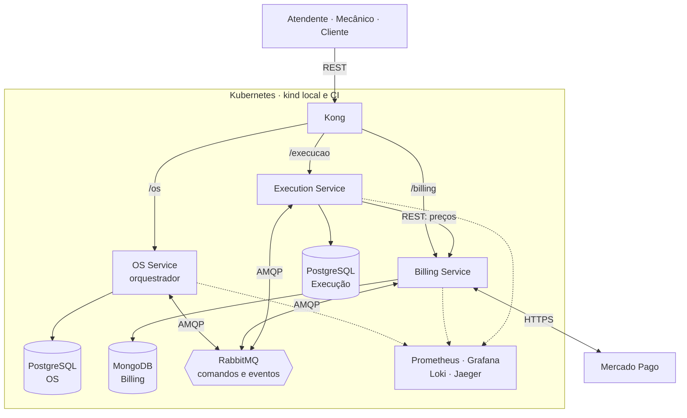

# Tech Challenge — Fase 4: PytStop

Documento de ensaio da turma 15SOAT, Pós-Graduação em Arquitetura de Software da FIAP. A versão final depende das provas operacionais e da gravação do vídeo. Prazo do portal: 17/11/2026 às 23:59.

## 1. Participantes

Identificação aguardando confirmação do grupo. A lista das fases anteriores não confirma os participantes desta fase.

## 2. Repositórios e execução

| Componente | Repositório | Documentação | CI/CD |
|---|---|---|---|
| OS Service | [repositório](https://github.com/fiap-postech-sw-architecture/postech-sw-arch-p4-os-service) | [README](https://github.com/fiap-postech-sw-architecture/postech-sw-arch-p4-os-service/blob/main/README.md) | [pipelines](https://github.com/fiap-postech-sw-architecture/postech-sw-arch-p4-os-service/actions) |
| Billing Service | [repositório](https://github.com/fiap-postech-sw-architecture/postech-sw-arch-p4-billing-service) | [README](https://github.com/fiap-postech-sw-architecture/postech-sw-arch-p4-billing-service/blob/main/README.md) | [pipelines](https://github.com/fiap-postech-sw-architecture/postech-sw-arch-p4-billing-service/actions) |
| Execution Service | [repositório](https://github.com/fiap-postech-sw-architecture/postech-sw-arch-p4-execution-service) | [README](https://github.com/fiap-postech-sw-architecture/postech-sw-arch-p4-execution-service/blob/main/README.md) | [pipelines](https://github.com/fiap-postech-sw-architecture/postech-sw-arch-p4-execution-service/actions) |
| Plataforma | [repositório](https://github.com/fiap-postech-sw-architecture/postech-sw-arch-p4-platform) | [README](https://github.com/fiap-postech-sw-architecture/postech-sw-arch-p4-platform/blob/main/README.md) | [pipelines](https://github.com/fiap-postech-sw-architecture/postech-sw-arch-p4-platform/actions) |

O [índice da entrega](../../../INDICE-DA-ENTREGA.md) concentra os artefatos exigidos. A [matriz](../matriz-de-rastreabilidade.md) liga os 44 requisitos aos serviços, PRs, código e trechos previstos do vídeo. Durante o ensaio, os links apontam para `main`; a versão final usará a tag `entrega-fase-4` dos quatro repositórios.

Cada serviço contém código, Dockerfile, manifestos Kubernetes, pipeline, testes, documentação de arquitetura, OpenAPI e collection Postman próprios. A plataforma é o complemento com infraestrutura compartilhada e provas integradas. Para reproduzir o ambiente, siga o [README da plataforma](../../../README.md#e2e-da-saga) e o `make kind-deploy` de cada serviço.

## 3. Vídeo

O vídeo de até 15 minutos ainda será gravado e publicado. O [roteiro](roteiro-video.md) reserva 14 minutos para fluxo completo, compensações, pipeline com deploy e observabilidade. Inserir o link público ou não listado após a gravação.

## 4. Arquitetura final

A fonte deste diagrama é a [RFC-004, seção 2](../../arquitetura/rfc/fase4/rfc-004-microsservicos-saga.md); o mesmo bloco aparece no README.

## 5. Divisão dos serviços e tecnologias

OS Service mantém cadastro, histórico, identidade e orquestração do atendimento. Billing concentra preços, orçamento, cobrança e Mercado Pago. Execution mantém diagnóstico, estoque, reservas e execução física. Cada serviço grava somente seu banco; a comunicação entre responsáveis usa REST ou mensagens. A [RFC-004, seção 3](../../arquitetura/rfc/fase4/rfc-004-microsservicos-saga.md) detalha o recorte do monólito.

PostgreSQL 16 preserva as relações e restrições do OS e da Execução. MongoDB 7 guarda os documentos de orçamento e pagamento do Billing, com replica set para transações locais entre agregado e outbox. RabbitMQ separa comandos e respostas, com confirmação, retry por atraso e filas de mensagens mortas. Kong publica as rotas previstas e aplica limites e correlação. JWT RS256 permite validar a identidade pela chave pública do OS, mantendo a chave privada somente no emissor.

Prometheus, Grafana, Loki e Jaeger retomam a observabilidade da fase 3. Os nove dashboards têm JSON e descrição por painel; os de negócio incluem volume diário de OS e tempo médio por status. As decisões estão nos [ADRs 034 a 043](../../arquitetura/adr/fase4/). O ambiente entregue é kind, local e no CI. Nuvem persistente é opcional, conforme o [ADR-042](../../arquitetura/adr/fase4/042-cicd-e-deploy-kubernetes.md).

## 6. Saga e compensações

O OS persiste a ordem e a instância da saga na mesma transação. Sua outbox publica comandos; cada participante grava o efeito e a resposta em sua própria transação. O orquestrador avança ao receber as respostas. A orquestração torna a ordem das compensações e a recuperação observáveis num ponto definido, mantendo os bancos isolados ([ADR-035](../../arquitetura/adr/fase4/035-saga-orquestrada.md)).

O caminho completo passa por diagnóstico, orçamento, decisão, reserva, pagamento, agendamento, início, finalização e entrega. Falha na reserva cancela orçamento e diagnóstico sem cobrar. Cancelamento pago antes do início cancela a execução, estorna o pagamento, libera a reserva e cancela orçamento e diagnóstico, nessa ordem. Após o início físico, o cancelamento responde 409: este é o pivot da saga.

Mensagens repetidas não repetem o efeito. Prazos e reenvios limitados levam uma compensação não resolvida à intervenção manual, com retomada autenticada pelo [runbook](../../operacao/runbook-saga.md). O [BDD integrado](../../../e2e/features/saga_atendimento.feature) verifica caminho feliz, compensações, pivot e recuperação de falhas.

## 7. Testes, qualidade e deploy

O enunciado exige cobertura mínima de 80%; o projeto adota gate de 95% nos serviços. Testes unitários, integração com bancos reais, BDD e mutação focal protegem os fluxos. Os pipelines incluem tipos, limites arquiteturais, análise de dependências e segredos, scan de imagem e SonarQube. Relatórios e tabelas de fechamento ficam nas [evidências](evidencias/README.md).

O CD do OS executa testes, imagem por digest, deploy num kind descartável e E2E. O workflow compartilhado e as chamadas equivalentes de Billing e Execution ainda estão em conclusão. Este ensaio não apresenta esse requisito como concluído nos três serviços. A proteção de `main`, os checks e a origem dos commits serão preservados nas evidências finais.

## 8. Evidências e fechamento

A [auditoria](auditoria-e-divida-tecnica.md) registra o que precisa ser provado. A sandbox real do Mercado Pago requer credenciais de teste do responsável; simulador e ensaio sem cobrança não substituem essa evidência.

Antes da submissão: confirmar participantes, concluir as provas de CD e observabilidade, conferir links, gravar/publicar o vídeo, congelar os quatro repositórios com a tag `entrega-fase-4` e regenerar o PDF. A submissão no portal cabe ao grupo.
