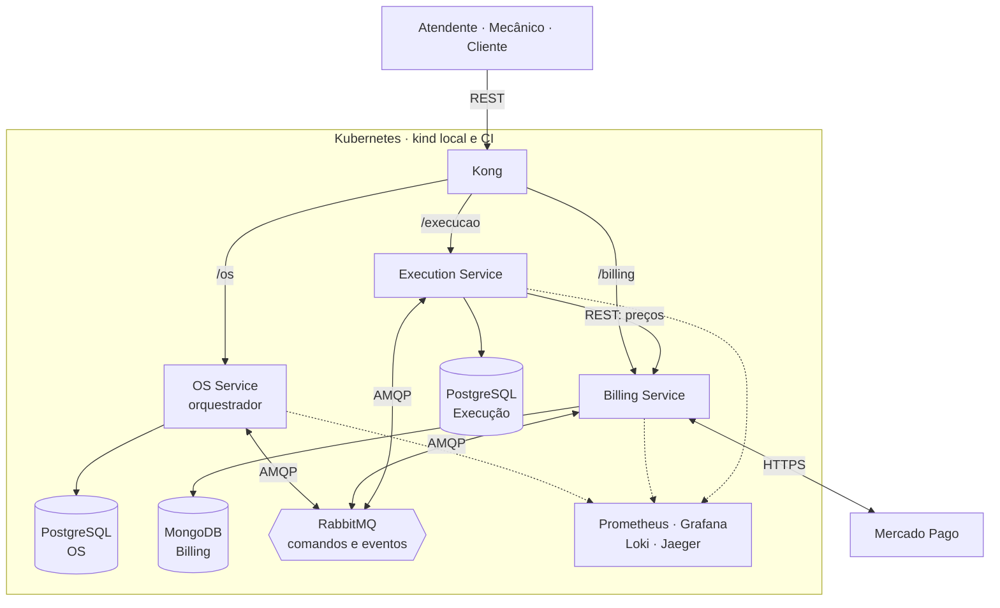

# Tech Challenge — Fase 4: PytStop

O PytStop é o sistema de gestão de uma oficina mecânica. Nas fases 1 a 3 ele foi um monólito; na fase 4 virou três microsserviços ligados por uma saga. Uma ordem de serviço (OS) registra um atendimento, da abertura à entrega do veículo. O OS Service cuida da OS e do cliente, o Billing Service do orçamento e do pagamento, e o Execution Service do diagnóstico, do estoque e do reparo.

Versão preliminar do documento da turma 15SOAT, Pós-Graduação em Arquitetura de Software da FIAP. A versão final depende das provas operacionais e da gravação do vídeo. Prazo do portal: 17/11/2026 às 23:59.

## 1. Participantes

Identificação dos participantes pendente de confirmação do grupo.

## 2. Repositórios e execução

| Componente | Repositório | Documentação | CI/CD |
|---|---|---|---|
| OS Service | [https://github.com/fiap-postech-sw-architecture/postech-sw-arch-p4-os-service](https://github.com/fiap-postech-sw-architecture/postech-sw-arch-p4-os-service) | [README](https://github.com/fiap-postech-sw-architecture/postech-sw-arch-p4-os-service/blob/main/README.md), [arquitetura](https://github.com/fiap-postech-sw-architecture/postech-sw-arch-p4-os-service/blob/main/docs/arquitetura.md), [API](https://github.com/fiap-postech-sw-architecture/postech-sw-arch-p4-os-service/tree/main/docs/api) | [workflows](https://github.com/fiap-postech-sw-architecture/postech-sw-arch-p4-os-service/tree/main/.github/workflows), [execuções](https://github.com/fiap-postech-sw-architecture/postech-sw-arch-p4-os-service/actions) |
| Billing Service | [https://github.com/fiap-postech-sw-architecture/postech-sw-arch-p4-billing-service](https://github.com/fiap-postech-sw-architecture/postech-sw-arch-p4-billing-service) | [README](https://github.com/fiap-postech-sw-architecture/postech-sw-arch-p4-billing-service/blob/main/README.md), [arquitetura](https://github.com/fiap-postech-sw-architecture/postech-sw-arch-p4-billing-service/blob/main/docs/arquitetura.md), [API](https://github.com/fiap-postech-sw-architecture/postech-sw-arch-p4-billing-service/tree/main/docs/api) | [workflows](https://github.com/fiap-postech-sw-architecture/postech-sw-arch-p4-billing-service/tree/main/.github/workflows), [execuções](https://github.com/fiap-postech-sw-architecture/postech-sw-arch-p4-billing-service/actions) |
| Execution Service | [https://github.com/fiap-postech-sw-architecture/postech-sw-arch-p4-execution-service](https://github.com/fiap-postech-sw-architecture/postech-sw-arch-p4-execution-service) | [README](https://github.com/fiap-postech-sw-architecture/postech-sw-arch-p4-execution-service/blob/main/README.md), [arquitetura](https://github.com/fiap-postech-sw-architecture/postech-sw-arch-p4-execution-service/blob/main/docs/arquitetura.md), [API](https://github.com/fiap-postech-sw-architecture/postech-sw-arch-p4-execution-service/tree/main/docs/api) | [workflows](https://github.com/fiap-postech-sw-architecture/postech-sw-arch-p4-execution-service/tree/main/.github/workflows), [execuções](https://github.com/fiap-postech-sw-architecture/postech-sw-arch-p4-execution-service/actions) |
| Plataforma | [https://github.com/fiap-postech-sw-architecture/postech-sw-arch-p4-platform](https://github.com/fiap-postech-sw-architecture/postech-sw-arch-p4-platform) | [README](https://github.com/fiap-postech-sw-architecture/postech-sw-arch-p4-platform/blob/main/README.md) | [workflows](https://github.com/fiap-postech-sw-architecture/postech-sw-arch-p4-platform/tree/main/.github/workflows), [execuções](https://github.com/fiap-postech-sw-architecture/postech-sw-arch-p4-platform/actions) |

O [índice da entrega](../../../INDICE-DA-ENTREGA.md) concentra os artefatos exigidos. A [matriz](../matriz-de-rastreabilidade.md) liga os 44 requisitos aos serviços, pull requests (PRs), código e trechos previstos do vídeo. Nesta versão preliminar, os links apontam para `main`; a versão final usará a tag `entrega-fase-4` dos quatro repositórios.

Cada serviço contém código, Dockerfile, manifestos Kubernetes, pipeline, testes, documentação de arquitetura, OpenAPI e collection Postman próprios. A plataforma reúne a infraestrutura compartilhada e as provas integradas. Para reproduzir o ambiente, siga o [README da plataforma](../../../README.md#e2e-da-saga) e o `make kind-deploy` de cada serviço.

## 3. Vídeo

O vídeo de até 15 minutos ainda será gravado e publicado. O [roteiro](roteiro-video.md) reserva 14 minutos para fluxo completo, compensações, pipeline com deploy e observabilidade. Inserir o link público ou não listado após a gravação.

## 4. Arquitetura final

A fonte deste diagrama é a proposta técnica da arquitetura (RFC, *request for comments*), na [RFC-004, seção 2](../../arquitetura/rfc/fase4/rfc-004-microsservicos-saga.md).

No diagrama, REST são chamadas HTTP síncronas, AMQP são as mensagens do RabbitMQ e kind é um cluster Kubernetes em contêineres Docker. Na integração contínua (CI), o overlay `kind-ci` roda Prometheus e Jaeger; Grafana e Loki ficam só no kind local.

## 5. Divisão dos serviços e tecnologias

O recorte do monólito segue três critérios do [ADR-034](../../arquitetura/adr/fase4/034-decomposicao-em-microsservicos.md). As capacidades que o enunciado sugere definem os serviços. Cada contexto delimitado do monólito vai inteiro para o serviço cuja capacidade sustenta, e cada serviço é o único dono dos seus dados. A regra que precisa de transação local com lock fica num serviço só, para que a reserva de peças não atravesse a rede.

- O OS Service guarda a OS, o histórico, os clientes, os veículos e os usuários internos, e orquestra a saga.
- O Billing Service guarda preços, orçamentos e pagamentos e fala com o Mercado Pago.
- O Execution Service guarda diagnóstico, estoque, reservas e execução.

Cada serviço também muda num ritmo próprio: o OS Service com o atendimento e a identidade, o Billing com a regra de preço e o provedor de pagamento, a Execução com o trabalho da oficina. Os serviços gravam somente nos próprios bancos e conversam por REST ou por mensagens. Há um desvio deliberado do enunciado, que põe o envio do orçamento no Billing: o Billing gera o orçamento e o link de decisão, e o e-mail sai do OS Service, dono do contato. Assim, nome, documento e contato do cliente não saem do OS Service. A [RFC-004, seção 3](../../arquitetura/rfc/fase4/rfc-004-microsservicos-saga.md) detalha o recorte.

PostgreSQL 16 preserva as relações e restrições do OS Service e da Execução. MongoDB 7 guarda os documentos de orçamento e pagamento do Billing, com replica set para gravar na mesma transação o documento e a outbox, a tabela das mensagens a publicar. RabbitMQ separa comandos e respostas, com confirmação, retry por atraso e filas de mensagens mortas. Kong é o gateway de API: publica as rotas `/os`, `/billing` e `/execucao`, limita a taxa de requisições e propaga o identificador de correlação. JSON Web Token (JWT), assinado com RSA e SHA-256 (RS256), permite validar a identidade pela chave pública do OS Service, mantendo a chave privada somente no emissor.

Prometheus, Grafana, Loki e Jaeger retomam a observabilidade da fase 3. Os nove dashboards têm JSON e descrição por painel; os de negócio incluem volume diário de OS e tempo médio por status. As decisões estão nos registros de decisão de arquitetura (ADRs, *architecture decision records*) [034 a 043](../../arquitetura/adr/fase4/). O ambiente entregue é o kind, executado localmente e no CI. Nuvem persistente é opcional, conforme o [ADR-042](../../arquitetura/adr/fase4/042-cicd-e-deploy-kubernetes.md).

## 6. Saga e compensações

A saga é orquestrada, e não coreografada: o OS Service é o orquestrador e comanda os outros dois serviços por mensagens ([ADR-035](../../arquitetura/adr/fase4/035-saga-orquestrada.md)). A escolha segue o tamanho da saga: nove passos em três serviços, esperas humanas, um provedor externo, seis compensações e um ponto sem retorno. O material da disciplina recomenda a coreografia para sagas simples, e esta não é. Com coreografia, os passos ficariam espalhados nos três serviços, sem um lugar que diga em que etapa a OS está, e cada serviço teria de assinar os eventos dos outros dois para tratar prazos e compensações.

O orquestrador fica no OS Service, que inicia a saga, e não num quarto serviço: o fluxo fica num lugar só, e a etapa da saga e o status da OS mudam na mesma transação. A outbox do OS Service publica os comandos, e cada participante grava o efeito e a resposta na própria transação. O orquestrador conhece só a ordem dos passos, as compensações e os prazos; preço, validade e pagamento ficam com os participantes. Se o OS Service cai, as mensagens esperam nas filas duráveis, e a saga segue do ponto gravado quando o Kubernetes recria o pod.

O caminho completo passa por diagnóstico, orçamento, decisão, reserva, pagamento, agendamento, início, finalização e entrega. Falha na reserva cancela o orçamento e descarta o diagnóstico, sem cobrar. Cancelamento pago antes do início cancela a execução, estorna o pagamento, libera a reserva, cancela o orçamento e descarta o diagnóstico, nessa ordem. Após o início físico, o cancelamento responde 409: este é o pivot da saga, o ponto sem retorno.

Uma mensagem duplicada não repete o efeito. Prazos e reenvios limitados levam uma compensação não resolvida à intervenção manual, com retomada autenticada pelo [runbook](../../operacao/runbook-saga.md). O [teste integrado orientado por comportamento (BDD)](../../../e2e/features/saga_atendimento.feature) verifica caminho feliz, compensações, pivot e recuperação de falhas.

## 7. Testes, qualidade e deploy

O enunciado exige cobertura mínima de 80%; o projeto adota gate de 95% nos serviços. Testes unitários, de integração com bancos reais, BDD e de mutação protegem os fluxos. Os pipelines de integração e implantação contínuas (CI/CD) verificam tipos, limites arquiteturais, dependências e segredos, varrem as imagens e passam pelo SonarQube. No CD da plataforma, o OWASP ZAP (*Zed Attack Proxy*) varre a borda. Relatórios e tabelas de fechamento ficam nas [evidências](evidencias/README.md).

O workflow de CD compartilhado fica na plataforma e passou no [CD da `main`](https://github.com/fiap-postech-sw-architecture/postech-sw-arch-p4-platform/actions/runs/39227461810). Os três serviços o chamam e passaram nos respectivos CDs da `main`, com imagem identificada pelo digest (o hash do conteúdo), lista de componentes da imagem (SBOM, *software bill of materials*), implantação no kind, teste de fumaça (smoke) e testes de ponta a ponta (E2E). As [provas dos serviços](evidencias/README.md#cd-compartilhado-dos-serviços) registram os quatro commits de cada execução.

A [collection do fluxo completo](evidencias/newman-resumo.md) passou no CI do [platform #24](https://github.com/fiap-postech-sw-architecture/postech-sw-arch-p4-platform/pull/24) e no [CD da `main`](https://github.com/fiap-postech-sw-architecture/postech-sw-arch-p4-platform/actions/runs/39231733886). A [proteção da `main`](evidencias/protecao-da-main.md) registra o ruleset, os checks obrigatórios e a origem dos commits de cada repositório. O [resumo do SonarQube](evidencias/coverage.md#sonarqube) traz o quality gate de cada serviço.

## 8. Evidências e fechamento

A [auditoria](auditoria-e-divida-tecnica.md) registra o que precisa ser provado. A sandbox real do Mercado Pago requer as credenciais de teste de um integrante do grupo; simulador e ensaio sem cobrança não substituem essa evidência.

Antes da submissão: confirmar participantes, concluir as provas de CD e observabilidade, conferir links, gravar e publicar o vídeo, congelar os quatro repositórios com a tag `entrega-fase-4` e regenerar o PDF. A submissão no portal cabe ao grupo.
