# Documento de Entrega

> Versão de 20/10/2026, sobre a `main` dos quatro repositórios nessa data. O vídeo, a prova na sandbox real do Mercado Pago, as capturas dos dashboards com três dias de histórico e a tag `entrega-fase-4` estão pendentes ([seção 14](#14-pendências-até-a-submissão)).

Documento de entrega da fase 4 do Tech Challenge da Pós-Graduação em Arquitetura de Software (FIAP). O PytStop é o sistema de gestão de uma oficina mecânica: registra cada ordem de serviço (OS) da abertura à entrega do veículo. Nas fases 1 a 3 ele foi um monólito modular; na fase 4 virou três microsserviços, cada um com repositório, banco e pipeline próprios, coordenados por uma saga orquestrada. O OS Service cuida da OS, dos clientes e da identidade e orquestra a saga; o Billing Service, dos preços, do orçamento e do pagamento no Mercado Pago; o Execution Service, do diagnóstico, do estoque de peças e da execução do reparo.

## Como ler este documento

Os repositórios são a fonte de verdade. Este documento traz o que o avaliador precisa para conferir a entrega; o que os READMEs e o `docs/arquitetura.md` de cada serviço já explicam aparece aqui numa frase, com o link. Os diagramas são os da [RFC-004](../../arquitetura/rfc/fase4/rfc-004-microsservicos-saga.md), a proposta técnica da fase, sem alteração. Os números de testes, cobertura, scans e deploy vêm dos runs do CD na `main` de 20/10/2026 listados na [seção 2](#2-repositórios-e-estado-do-cicd).

Siglas: ACID (as garantias de uma transação de banco), ADR (registro de decisão de arquitetura), AMQP (protocolo de mensagens do RabbitMQ), BDD (testes de comportamento em Gherkin), CI e CD (integração e entrega contínuas), CVE (vulnerabilidade catalogada), DLQ (fila de mensagens mortas), E2E (teste de ponta a ponta), GHCR (registro de imagens do GitHub), HMAC (assinatura com chave secreta), JWKS (chaves públicas do JWT), JWT (token assinado), kind (Kubernetes em contêineres Docker), LGPD (Lei Geral de Proteção de Dados), PR (pull request), RF, RNF e RN (requisito funcional, não funcional e regra de negócio), RFC (proposta técnica), SAST e SCA (análise de segurança do código e das dependências), SBOM e SPDX (lista dos componentes de uma imagem e o formato dela), TLS (criptografia do tráfego), TTL (prazo de vida de um registro) e ZAP (varredura de segurança da OWASP).

## Índice dos artefatos

As seis primeiras linhas são os itens que o enunciado pede no PDF; as demais reúnem os artefatos que a avaliação da fase 3 pediu num índice só (componentes, sequências, RFC, ADRs e modelo de dados), mais testes, CI/CD, segurança e observabilidade. Na coluna "Neste PDF" vêm a seção e a página. O [índice da entrega](../../../INDICE-DA-ENTREGA.md), no repositório, liga os mesmos artefatos a cada grupo de requisitos.

| Artefato | Neste PDF | No repositório |
|---|---|---|
| Nome e identificação dos participantes | [1](#1-identificação-do-grupo) | não se aplica |
| Links dos repositórios, com o estado do CI/CD | [2](#2-repositórios-e-estado-do-cicd) | [OS Service](https://github.com/fiap-postech-sw-architecture/postech-sw-arch-p4-os-service), [Billing](https://github.com/fiap-postech-sw-architecture/postech-sw-arch-p4-billing-service), [Execução](https://github.com/fiap-postech-sw-architecture/postech-sw-arch-p4-execution-service), [`platform`](https://github.com/fiap-postech-sw-architecture/postech-sw-arch-p4-platform) |
| Link do vídeo de até 15 minutos | [3](#3-link-do-vídeo) | [roteiro do vídeo](roteiro-video.md) |
| Diagrama geral: microsserviços, bancos e comunicação | [4.1](#41-diagrama-geral) | [RFC-004, seção 2](../../arquitetura/rfc/fase4/rfc-004-microsservicos-saga.md#2-diagrama-geral-da-arquitetura) |
| Estratégia escolhida para o Saga Pattern | [6](#6-estratégia-da-saga) | [ADR-035](../../arquitetura/adr/fase4/035-saga-orquestrada.md); [README do OS Service](https://github.com/fiap-postech-sw-architecture/postech-sw-arch-p4-os-service/blob/main/README.md#por-que-orquestração) |
| Justificativa da divisão dos microsserviços e das tecnologias | [5](#5-divisão-dos-serviços-e-tecnologias) | [ADR-034](../../arquitetura/adr/fase4/034-decomposicao-em-microsservicos.md), [ADR-037](../../arquitetura/adr/fase4/037-banco-por-servico.md) |
| Diagrama de componentes: processos, filas e integrações | [4.2](#42-componentes-e-integrações) | [RFC-004, Processos e integrações](../../arquitetura/rfc/fase4/rfc-004-microsservicos-saga.md#processos-e-integrações) |
| Sequências da saga: caminho feliz, orçamento recusado ou expirado, falta de peça e cancelamento com estorno | [6.3](#63-caminho-feliz) e [6.4](#64-compensações-principais) | [RFC-004, seção 4.8](../../arquitetura/rfc/fase4/rfc-004-microsservicos-saga.md#48-sequências) |
| Estados da saga e da OS; mapa de contextos; topologia do RabbitMQ | só no repositório | RFC-004, seções [4.1](../../arquitetura/rfc/fase4/rfc-004-microsservicos-saga.md#41-etapas-da-instância), [4.2](../../arquitetura/rfc/fase4/rfc-004-microsservicos-saga.md#42-status-da-os), [3.1](../../arquitetura/rfc/fase4/rfc-004-microsservicos-saga.md#31-mapa-de-contextos) e [5.1](../../arquitetura/rfc/fase4/rfc-004-microsservicos-saga.md#51-topologia) |
| RFC-004, o desenho integrado da fase | só no repositório | [rfc-004-microsservicos-saga.md](../../arquitetura/rfc/fase4/rfc-004-microsservicos-saga.md) |
| ADRs 034 a 043 | [5.3](#53-tecnologias-e-decisões) | [decisões da fase 4](../../arquitetura/adr/fase4/) |
| Modelo de dados: ER do OS Service e da Execução e modelo dos documentos do Billing | [7](#7-modelo-de-dados) | `docs/arquitetura.md` do [OS Service](https://github.com/fiap-postech-sw-architecture/postech-sw-arch-p4-os-service/blob/main/docs/arquitetura.md#3-modelo-de-dados), do [Billing](https://github.com/fiap-postech-sw-architecture/postech-sw-arch-p4-billing-service/blob/main/docs/arquitetura.md#3-modelo-de-dados) e da [Execução](https://github.com/fiap-postech-sw-architecture/postech-sw-arch-p4-execution-service/blob/main/docs/arquitetura.md#3-modelo-de-dados) |
| Contratos de mensageria | [4.3](#43-comunicação-entre-os-serviços) | [AsyncAPI e JSON Schemas](../../../contratos/asyncapi.yaml) |
| Testes, cobertura, BDD e SonarQube | [8](#8-testes-e-qualidade) | [cobertura e SonarQube](evidencias/coverage.md), [BDD no CD](evidencias/bdd-resumo.md) |
| CI/CD e deploy em Kubernetes | [9](#9-cicd-e-deploy) | [ADR-042](../../arquitetura/adr/fase4/042-cicd-e-deploy-kubernetes.md) |
| Segurança e relatório de vulnerabilidades | [10](#10-segurança-e-análise-de-vulnerabilidades) e [Anexo A](#anexo-a--scans-de-segurança-da-fase-4) | [ADR-039](../../arquitetura/adr/fase4/039-autenticacao-entre-servicos.md); [README do `platform`](../../../README.md#decisões-e-limites) |
| Observabilidade: dashboards, alertas e traces | [11](#11-observabilidade) | [técnicos e alertas](../../../observabilidade/README.md), [negócio](../../../observabilidade/negocio.md) |
| Swagger e collections Postman | [Anexo B, B3](#b3--swagger-pela-borda) | `docs/api/` do [OS Service](https://github.com/fiap-postech-sw-architecture/postech-sw-arch-p4-os-service/tree/main/docs/api), do [Billing](https://github.com/fiap-postech-sw-architecture/postech-sw-arch-p4-billing-service/tree/main/docs/api) e da [Execução](https://github.com/fiap-postech-sw-architecture/postech-sw-arch-p4-execution-service/tree/main/docs/api); [fluxo completo](../../api/fluxo-completo.postman_collection.json) |
| Rastreabilidade dos 44 requisitos | [12](#12-rastreabilidade-requisito--evidência) | [matriz de rastreabilidade](../matriz-de-rastreabilidade.md) |
| Feedback da fase 3 | [13](#13-feedback-da-fase-3) | [tratamento na fase 3](https://github.com/fiap-postech-sw-architecture/postech-sw-arch-p3/blob/main/docs/entrega/fase3/feedback-professor.md) |
| Capturas de tela | [Anexo B](#anexo-b--evidências-visuais) | [registro de evidências](evidencias/README.md#capturas-de-tela) |

## 1. Identificação do grupo

| Campo | Valor |
|---|---|
| Nome do grupo | PytStop |
| Grupo | 158 |
| Turma | 15SOAT — Pós-Graduação em Arquitetura de Software (FIAP) |

### Participantes

Os mesmos integrantes das fases 1 a 3.

| Nome | RM | Discord |
|---|---|---|
| João Amaral | RM373448 | joao_13997 |
| Allan Aurélio | RM372116 | all66_ |
| Carlos Silva | RM374191 | carlossilva156 |
| Guilherme Sousa | RM373609 | romen0 |
| Nicolas Gerbi | RM372644 | sethiiz_gerbi |

## 2. Repositórios e estado do CI/CD

Os quatro repositórios são públicos, e o usuário `soat-architecture` é colaborador de leitura nos quatro (conferido pela API do GitHub em 20/10/2026). São os três microsserviços que o enunciado pede, mais o `platform`, que guarda o que os três compartilham e não é microsserviço: não tem domínio, API de negócio nem banco ([ADR-034](../../arquitetura/adr/fase4/034-decomposicao-em-microsservicos.md)).

| Repositório | Banco | CD da `main` em 20/10/2026 |
|---|---|---|
| OS Service [https://github.com/fiap-postech-sw-architecture/postech-sw-arch-p4-os-service](https://github.com/fiap-postech-sw-architecture/postech-sw-arch-p4-os-service) | PostgreSQL 16 | [run 39449191933](https://github.com/fiap-postech-sw-architecture/postech-sw-arch-p4-os-service/actions/runs/39449191933), commit `3ce582b`, aprovado |
| Billing Service [https://github.com/fiap-postech-sw-architecture/postech-sw-arch-p4-billing-service](https://github.com/fiap-postech-sw-architecture/postech-sw-arch-p4-billing-service) | MongoDB 7 | [run 39449241713](https://github.com/fiap-postech-sw-architecture/postech-sw-arch-p4-billing-service/actions/runs/39449241713), commit `76b5f9b`, aprovado |
| Execution Service ("Execução", no texto) [https://github.com/fiap-postech-sw-architecture/postech-sw-arch-p4-execution-service](https://github.com/fiap-postech-sw-architecture/postech-sw-arch-p4-execution-service) | PostgreSQL 16 | [run 39449216419](https://github.com/fiap-postech-sw-architecture/postech-sw-arch-p4-execution-service/actions/runs/39449216419), commit `5b1bef4`, aprovado |
| `platform`: RabbitMQ, Kong, observabilidade, contratos, E2E e documentos da entrega [https://github.com/fiap-postech-sw-architecture/postech-sw-arch-p4-platform](https://github.com/fiap-postech-sw-architecture/postech-sw-arch-p4-platform) | nenhum | [run 39458619627](https://github.com/fiap-postech-sw-architecture/postech-sw-arch-p4-platform/actions/runs/39458619627), commit `d703200`, aprovado |

Cada repositório de serviço tem o código em `src/` (camadas `dominio`, `aplicacao`, `infraestrutura` e `interfaces`), o `Dockerfile`, os manifestos em `k8s/`, os workflows de CI/CD, a arquitetura em `docs/arquitetura.md` e o OpenAPI e a collection Postman em `docs/api/`; o README diz como rodar e testar e traz a cobertura com o link do run. O `make check` roda na máquina os mesmos gates de código do CI.

**Proteção da `main`.** Os quatro repositórios têm ruleset ativo, visível a quem só tem leitura e sem exceção para nenhum ator: PR obrigatório, merge só por squash, conversas resolvidas, histórico linear, sem force push nem exclusão da branch. Os checks obrigatórios são os nove jobs de CI e segurança nos serviços e `manifests`, `contratos`, `gitleaks` e `deploy-kind` no `platform`. Nos commits da tabela, as `main` do OS Service, do Billing, da Execução e do `platform` tinham 26, 24, 20 e 32 commits, todos de PR, menos o `Initial commit` que o GitHub cria com o repositório ([conferência](evidencias/protecao-da-main.md)).

## 3. Link do vídeo

Vídeo de até 15 minutos, no YouTube, com as quatro demonstrações do enunciado. A gravação está pendente; o link entra nesta tabela e no índice da entrega depois da publicação.

| Recurso | URL |
|---|---|
| Vídeo de demonstração (YouTube, não listado) | pendente: gravação e publicação |

O [roteiro](roteiro-video.md) prevê 14 minutos sobre os quatro commits da entrega:

| Tempo | Demonstração |
|---|---|
| 00:00–00:30 | Integrantes, repositórios e o diagrama com os bancos separados |
| 00:30–04:30 | Fluxo completo de uma OS pelos três serviços (`make demo`, bloco 1) |
| 04:30–08:30 | Saga e falhas: falta de peça, estorno, 409 depois do início, consumidor parado e circuito aberto (bloco 2) |
| 08:30–11:00 | Deploy automatizado de um serviço, do PR ao E2E no kind |
| 11:00–14:00 | Trace da saga, logs correlacionados, dashboards, alerta e runbook |

O pagamento do vídeo usa o simulador do Mercado Pago, dito na tela; a prova na sandbox real é outra execução ([seção 14](#14-pendências-até-a-submissão)).

## 4. Desenho da arquitetura

### 4.1 Diagrama geral

Três serviços, um banco para cada um e dois canais de comunicação: REST pela borda e entre a Execução e o Billing, e mensagens AMQP pelo RabbitMQ. O Kong é a única entrada de fora do cluster. A única chamada síncrona de negócio entre serviços é a validação de preços, da Execução para o Billing; a outra dependência HTTP é a chave pública do JWT (JWKS), que Billing e Execução leem do OS Service com cache de 10 minutos. Só o Billing fala com o Mercado Pago. Tudo roda num cluster Kubernetes kind, na máquina local e no CI.

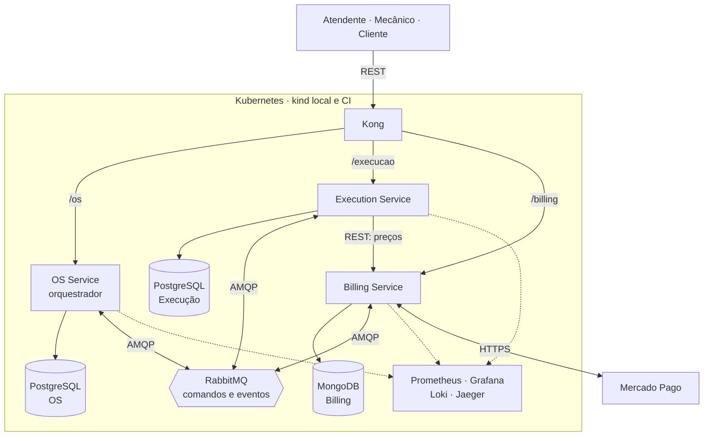

### 4.2 Componentes e integrações

Cada serviço roda processos separados, um Deployment para cada: a `api`, o `consumidor` (lê a fila do serviço), o `relay` (publica a outbox no RabbitMQ) e, no OS Service e no Billing, o `prazos` (prazos técnicos, validade do orçamento e do pagamento e conciliação com o Mercado Pago). O OS Service tem ainda o `notificador`, que entrega os e-mails ao cliente por SMTP (o Mailpit, na demonstração). O processo que muda estado grava o efeito e a mensagem de saída na mesma transação (a outbox), e o relay publica depois. O cliente da oficina não tem login: acompanha a OS pela rota pública, decide o orçamento por um link assinado e paga no checkout do Mercado Pago, cujo webhook entra pelo Kong. Cada serviço roda no próprio namespace (`pytstop-os`, `pytstop-billing` e `pytstop-execucao`), e a plataforma, em `pytstop-plataforma`.

### 4.3 Comunicação entre os serviços

A regra é REST quando quem chama precisa da resposta para continuar e a operação só lê, e mensagem quando a operação muda estado em outro serviço ([ADR-038](../../arquitetura/adr/fase4/038-borda-e-comunicacao-sincrona.md)).

**Mensageria.** No RabbitMQ 4.3.6 ([ADR-036](../../arquitetura/adr/fase4/036-mensageria-rabbitmq.md)), comandos saem do OS Service pela exchange `pytstop.comandos` para as filas `billing.comandos` e `execucao.comandos`, e eventos voltam pela `pytstop.eventos` para a `os.eventos`, lida só pelo orquestrador. Cada fila de trabalho tem cinco filas de retry por atraso e uma DLQ: 21 filas quorum, declaradas num `definitions.json` do `platform`. Cada serviço conecta com usuário próprio, sem permissão de configure, e só publica as próprias routing keys. A topologia está na [RFC-004, seção 5.1](../../arquitetura/rfc/fase4/rfc-004-microsservicos-saga.md#51-topologia).

**Contratos.** Toda mensagem usa o mesmo envelope JSON, com `correlation_id` igual ao `ordem_id`, `causation_id` e o `traceparent` nos headers AMQP. São 34 mensagens, 11 comandos e 23 eventos, cada uma com um JSON Schema, e o conjunto está em [AsyncAPI 3.0](../../../contratos/asyncapi.yaml); cada serviço valida os schemas que usa em teste de contrato no CI.

**REST síncrono.** Na conclusão do diagnóstico, a Execução valida os códigos de serviço e de peça no Billing (`POST /api/v1/precos/validacao`), com timeout de 2 s, 2 retries com jitter e circuit breaker que abre com 5 falhas e fica aberto por 30 s; com o circuito aberto, a conclusão responde 503 e não grava nada. A chamada é síncrona porque o mecânico precisa saber na hora que um código não existe.

## 5. Divisão dos serviços e tecnologias

### 5.1 Critérios do recorte

O enunciado sugere três serviços: ordens de serviço, orçamento e pagamento, e execução e produção. O recorte seguiu três critérios, nesta ordem ([ADR-034](../../arquitetura/adr/fase4/034-decomposicao-em-microsservicos.md)): (1) as capacidades sugeridas pelo enunciado definem os serviços; (2) cada contexto delimitado da fase 3 vai inteiro para o serviço cuja capacidade sustenta, menos o contexto Ordem de Serviço, que misturava atendimento, orçamento e execução e se reparte entre os três, e o preço da peça, que vai para o Billing porque preço e saldo têm donos diferentes; (3) a regra que depende de transação local com lock fica num serviço só: a reserva de peças não atravessa a rede. Os três também mudam por motivos diferentes (o atendimento e a identidade; a regra de preço e o provedor de pagamento; o trabalho da oficina), e juntar dois misturaria esses ritmos num deploy só. O mapa de contextos está na [RFC-004, seção 3.1](../../arquitetura/rfc/fase4/rfc-004-microsservicos-saga.md#31-mapa-de-contextos).

| Serviço | Responsabilidades | Integrações |
|---|---|---|
| OS Service | Abertura, status, histórico e entrega da OS; cancelamento antes do pivot; clientes, veículos e consentimentos da LGPD; login interno e emissão do JWT; orquestração da saga; e-mail ao cliente, inclusive com o orçamento | Comandos à Execução e ao Billing e eventos dos dois; publica o JWKS |
| Billing | Preços de serviços e peças; orçamento com preços congelados, link de decisão e validade; pagamento, conciliação, cancelamento e estorno | Mercado Pago (Checkout Pro, consulta, estorno e webhook); atende a Execução por REST |
| Execução | Fila de diagnóstico; reserva, liberação e baixa de peças; fila de execução e estoque físico | Valida preços no Billing por REST |

Entre os exemplos de divisão, o enunciado põe o envio do orçamento no Billing; aqui o Billing gera o orçamento e o link de decisão, e o e-mail sai do OS Service, dono do contato, para que nome, documento e contato do cliente não saiam dele. O código partiu do commit `08dcffe` da fase 3, recortado por contexto; a base técnica (entidades, `Dinheiro`, unidade de trabalho, outbox, logging e métricas) foi copiada em cada serviço, sem pacote compartilhado, e o teste de contrato pega a divergência que quebraria a integração.

| Alternativa descartada | Por que não |
|---|---|
| Quatro ou mais serviços, com preço e estoque separados | Orçamento, validação, reserva e baixa chamariam outro serviço no meio da saga: mais saltos de rede nos mesmos passos |
| Serviço próprio de clientes e identidade | Toda abertura de OS validaria cliente e veículo por chamada síncrona |
| Estoque no Billing | A reserva pede lock de linha com saldo nunca negativo; o Billing teria de ir para o SQL |
| Pacote compartilhado para a base técnica | Cada mudança exigiria publicar versão e atualizar três repositórios em ordem |

### 5.2 Banco por serviço

O enunciado pede banco próprio por serviço, com pelo menos um relacional e um não relacional. O OS Service e a Execução usam PostgreSQL 16: no OS Service, a transição da OS, o histórico, a etapa da saga e a outbox entram num commit; na Execução, a reserva é tudo ou nada, com lock de linha e saldo nunca negativo. O Billing usa MongoDB 7: orçamento e pagamento são documentos lidos e gravados inteiros, que na fase 3 já eram JSONB, e o replica set de um nó dá a transação que grava o documento e a outbox juntos. Ficaram de fora o PostgreSQL nos três (não atenderia o NoSQL), o DynamoDB (só na AWS, cuja conta acadêmica tem credencial de 4 horas), o Redis como banco (persistência opcional para um registro financeiro) e o Cassandra (sem a transação de que orçamento e outbox precisam) ([ADR-037](../../arquitetura/adr/fase4/037-banco-por-servico.md)).

### 5.3 Tecnologias e decisões

| Camada | Tecnologia | Por quê | Decisão |
|---|---|---|---|
| Linguagem e API | Python 3.14, uv, FastAPI, Pydantic v2 | domínio da fase 3 recortado sem reescrita | ADR-001 e ADR-014 da fase 3 |
| Arquitetura interna | DDD com camadas Onion, conferidas pelo import-linter | fronteira entre camadas vira gate de CI | ADR-003 da fase 3 |
| Divisão | três serviços e uma plataforma | capacidades do enunciado e contextos da fase 3 | [ADR-034](../../arquitetura/adr/fase4/034-decomposicao-em-microsservicos.md) |
| Coordenação | saga orquestrada pelo OS Service | um lugar que sabe a etapa de cada OS | [ADR-035](../../arquitetura/adr/fase4/035-saga-orquestrada.md) |
| Mensageria | RabbitMQ 4.3.6, outbox e consumidor idempotente; AsyncAPI 3.0 | retry, DLQ e permissões por configuração | [ADR-036](../../arquitetura/adr/fase4/036-mensageria-rabbitmq.md) |
| Bancos | PostgreSQL 16.15 com SQLAlchemy 2.0; MongoDB 7.0.43 | lock onde há saldo; documento no orçamento e no pagamento | [ADR-037](../../arquitetura/adr/fase4/037-banco-por-servico.md) |
| Borda e REST | Kong 3.9.3 com o Ingress Controller 3.5.13; httpx com circuit breaker | gateway das aulas; uma chamada síncrona, protegida | [ADR-038](../../arquitetura/adr/fase4/038-borda-e-comunicacao-sincrona.md) |
| Identidade | JWT RS256 do OS Service, validado por JWKS | nenhum segredo compartilhado entre serviços | [ADR-039](../../arquitetura/adr/fase4/039-autenticacao-entre-servicos.md) |
| Pagamento | Mercado Pago Checkout Pro; simulador no CI | exigido pelo enunciado | [ADR-040](../../arquitetura/adr/fase4/040-integracao-mercado-pago.md) |
| Testes e qualidade | pytest, testcontainers, pytest-bdd (8.1 no `platform` e 9.0 no OS Service), SonarQube 26.9 | pirâmide por serviço e BDD do fluxo completo | [ADR-041](../../arquitetura/adr/fase4/041-estrategia-de-testes-e-qualidade.md) |
| CI/CD | GitHub Actions, GHCR, Kustomize, kind com Kubernetes 1.35 | deploy automatizado sem credencial externa | [ADR-042](../../arquitetura/adr/fase4/042-cicd-e-deploy-kubernetes.md) |
| Observabilidade | OpenTelemetry, Jaeger 1.76.0, Prometheus 2.54.1, Grafana 11.1.0, Loki 2.9.8 | a stack da fase 3, nos três serviços | [ADR-043](../../arquitetura/adr/fase4/043-observabilidade-distribuida.md) |

Cada ADR traz contexto, decisão, alternativas e consequências, e a [RFC-004](../../arquitetura/rfc/fase4/rfc-004-microsservicos-saga.md) junta as dez decisões num desenho só. As versões fixadas estão no [README do `platform`](../../../README.md#componentes-e-versões).

## 6. Estratégia da saga

### 6.1 Por que orquestração

A saga é orquestrada. O OS Service é o orquestrador: envia comandos aos outros dois serviços pelo RabbitMQ, e os participantes respondem com eventos, sem conhecer a saga. A justificativa está no [ADR-035](../../arquitetura/adr/fase4/035-saga-orquestrada.md) e no [README do OS Service](https://github.com/fiap-postech-sw-architecture/postech-sw-arch-p4-os-service/blob/main/README.md#por-que-orquestração), como pede o enunciado:

- **O tamanho da saga.** São nove passos (T1 a T9) em três serviços, mais a entrega local (T10), com esperas humanas, um provedor externo e seis compensações. A Aula 02 de SAGA Pattern, citando Richardson, recomenda a coreografia para sagas simples, e esta não é.
- **Um lugar que sabe a etapa.** Com coreografia, os passos ficariam espalhados, sem um lugar que diga em que etapa a OS está; prazos, ordem das compensações e o ponto sem retorno exigiriam que cada serviço assinasse eventos dos outros dois, com risco de ciclo.
- **Orquestrador no serviço que inicia a saga.** Como nos exemplos do material, o orquestrador fica no OS Service, e não num quarto serviço: etapa da saga e status da OS mudam na mesma transação local.
- **Os contras, contidos.** O orquestrador só conhece a ordem dos passos, as compensações e os prazos; preço, validade e pagamento ficam com os participantes. Ele também não é ponto único de falha: o estado fica no banco, as mensagens em filas duráveis, e o consumidor recriado pelo Kubernetes segue do ponto gravado.

Ficaram de fora a coreografia, o orquestrador como quarto serviço (status da OS e etapa da saga em bancos diferentes), um motor de workflow como Temporal, Camunda ou AWS Step Functions (servidor e banco próprios no cluster) e o Apache Camel das aulas (Java, e as rotas do exemplo não guardam estado nem compensam).

### 6.2 Passos e compensações

Há uma instância da saga por OS (`saga_id = ordem_id`, que também é o `correlation_id` das mensagens), gravada na tabela `sagas`, no mesmo PostgreSQL da outbox. A etapa é o estado do orquestrador; o status é o que o cliente e o atendente veem na OS. Os diagramas de estado das duas estão na [RFC-004, seções 4.1 e 4.2](../../arquitetura/rfc/fase4/rfc-004-microsservicos-saga.md#41-etapas-da-instância).

| Passo (dono) | Comando | Sucesso | Falha de negócio | Compensação |
|---|---|---|---|---|
| T1 abrir OS (OS Service) | nenhum | OS `RECEBIDA` | nenhuma | OS `CANCELADA` |
| T2 diagnóstico (Execução) | `SolicitarDiagnostico` | `DiagnosticoIniciado`, `DiagnosticoConcluido` | nenhuma | `DescartarDiagnostico` |
| T3 orçamento (Billing) | `GerarOrcamento` | `OrcamentoGerado` | `GeracaoDeOrcamentoFalhou` | `CancelarOrcamento` |
| T4 decisão do cliente (Billing) | nenhum (espera humana) | `OrcamentoAprovado` | `OrcamentoRecusado`, `OrcamentoExpirado` | nenhuma: desfecho de negócio |
| T5 reserva de peças (Execução) | `ReservarPecas` | `PecasReservadas` | `ReservaDePecasFalhou` | `LiberarReserva` |
| T6 pagamento (Billing e Mercado Pago) | `SolicitarPagamento` | `PagamentoSolicitado`, `PagamentoConfirmado` | `PagamentoRecusado`, `PagamentoExpirado` | `EstornarPagamento` |
| T7 agendamento (Execução) | `AgendarExecucao` | `ExecucaoAgendada` | nenhuma | `CancelarExecucao` |
| T8 início da execução (Execução) | nenhum | `ExecucaoIniciada` | nenhuma | nenhuma: é o pivot |
| T9 finalização (Execução) | nenhum | `ExecucaoFinalizada`, com a baixa do estoque | nenhuma | nenhuma: reprocessável |
| T10 entrega (OS Service, fora da saga) | nenhum | OS `ENTREGUE` | nenhuma | nenhuma: reprocessável |

A reserva (T5) vem antes do pagamento (T6), como no exemplo da Aula 01 de SAGA Pattern, e a OS só entra na fila de execução (T7) com o pagamento confirmado (RN-027): a falta de peça aparece antes da cobrança. O pivot é o início da execução física (T8): depois que o mecânico começa a desmontar o carro, o trabalho não se desfaz por mensagem, e o cancelamento passa a responder 409 `TRANSICAO_STATUS_INVALIDA` (RN-029). Até ali tudo compensa, inclusive o pagamento, por estorno.

As compensações rodam em sequência, cada uma esperando a resposta da anterior, na ordem inversa dos passos. O plano inclui os passos concluídos e o passo em andamento, cujo comando saiu e ainda não teve resposta; o passo que falhou por regra de negócio fica de fora, porque o participante já o encerrou. Todo plano termina com a OS `CANCELADA` e a saga `COMPENSADA`.

| Etapa da saga | Gatilho | Compensações, em ordem |
|---|---|---|
| `AGUARDANDO_DIAGNOSTICO` | cancelamento | `DescartarDiagnostico` |
| `AGUARDANDO_ORCAMENTO` | `GeracaoDeOrcamentoFalhou` | `DescartarDiagnostico` |
| `AGUARDANDO_ORCAMENTO` | cancelamento ou prazo técnico esgotado, com `GerarOrcamento` em andamento | `CancelarOrcamento`, `DescartarDiagnostico` |
| `AGUARDANDO_DECISAO` | `OrcamentoRecusado` ou `OrcamentoExpirado` | `DescartarDiagnostico` |
| `AGUARDANDO_DECISAO` | cancelamento | `CancelarOrcamento`, `DescartarDiagnostico` |
| `AGUARDANDO_RESERVA` | `ReservaDePecasFalhou` | `CancelarOrcamento`, `DescartarDiagnostico` |
| `AGUARDANDO_RESERVA` | cancelamento ou prazo técnico esgotado, com `ReservarPecas` em andamento | `LiberarReserva`, `CancelarOrcamento`, `DescartarDiagnostico` |
| `AGUARDANDO_PAGAMENTO` | `PagamentoRecusado` ou `PagamentoExpirado` | `LiberarReserva`, `CancelarOrcamento`, `DescartarDiagnostico` |
| `AGUARDANDO_PAGAMENTO` | cancelamento ou prazo técnico esgotado | `EstornarPagamento`, `LiberarReserva`, `CancelarOrcamento`, `DescartarDiagnostico` |
| `AGUARDANDO_AGENDAMENTO` e `AGUARDANDO_INICIO` | cancelamento; no agendamento, também o prazo técnico esgotado | `CancelarExecucao`, `EstornarPagamento`, `LiberarReserva`, `CancelarOrcamento`, `DescartarDiagnostico` |
| `EM_EXECUCAO` e depois | cancelamento | nenhuma: 409 `TRANSICAO_STATUS_INVALIDA` (RN-029) |

O `EstornarPagamento` compensa o T6 em qualquer estado do pagamento: com a cobrança aberta, o Billing a cancela; com o pagamento confirmado, estorna no Mercado Pago com a chave de idempotência `estorno-{pagamento_id}`. Uma aprovação que chega depois do cancelamento, da expiração ou da recusa é estornada pelo próprio Billing.

### 6.3 Caminho feliz

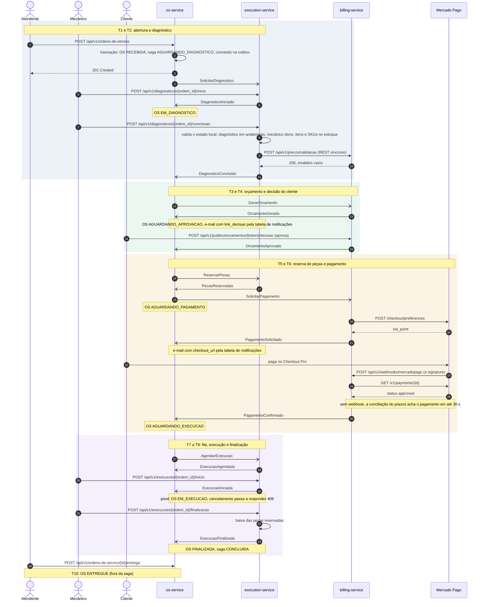

No caminho feliz, a OS passa pelo diagnóstico, com a validação de preços no Billing, pelo orçamento enviado por e-mail e aprovado pelo cliente, pela reserva de peças e pelo pagamento no Mercado Pago, confirmado pelo webhook ou pela conciliação em até 30 s; depois vêm o agendamento, o início (o pivot), a finalização com a baixa das peças e a entrega. Nos diagramas de sequência, setas de ponta aberta são mensagens assíncronas (outbox, relay, fila e consumidor), e as chamadas REST de fora do cluster passam pelo Kong, omitido.

### 6.4 Compensações principais

**Orçamento recusado ou expirado.** O cliente recusa pelo link, ou a validade vence sem decisão. O orçamento já está encerrado no Billing, então a saga só descarta o diagnóstico e cancela a OS (RN-024).

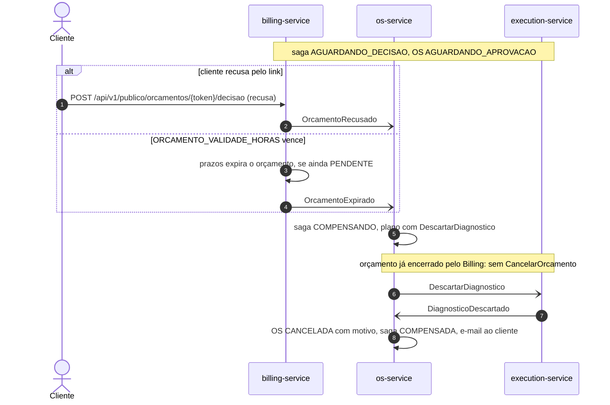

**Falta de peça na reserva.** A Execução trava os itens com lock pessimista, acha saldo insuficiente e não reserva nada. Nenhum pagamento foi solicitado: a saga cancela o orçamento, descarta o diagnóstico e cancela a OS sem cobrar o cliente (RN-026).

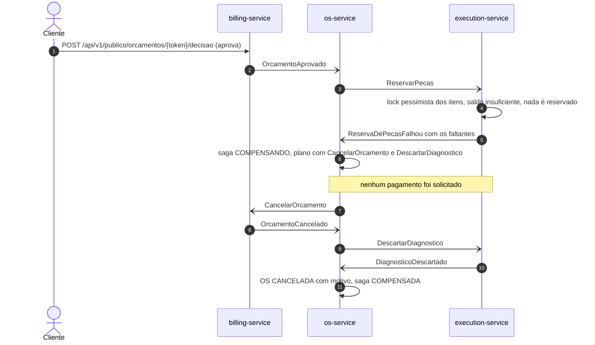

**Cancelamento depois do pagamento, com estorno.** Com a OS paga e na fila, o atendente cancela e recebe 202 com a etapa `COMPENSANDO`. A execução sai da fila antes do estorno, para nenhum mecânico começar o reparo de uma OS com o pagamento devolvido. O Billing confere o pagamento no Mercado Pago e estorna; se o provedor recusar o estorno, a saga vai a `FALHA_NA_COMPENSACAO` e espera o operador.

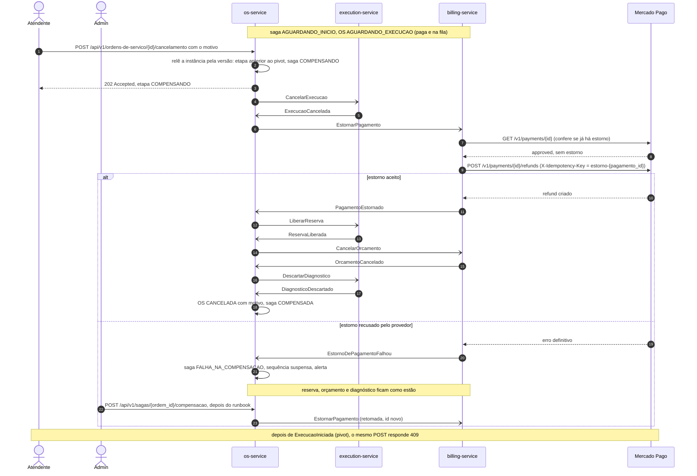

**Pagamento recusado ou vencido.** Por padrão, na terceira recusa ou em 60 minutos. Nada foi cobrado, então a saga segue o diagrama do cancelamento com estorno a partir do passo 12, `LiberarReserva`, sem estorno (RN-025), como diz a [RFC-004, seção 4.8](../../arquitetura/rfc/fase4/rfc-004-microsservicos-saga.md#48-sequências); o cenário BDD do pagamento recusado confere a ordem ([seção 8](#8-testes-e-qualidade)).

### 6.5 Idempotência, novas tentativas e prazos

**Outbox e consumidor idempotente.** Nos três serviços, a mensagem de saída é gravada na transação do efeito, e o relay só a marca como entregue depois da confirmação do broker; com o broker fora, as mensagens esperam na outbox. O consumidor grava o `id` da mensagem em `mensagens_processadas` na mesma transação do efeito: evento repetido não repete efeito, e comando repetido, pelo `id` ou pela chave de negócio (uma reserva por OS, uma cobrança por orçamento), republica a resposta registrada (RN-028).

**Isolamento.** A saga não tem o "I" do ACID, e o ADR-035 aplica as contramedidas da Aula 03 de SAGA Pattern: cada transição relê a OS e a instância e grava conferindo a versão (lock otimista), o estorno só sai depois de `ExecucaoCancelada`, e a compensação que chega antes do comando original cria o registro já no estado final.

**Novas tentativas, DLQ e prazos.** Erro transitório volta à fila pelas filas de retry de 1, 5, 15, 60 e 300 s; a falha seguinte à quinta, ou um erro permanente, manda a mensagem para a DLQ, que dispara o alerta. O orquestrador espera 120 s pela resposta a cada comando e reenvia até 5 vezes; esgotados os reenvios, a saga compensa. Uma compensação que também esgota os reenvios, ou um estorno recusado, leva a saga a `FALHA_NA_COMPENSACAO`, e o operador retoma pelo [runbook da saga](../../operacao/runbook-saga.md). Os prazos e os parâmetros estão na [RFC-004, seções 4.6 e 10.3](../../arquitetura/rfc/fase4/rfc-004-microsservicos-saga.md#103-parâmetros-e-variáveis-de-ambiente).

## 7. Modelo de dados

Cada serviço é o único dono do seu banco, com credencial própria montada só nos pods dele, e a NetworkPolicy de cada namespace só deixa o próprio namespace chegar ao banco. Os diagramas mostram as tabelas de que a saga e os contratos dependem; o modelo completo, com colunas, índices e estados, está na seção 3 do `docs/arquitetura.md` do [OS Service](https://github.com/fiap-postech-sw-architecture/postech-sw-arch-p4-os-service/blob/main/docs/arquitetura.md#3-modelo-de-dados), do [Billing](https://github.com/fiap-postech-sw-architecture/postech-sw-arch-p4-billing-service/blob/main/docs/arquitetura.md#3-modelo-de-dados) e da [Execução](https://github.com/fiap-postech-sw-architecture/postech-sw-arch-p4-execution-service/blob/main/docs/arquitetura.md#3-modelo-de-dados).

**OS Service (PostgreSQL 16).** Clientes, veículos, consentimentos, usuários e tokens revogados vêm da fase 3; o documento do cliente fica cifrado, com um hash para a busca. A OS ganhou versão para o lock otimista e o resumo do orçamento e do pagamento, copiado dos eventos. O histórico só recebe inserções, `sagas` guarda a instância da saga e `notificacoes`, os e-mails do `notificador`.

**Execution Service (PostgreSQL 16).** A reserva move quantidade de disponível para reservada, a liberação devolve e a finalização dá baixa. O `ordem_id` é único em reserva, diagnóstico e execução, o que torna os três idempotentes por OS, e diagnóstico e execução guardam o retrato do veículo, para o mecânico achar o carro no pátio.

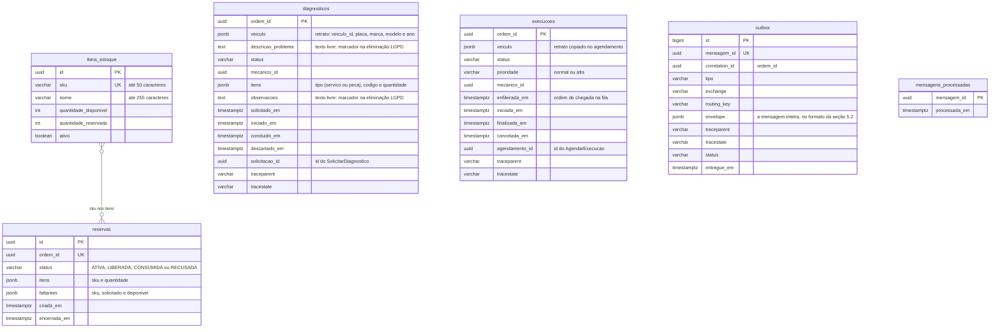

**Billing Service (MongoDB 7).** Orçamento e pagamento são documentos lidos e gravados inteiros, com dinheiro em `Decimal128` e sem nenhum dado do pagador ou do cartão; o orçamento leva as linhas embutidas, com o preço congelado na geração. A lápide é o registro que a compensação grava quando chega antes do comando original: o comando atrasado a acha pelo índice único de `ordem_id` e é descartado. A tabela é a das coleções da [RFC-004, seção 7.4](../../arquitetura/rfc/fase4/rfc-004-microsservicos-saga.md#74-billing-service-mongodb-7), que traz também o exemplo de documento; o [`docs/arquitetura.md` do Billing](https://github.com/fiap-postech-sw-architecture/postech-sw-arch-p4-billing-service/blob/main/docs/arquitetura.md#3-modelo-de-dados) detalha esse modelo campo a campo, com três acréscimos que ele mesmo lista: um índice da outbox, dois campos de `mensagens_processadas` e a coleção `versao_do_banco`.

| Coleção | Índices |
|---|---|
| `precos_servicos`, `precos_pecas` | únicos `{codigo: 1}` e `{sku: 1}`; o `sku` liga a peça ao estoque da Execução |
| `orcamentos` | único `{ordem_id: 1}`: um orçamento por OS, imutável depois de gerado, com os preços congelados nas linhas (RN-013 e RN-016 do p3); `{status: 1, valido_ate: 1}` para a expiração. O subtotal de cada linha não é gravado: é a quantidade vezes o preço |
| `pagamentos` | único e parcial `{orcamento_id: 1}`, só nos documentos que têm o campo (uma cobrança por orçamento, RF-032; a lápide não tem orçamento); único `{ordem_id: 1}`, pelo qual a compensação acha a cobrança; único e parcial `{referencia_pagamento: 1}`, só quando é texto, para o webhook; `{status: 1, expira_em: 1}` para a expiração e a conciliação |
| `outbox`, `mensagens_processadas` | `{status: 1, proxima_tentativa_em: 1, _id: 1}` para o *claim*; `_id` igual ao `id` da mensagem; índices TTL (apagam sozinhos) em `entregue_em` (7 dias, só `entregue`), `morta_em` (30 dias, só `dead`) e `processada_em` (30 dias) |

## 8. Testes e qualidade

O enunciado pede testes unitários em todos os serviços, ao menos um fluxo completo com BDD, cobertura mínima de 80% por serviço e SonarQube ou similar no CI. A tabela traz os números do CD da `main` de 20/10/2026 ([ADR-041](../../arquitetura/adr/fase4/041-estrategia-de-testes-e-qualidade.md)); a cobertura por contexto e por camada e a lista dos mutantes estão no README de cada serviço.

| Repositório | Testes no CD | Cobertura (gate) | SonarQube | Mutação | No README |
|---|---|---|---|---|---|
| OS Service | 10.312: unitários, integração com PostgreSQL e RabbitMQ reais, contrato e BDD de componente (28 cenários e 7 esquemas) | 99,6% (95%) | aprovado; 0 bugs, 0 vulnerabilidades, 138 code smells | 60 mutantes, 60 mortos | [cobertura](https://github.com/fiap-postech-sw-architecture/postech-sw-arch-p4-os-service/blob/main/README.md#cobertura), [mutação](https://github.com/fiap-postech-sw-architecture/postech-sw-arch-p4-os-service/blob/main/README.md#mutação) |
| Billing | 1.731: unitários, integração com MongoDB e RabbitMQ reais e contrato | 100% (95%) | aprovado; 0, 0 e 91 | 74 mutantes, 72 mortos, 2 equivalentes | [cobertura](https://github.com/fiap-postech-sw-architecture/postech-sw-arch-p4-billing-service/blob/main/README.md#cobertura), [mutação](https://github.com/fiap-postech-sw-architecture/postech-sw-arch-p4-billing-service/blob/main/README.md#mutação) |
| Execução | 1.475: unitários, integração com PostgreSQL e RabbitMQ reais e contrato | 100% (95%) | aprovado; 0, 0 e 18 | 95 mutantes, 94 mortos, 1 equivalente | [cobertura](https://github.com/fiap-postech-sw-architecture/postech-sw-arch-p4-execution-service/blob/main/README.md#cobertura), [mutação](https://github.com/fiap-postech-sw-architecture/postech-sw-arch-p4-execution-service/blob/main/README.md#mutação) |
| `platform` | 3.366: contratos de mensageria, dashboards e alertas, scripts de deploy e smoke, apoio do E2E | 99,85% do código de teste (90%) | não se aplica | não se aplica | [CI](../../../README.md#ci) |

A cobertura soma linhas e ramos, e o código novo de cada PR passa também pelo `diff-cover` (90%). O gate do SonarQube, versionado em `.sonar/quality-gate.json`, exige cobertura de 80%, no máximo 3% de duplicação e nota A em confiabilidade, segurança e manutenibilidade, e passou nos três ([resumo](evidencias/coverage.md#sonarqube)). Os 138, 91 e 18 code smells são avisos de manutenibilidade do perfil padrão do SonarQube; não há bug, vulnerabilidade nem hotspot, e a manutenibilidade fica com nota A. A análise refeita nos mesmos commits, com a mesma versão do SonarQube e do scanner, dá os mesmos números: 214 dos 247 vêm da regra python:S5778, que pede uma só chamada dentro de cada `pytest.raises` dos testes, e os outros 33 se espalham por 11 regras, como a ordem dos argumentos nas asserções, comentários de supressão fora do formato, literais repetidos e parênteses redundantes ([contagem por regra](evidencias/coverage.md#code-smells-por-regra)). A mutação usa mutantes manuais nos módulos críticos, sem gate de CI ([ADR-041](../../arquitetura/adr/fase4/041-estrategia-de-testes-e-qualidade.md#teste-de-mutação)).

**BDD do fluxo completo.** O [`saga_atendimento.feature`](../../../e2e/features/saga_atendimento.feature) do `platform` tem 11 cenários e um esquema de cenário com 3 exemplos, 14 execuções em Gherkin, em português, contra os três serviços no kind; roda no `deploy-kind` do CD de cada serviço e no job `e2e` do CD do `platform`, onde as 14 passaram em 206,65 s ([run 39458619627](https://github.com/fiap-postech-sw-architecture/postech-sw-arch-p4-platform/actions/runs/39458619627)). Cobrem o caminho feliz, com os oito status, o orçamento de R$ 210,00, a baixa do estoque e o trace nos três serviços; as quatro compensações (orçamento recusado, falta de peça, pagamento recusado e cancelamento com estorno); a expiração do orçamento; o 409 depois do início; a recusa de CPF inválido; o consumidor do Billing parado; a API do Billing parada, com o circuito aberto; e a borda ([resumo do BDD](evidencias/bdd-resumo.md)). O pagamento usa o simulador do Mercado Pago.

**Collection com Newman.** A [collection do fluxo completo](../../api/fluxo-completo.postman_collection.json) leva uma OS pelos três serviços até a entrega, pela borda, com o Newman 6.2.3 no job `e2e` do `platform`: 108 assertions, 49 requisições e nenhuma falha no [run 39458619627](https://github.com/fiap-postech-sw-architecture/postech-sw-arch-p4-platform/actions/runs/39458619627), de 20/10/2026, o das capturas do [Anexo B, B4](#b4--newman-e-zap-no-cd-do-platform) ([execuções anteriores](evidencias/newman-resumo.md)).

## 9. CI/CD e deploy

O enunciado pede deploy automatizado em ambiente Kubernetes e não exige nuvem. A cada push na `main`, o CD de cada serviço cria um cluster Kubernetes (kind) descartável no runner, implanta nele a imagem que acabou de publicar e só passa com o smoke e o E2E verdes. Nenhuma credencial de nuvem fica no GitHub, e o deploy não depende da credencial de cerca de 4 horas do AWS Academy, que alguém teria de renovar a cada sessão ([ADR-042](../../arquitetura/adr/fase4/042-cicd-e-deploy-kubernetes.md#deploy-remoto-opcional-e-desligado)).

Cada serviço tem três workflows, com jobs de nome estável, que são os checks obrigatórios do ruleset ([ADR-042](../../arquitetura/adr/fase4/042-cicd-e-deploy-kubernetes.md)). O `ci.yml` roda em todo PR: lint e import-linter, mypy strict, bandit, testes com os gates de cobertura, SonarQube e o build, com os manifestos e o smoke da imagem. O `security.yml` roda pip-audit, gitleaks e trivy em todo PR e toda segunda-feira. O `cd.yml` roda no push na `main`: chama o CI e a segurança do mesmo commit e, com os dois verdes, segue para:

1. `image`: build único, push no GHCR com o SHA do commit como tag, SBOM em SPDX e o tar da imagem como artefato;
2. `deploy-kind`: cria um kind efêmero no runner, implanta a plataforma e os três serviços, gera os Secrets no próprio run, roda o smoke de cada namespace e o E2E BDD pela borda ([passos, no README do OS Service](https://github.com/fiap-postech-sw-architecture/postech-sw-arch-p4-os-service/blob/main/README.md#o-que-o-deploy-kind-faz-na-ordem)). O serviço do pipeline entra com a imagem que o `image` publicou; os outros dois são construídos do código, no commit do último CD verde de cada um, para o E2E provar a saga com os três;
3. `remote-skipped`: roda no lugar do `deploy-remote`, o gancho opcional que implantaria num cluster persistente o mesmo digest que passou no kind. O gancho fica desligado na entrega, sem a variável `DEPLOY_REMOTO_HABILITADO` igual a `true`, e as receitas de EKS e k3s estão em [nuvem opcional](../../operacao/nuvem-opcional.md).

Os jobs do CD têm uma definição só, no `.github/workflows/cd-servico.yml` do `platform`, chamada pelo `cd.yml` de cada serviço com o nome dele e quatro SHAs ([platform #22](https://github.com/fiap-postech-sw-architecture/postech-sw-arch-p4-platform/pull/22)). A independência que o enunciado pede está no que é de cada serviço: build, testes, análise, imagem e deploy saem do pipeline dele, disparados pelo commit dele, e nenhum pipeline publica a imagem de outro. Nos manifestos de cada serviço, a API tem sondas de inicialização, de vida e de prontidão, requests e limits, e um HPA de 1 a 2 réplicas por CPU (70%); o overlay do CD limita o HPA a 1 réplica, para os três serviços caberem no runner. O CD do `platform` implanta a plataforma com o smoke e, no job `e2e`, os três serviços, com o BDD, o Newman e o ZAP.

| Serviço | Digest da imagem publicada em 20/10/2026 | SBOM |
|---|---|---|
| OS Service | `sha256:7e4d5d0312d7bc244f8b4c18997422f38232e106121304e0c4e1bf6e80320d59` | 171 pacotes |
| Billing | `sha256:340abc00151ffd49d835e14ceb93a02691c3147aa1f4931bda38f5973b641488` | 147 pacotes |
| Execução | `sha256:c53d188243ff3fc2b454502bcd47e77e21b0a32a856d0b8a0e167bd7e40d75f1` | 162 pacotes |

No CD do OS Service de 20/10/2026, as etapas medidas do `deploy-kind` (criação do kind, plataforma, serviços, smoke e E2E) somaram 7 min 13 s; no job `e2e` do `platform`, com o Newman e o ZAP, 9 min 18 s. A memória por pod está na [medição integrada no kind](../../operacao/ensaio-integrado.md), de 14/10/2026, o diagrama do pipeline na [RFC-004, seção 10.2](../../arquitetura/rfc/fase4/rfc-004-microsservicos-saga.md#102-pipeline-e-deploy), e as capturas dos CDs no [Anexo B](#b1--cd-da-main).

## 10. Segurança e análise de vulnerabilidades

A segurança é verificada no CI de cada serviço, em todo PR, a cada push na `main` e toda segunda-feira, e o ZAP varre a borda no CD do `platform`. Na `main` de 20/10/2026, bandit, pip-audit, trivy e gitleaks não acharam nada nos três serviços; o SonarQube aprovou os três, com 0 bugs, 0 vulnerabilidades e 0 hotspots; o ZAP não teve regra em FAIL; e o SBOM listou 171, 147 e 162 pacotes. O detalhe por ferramenta e por serviço, com os avisos do ZAP, está no [Anexo A](#anexo-a--scans-de-segurança-da-fase-4).

- **Identidade.** JWT RS256 emitido só pelo OS Service, com validade de 15 minutos; Billing e Execução validam pelo JWKS, e a matriz de papel por rota (admin, atendente e mecânico) vira teste de 401 e 403 em cada serviço ([ADR-039](../../arquitetura/adr/fase4/039-autenticacao-entre-servicos.md)).
- **Canais públicos.** O link de decisão do orçamento é assinado com HMAC-SHA256 e vale uma vez; o webhook do Mercado Pago confere o `x-signature` e lê o estado na API do provedor, nunca no corpo da notificação.
- **Borda e rede.** O Kong não revela produto nem versão, barra `/metrics` e `/api/v1/admin/*` e limita a taxa por IP do cliente. A NetworkPolicy de cada namespace nega toda entrada e libera só o previsto, e o smoke do CD prova que o banco recusa conexão de outro namespace.
- **Bancos e broker.** Cada PostgreSQL tem um papel por uso, o MongoDB separa o usuário do serviço e o do exporter, e o RabbitMQ tem um usuário por serviço.
- **Segredos e LGPD.** Nenhum segredo de aplicação fica no GitHub: senhas e chaves nascem no cluster, no primeiro deploy. O documento do cliente fica cifrado, as mensagens não levam nome, documento nem contato, e a eliminação de dados anonimiza a placa também na Execução. As APIs rodam sem root e com a raiz somente leitura.

Riscos aceitos: tráfego interno do cluster sem TLS, contido pela NetworkPolicy; token revogado ainda válido por até 15 minutos no Billing e na Execução; Mailpit sem autenticação, só com dados fictícios; controller do Kong com leitura dos Secrets dos quatro namespaces; e imagens da plataforma herdadas da fase 3 (Prometheus 2.54.1, Loki 2.9.8 e kube-state-metrics 2.13.0) com CVE HIGH e CRITICAL sem correção na própria linha (96 e 6, 53 e 3 e 44 e 1 no trivy de outubro), que rodam só dentro do cluster, sem Ingress. O tratamento está no [README do `platform`](../../../README.md#decisões-e-limites) e na [RFC-004, seção 11](../../arquitetura/rfc/fase4/rfc-004-microsservicos-saga.md#11-riscos-limitações-e-pontos-em-aberto).

## 11. Observabilidade

A stack da fase 3 passou para o `platform` e serve os três serviços, cada um com `service.name` próprio ([ADR-043](../../arquitetura/adr/fase4/043-observabilidade-distribuida.md)): Prometheus para métricas, Grafana para dashboards e alertas, Loki com Promtail para os logs e Jaeger para os traces, recebidos por OpenTelemetry; a peça nova são os exporters dos bancos. Os logs são JSON, sem dado pessoal, com `correlation_id` (o `ordem_id`) e `trace_id`: uma busca no Loki traz a OS nos três serviços, e o `trace_id` leva ao trace. Cada saga é um trace, porque a outbox grava o `traceparent` de quem a escreveu e o relay o publica nos headers AMQP ([RFC-004, seção 9](../../arquitetura/rfc/fase4/rfc-004-microsservicos-saga.md#9-observabilidade)). As métricas estão no [catálogo](../../../observabilidade/README.md#catálogo-de-métricas), e um teste reprova painel ou alerta que use métrica fora dele.

| Dashboard | Tag | Responde |
|---|---|---|
| Atendimento | negócio | volume diário de OS e tempo médio por status, OS por status, funil, desfecho das sagas e motivos de cancelamento |
| Orçamentos | negócio | orçamentos por desfecho, taxa de aprovação e tempo até a decisão |
| Pagamentos | negócio | faturamento por dia, pagamentos por desfecho, estornos e cobranças abertas |
| Execução e estoque | negócio | filas da oficina, tempos de espera e de execução e peças em falta |
| Saga | técnico | prazo técnico vencido, falhas na compensação, sagas ativas e duração por etapa |
| Mensageria dos serviços | técnico | mensagens por tipo e resultado, retry, DLQ, outbox e reconexões |
| Serviços | técnico | requisições, erro 5xx, latência p95 e taxa de sucesso por serviço, circuitos e Mercado Pago |
| Bancos | técnico | conexões, transações, locks, tamanho e replica set do MongoDB |
| Plataforma | técnico | DLQs, consumidores, alarmes do broker, alvos do Prometheus e tráfego da borda |

Cada dashboard é um JSON em [`observabilidade/dashboards/`](../../../observabilidade/dashboards), com os de negócio separados dos técnicos, como a avaliação da fase 3 pediu, e a descrição de cada painel igual à coluna "Como ler" da documentação ([negócio](../../../observabilidade/negocio.md) e [técnicos](../../../observabilidade/README.md)). Depois do E2E, o CD do `platform` confere no Prometheus a consulta de cada painel de negócio: no último CD, as 47 voltaram com série. São 21 regras de alerta, cada uma com um caso que dispara e um que não dispara no promtool: DLQ com mensagens, saga parada, compensações acima do normal, 5xx, latência p95, circuito aberto, outbox parada, fila sem consumidor, serviço ou banco fora do ar e as da plataforma ([tabela completa](../../../observabilidade/README.md#regras-de-alerta-pasta-pytstop)).

| Evidência | Onde |
|---|---|
| Trace da saga nos três serviços: 339 spans numa OS paga e cancelada, 245 no caminho feliz | [Anexo B, B2](#b2--trace-da-saga-no-jaeger) |
| Alerta de fila sem consumidor disparado e recuperado no kind local, em 19/10/2026 | [Anexo B, B5](#b5--alerta-de-fila-sem-consumidor) |
| Kind local de 19/10/2026: E2E com as 14 execuções do BDD, 28 pods sem reinício em 600,9 s sem tráfego e `make demo` com seis cenários | [relatório da execução local](evidencias/observabilidade.md) |
| Nove dashboards com três dias de histórico | pendente: [Anexo B, B6](#b6--dashboards-do-grafana) |

## 12. Rastreabilidade requisito → evidência

Cada requisito tem um ID na [gap analysis](../../requisitos/fase4/gap-analysis-fase-4.md), que cita o trecho do enunciado de onde ele vem: 11 requisitos funcionais, 26 não funcionais e 7 regras de negócio. A [matriz de rastreabilidade](../matriz-de-rastreabilidade.md) traz também os PRs, o código e o trecho do vídeo. "BDD" é o cenário do [resumo do BDD no CD](evidencias/bdd-resumo.md).

| ID | Requisito | Evidência |
|---|---|---|
| RF-028 | Abertura da OS | BDD do caminho feliz; [OS #2](https://github.com/fiap-postech-sw-architecture/postech-sw-arch-p4-os-service/pull/2) |
| RF-029 | Atualização de status | BDD: os oito status em ordem |
| RF-030 | Status e histórico | BDD e [Newman](evidencias/newman-resumo.md): oito status no histórico |
| RF-031 | Orçamento para aprovação | BDD: orçamento de R$ 210,00 e e-mail com o link |
| RF-032 | Registro e verificação do pagamento | BDD: confirmado, recusado e estornado |
| RF-033 | Status após o pagamento | BDD e Newman |
| RF-034 | Mercado Pago | adapter do Mercado Pago com teste de contrato ([Billing #2](https://github.com/fiap-postech-sw-architecture/postech-sw-arch-p4-billing-service/pull/2) e [Billing #9](https://github.com/fiap-postech-sw-architecture/postech-sw-arch-p4-billing-service/pull/9); [`test_mercadopago.py`](https://github.com/fiap-postech-sw-architecture/postech-sw-arch-p4-billing-service/blob/main/tests/unitarios/test_mercadopago.py)); sandbox real pendente |
| RF-035 | Fila de execução | BDD: a OS só entra na fila depois do pagamento |
| RF-036 | Status no diagnóstico e no reparo | BDD: diagnóstico, execução e finalização |
| RF-037 | Finalização ao OS Service | BDD: baixa do estoque e saga concluída |
| RF-038 | Saga Pattern | BDD das compensações e do pivot ([seção 6](#6-estratégia-da-saga)) |
| RNF-031 | Repositório, infraestrutura e banco por serviço | [seção 2](#2-repositórios-e-estado-do-cicd) |
| RNF-032 | Banco relacional | PostgreSQL 16 ([seção 7](#7-modelo-de-dados)) |
| RNF-033 | Banco não relacional | MongoDB 7 ([seção 7](#7-modelo-de-dados)) |
| RNF-034 | REST síncrono | BDD: API do Billing parada, 503 e circuito aberto |
| RNF-035 | Mensageria assíncrona | BDD: consumidor parado sem perder o fluxo |
| RNF-036 | Sem acesso ao banco de outro serviço | smoke do CD ([platform #25](https://github.com/fiap-postech-sw-architecture/postech-sw-arch-p4-platform/pull/25)) |
| RNF-037 | Saga justificada no README | [README do OS Service](https://github.com/fiap-postech-sw-architecture/postech-sw-arch-p4-os-service/blob/main/README.md#por-que-orquestração) |
| RNF-038 | Testes unitários | 10.312, 1.731 e 1.475 testes ([seção 8](#8-testes-e-qualidade)) |
| RNF-039 | Fluxo completo com BDD | 11 cenários e um esquema com 3 exemplos no CD de cada serviço |
| RNF-040 | Cobertura de 80% | 99,6%, 100% e 100% ([registro](evidencias/coverage.md)) |
| RNF-041 | SonarQube no CI | gate aprovado nos três ([resumo](evidencias/coverage.md#sonarqube)) |
| RNF-042 | Pipeline independente até o Kubernetes | CD aprovado nos três ([seção 9](#9-cicd-e-deploy)) |
| RNF-043 | `main` protegida | ruleset nos quatro ([conferência](evidencias/protecao-da-main.md)) |
| RNF-044 | Um repositório por serviço | [seção 2](#2-repositórios-e-estado-do-cicd) |
| RNF-045 | Mensageria na orquestração | comandos e eventos no RabbitMQ ([seção 4.3](#43-comunicação-entre-os-serviços)) |
| RNF-046 | Observabilidade da fase 3 | 9 dashboards e 21 alertas ([seção 11](#11-observabilidade)); capturas pendentes |
| RNF-047 | Código-fonte | `src/` de cada serviço |
| RNF-048 | Dockerfile e manifestos | imagem e deploy em cada CD |
| RNF-049 | Pipelines de CI/CD | runs da [seção 2](#2-repositórios-e-estado-do-cicd) |
| RNF-050 | Evidências de cobertura | seção Cobertura de cada README |
| RNF-051 | Arquitetura do serviço | `docs/arquitetura.md` de cada serviço |
| RNF-052 | Swagger ou Postman | OpenAPI e collection por serviço; Newman no CD |
| RNF-053 | Vídeo de até 15 minutos | pendente: gravação ([seção 3](#3-link-do-vídeo)) |
| RNF-054 | PDF com os seis itens | este documento; submissão pendente |
| RNF-055 | Timeout, retry, DLQ e circuit breaker | BDD de resiliência ([seção 6.5](#65-idempotência-novas-tentativas-e-prazos)) |
| RNF-056 | Rastreamento distribuído | trace nos três serviços ([Anexo B, B2](#b2--trace-da-saga-no-jaeger)); o do Mercado Pago pendente |
| RN-023 | Compensação em qualquer etapa | plano de compensação ([seção 6.2](#62-passos-e-compensações)); quatro cenários BDD |
| RN-024 | Orçamento recusado ou expirado | BDD: recusa pelo link e expiração |
| RN-025 | Pagamento recusado ou expirado | BDD: pagamento recusado no simulador |
| RN-026 | Falta de peça; cancelamento pago | BDD: falta de peça e cancelamento com estorno |
| RN-027 | Fila só com pagamento confirmado | BDD: a OS não está na fila antes do pagamento |
| RN-028 | Reentrega sem repetir efeito | testes de reentrega no [OS Service](https://github.com/fiap-postech-sw-architecture/postech-sw-arch-p4-os-service/blob/main/tests/unitarios/ordem_servico/test_orquestrador.py#L473), no [Billing](https://github.com/fiap-postech-sw-architecture/postech-sw-arch-p4-billing-service/blob/main/tests/integracao/test_consumidor.py#L700) e na [Execução](https://github.com/fiap-postech-sw-architecture/postech-sw-arch-p4-execution-service/blob/main/tests/unitarios/execucao/test_use_cases_execucao.py#L512) |
| RN-029 | Pivot: sem cancelamento depois do início | BDD: 409 `TRANSICAO_STATUS_INVALIDA` |

## 13. Feedback da fase 3

| Ponto da avaliação da fase 3 | Como a fase 4 trata |
|---|---|
| Validar o CPF antes da consulta ao banco | O OS Service valida CPF e CNPJ pelo módulo 11 antes de consultar ([CPF](https://github.com/fiap-postech-sw-architecture/postech-sw-arch-p4-os-service/blob/main/src/compartilhado/dominio/cpf.py), [CNPJ](https://github.com/fiap-postech-sw-architecture/postech-sw-arch-p4-os-service/blob/main/src/compartilhado/dominio/cnpj.py)), e o cenário BDD `@validacao` prova a recusa no CD |
| Commits diretos na `main`; exigir PR | Os quatro repositórios nasceram com ruleset: nenhum commit direto além do `Initial commit` ([seção 2](#2-repositórios-e-estado-do-cicd)) |
| Dashboards de negócio em JSON separado e documentado | Quatro dashboards de negócio em JSON próprio, cada painel documentado em [`negocio.md`](../../../observabilidade/negocio.md), com teste que reprova a divergência ([seção 11](#11-observabilidade)) |
| Material muito extenso; concentrar num índice os artefatos pedidos (componentes, sequências, RFCs, ADRs e ER) | O documento abre com o [índice dos artefatos](#índice-dos-artefatos), com seção, página e link, e o detalhe dos READMEs ficou neles |
| Vídeo, repositório extra e observação geral | Sem pendência; a entrega tem só os quatro repositórios da seção 2 |

## 14. Pendências até a submissão

A dívida técnica aceita, com o limite atual e quando revisar cada item, está na [auditoria pré-entrega](auditoria-e-divida-tecnica.md). O que falta para a submissão:

| Pendência | Quem fecha e como |
|---|---|
| Vídeo de até 15 minutos | O grupo grava pelo [roteiro](roteiro-video.md), publica no YouTube (não listado) e põe o link na seção 3 e no índice |
| Prova na sandbox real do Mercado Pago | Um integrante com as credenciais de teste roda o `make mp-sandbox` no kind local ([README do `platform`](../../../README.md#mercado-pago-na-sandbox)) |
| Capturas dos nove dashboards com três dias de histórico | O `platform` captura no kind com o Prometheus em volume persistente, para a seção B6 |
| Tag `entrega-fase-4` nos quatro repositórios | O grupo cria a tag nos commits da entrega, repete as provas do CD, refaz as capturas do Anexo B sobre esses commits e gera o PDF final |
| Submissão do PDF no portal | O grupo submete o PDF final depois da tag e do vídeo |

# Anexo A — Scans de segurança da fase 4

Bateria da `main` de 20/10/2026, nos CDs do [OS Service](https://github.com/fiap-postech-sw-architecture/postech-sw-arch-p4-os-service/actions/runs/39449191933) (`3ce582b`), do [Billing](https://github.com/fiap-postech-sw-architecture/postech-sw-arch-p4-billing-service/actions/runs/39449241713) (`76b5f9b`), da [Execução](https://github.com/fiap-postech-sw-architecture/postech-sw-arch-p4-execution-service/actions/runs/39449216419) (`5b1bef4`) e do [`platform`](https://github.com/fiap-postech-sw-architecture/postech-sw-arch-p4-platform/actions/runs/39458619627) (`d703200`), cujo job `e2e` roda o ZAP contra os três serviços nesses commits. Os números foram lidos nos logs e nos artefatos desses runs.

| Ferramenta | OS Service | Billing | Execução |
|---|---|---|---|
| bandit 1.9.4 (SAST) | 0 achados | 0 achados | 0 achados |
| pip-audit 2.10.1 (SCA) | 70 dependências, nenhuma vulnerável | 57, nenhuma | 61, nenhuma |
| trivy 0.72.0 (imagem) | 73 alvos, 0 achados | 59 alvos, 0 | 64 alvos, 0 |
| gitleaks (histórico) | 26 commits, 0 vazamentos | 24 commits, 0 | 20 commits, 0 |
| SonarQube 26.9: linhas e cobertura | 11.107; 97,2% | 7.790; 98,8% | 6.077; 98,6% |
| SonarQube: bugs, vulnerabilidades, hotspots, duplicação | 0, 0, 0 e 0,0% | 0, 0, 0 e 0,0% | 0, 0, 0 e 0,0% |
| ZAP 2.17.0: URLs; FAIL, WARN e PASS | 38; 0, 1 e 59 | 38; 0, 2 e 58 | 24; 0, 1 e 59 |
| SBOM em SPDX | 171 pacotes | 147 pacotes | 162 pacotes |

O bandit reprova qualquer severidade, o pip-audit roda com `--strict` nas dependências de runtime e o trivy barra HIGH e CRITICAL com correção. O gitleaks do `platform` varreu 32 commits, sem vazamento, e um controle negativo confere que as regras pegam senha plantada. O kubeconform e o `trivy config` aprovaram os overlays `kind`, `kind-ci` e `k3s`. O ZAP varre a borda como um cliente de fora a vê, no kind descartável do job `e2e`, e chama cada operação do OpenAPI uma vez. Os avisos:

| Achado | Onde | Tratamento |
|---|---|---|
| 10035, `Strict-Transport-Security` ausente (WARN) | só nos 404 do próprio Kong (`/`, o prefixo, `/robots.txt` e `/sitemap.xml`) | o Kong sem rota casada não executa plugin |
| 10024, dado sensível na URL (WARN, só no Billing) | o checkout do simulador, com o `token` na query | só existe com `MP_MODE=simulado`; o Promtail mascara o `token=` |
| 10015, `Cache-Control` (IGNORE) | `saude` e `openapi.json`, com `no-store`, e o JWKS, com `max-age=600` | `no-store` já proíbe o cache |

Ficam em FAIL, e reprovam o job, o nome e a versão de produto nos cabeçalhos `Server` e `X-Powered-By` e a falta de `X-Content-Type-Options` ([regras](../../../README.md#regras-e-allowlist)). O relatório da fase 1, com o OWASP Top 10, está no [repositório da fase 3](https://github.com/fiap-postech-sw-architecture/postech-sw-arch-p3/blob/main/docs/seguranca/relatorio-vulnerabilidades.md).

# Anexo B — Evidências visuais

As capturas vêm de páginas públicas do GitHub, de um cluster kind local, que só recebeu leituras, e dos artefatos dos runs; o kind roda os commits de 19/10/2026 do [relatório da execução local](evidencias/observabilidade.md#ambiente-e-commits). O [registro de evidências](evidencias/README.md#capturas-de-tela) dá a origem de cada arquivo.

## B1 — CD da `main`

CI, segurança, SonarQube, imagem e implantação no kind verdes; o `remote-skipped` registra o deploy remoto desligado.

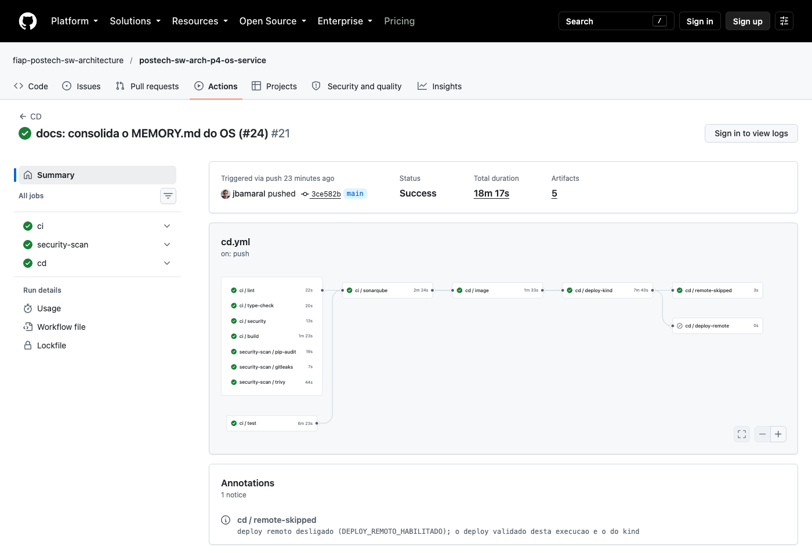

Fonte: [run 39449191933](https://github.com/fiap-postech-sw-architecture/postech-sw-arch-p4-os-service/actions/runs/39449191933), commit `3ce582b`, 20/10/2026.

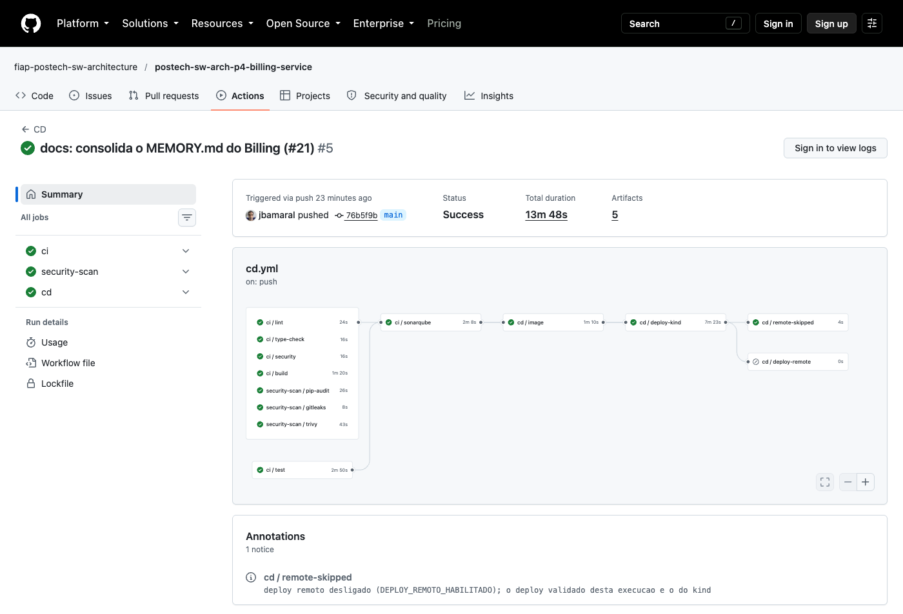

Fonte: [run 39449241713](https://github.com/fiap-postech-sw-architecture/postech-sw-arch-p4-billing-service/actions/runs/39449241713), commit `76b5f9b`, 20/10/2026.

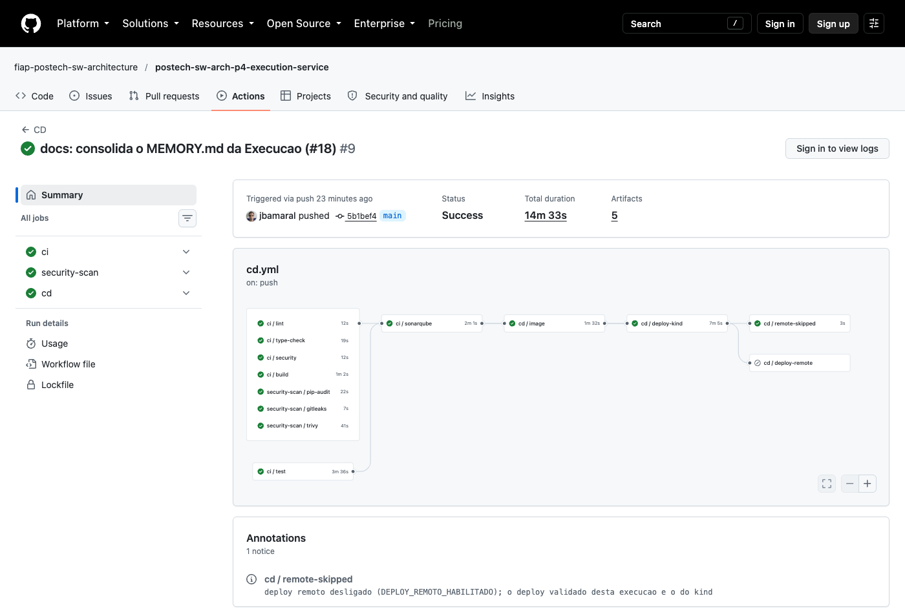

Fonte: [run 39449216419](https://github.com/fiap-postech-sw-architecture/postech-sw-arch-p4-execution-service/actions/runs/39449216419), commit `5b1bef4`, 20/10/2026.

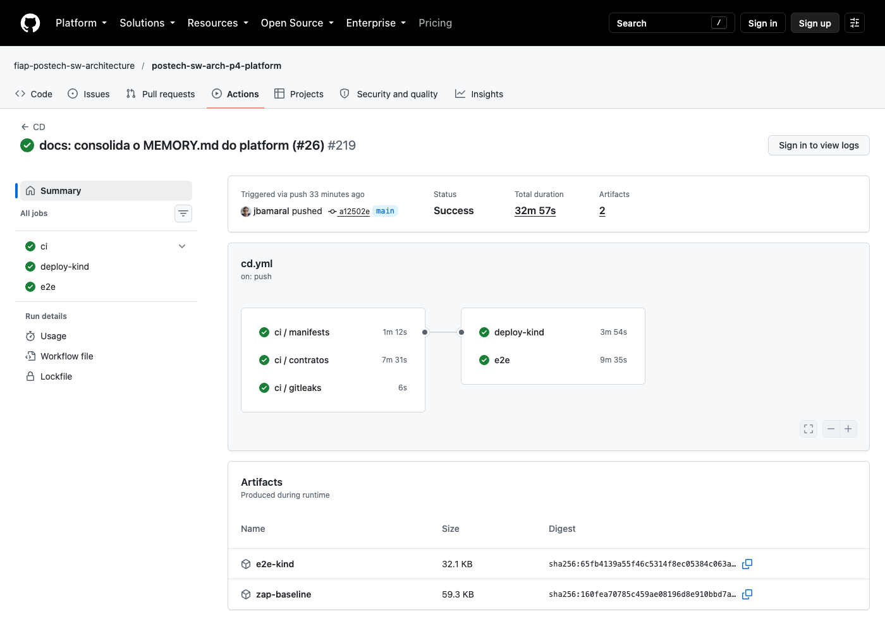

Fonte: [run 39458619627](https://github.com/fiap-postech-sw-architecture/postech-sw-arch-p4-platform/actions/runs/39458619627), commit `d703200`, 20/10/2026.

## B2 — Trace da saga no Jaeger

Os dois primeiros traces são de uma execução no kind local em 20/10/2026, às 09:03 (horário de Brasília), lidos no Jaeger do kind por `kubectl port-forward`. O do caminho feliz, de 19/10/2026, já tinha saído da memória do Jaeger e foi aberto pela aba Upload de um Jaeger 1.76.0 avulso.

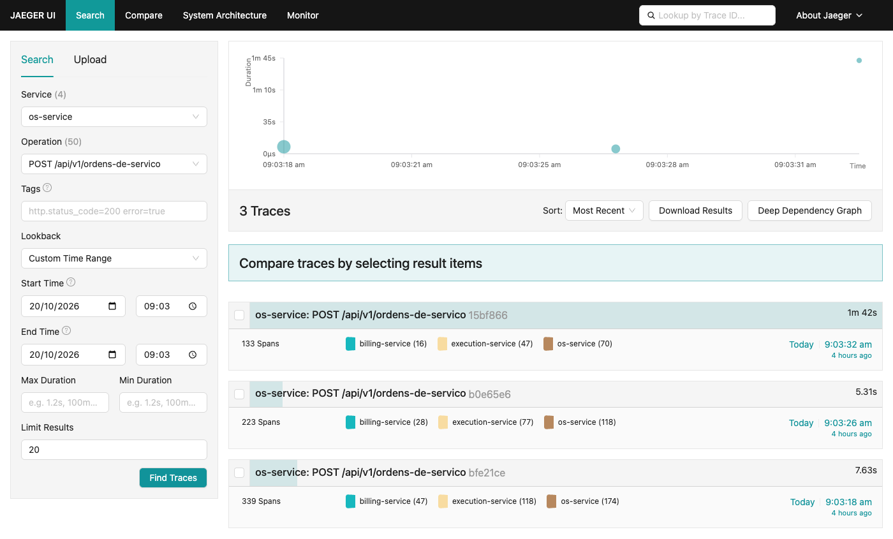

Fonte: Jaeger 1.76.0, serviço `os-service`, de 09:03:10 a 09:03:40.

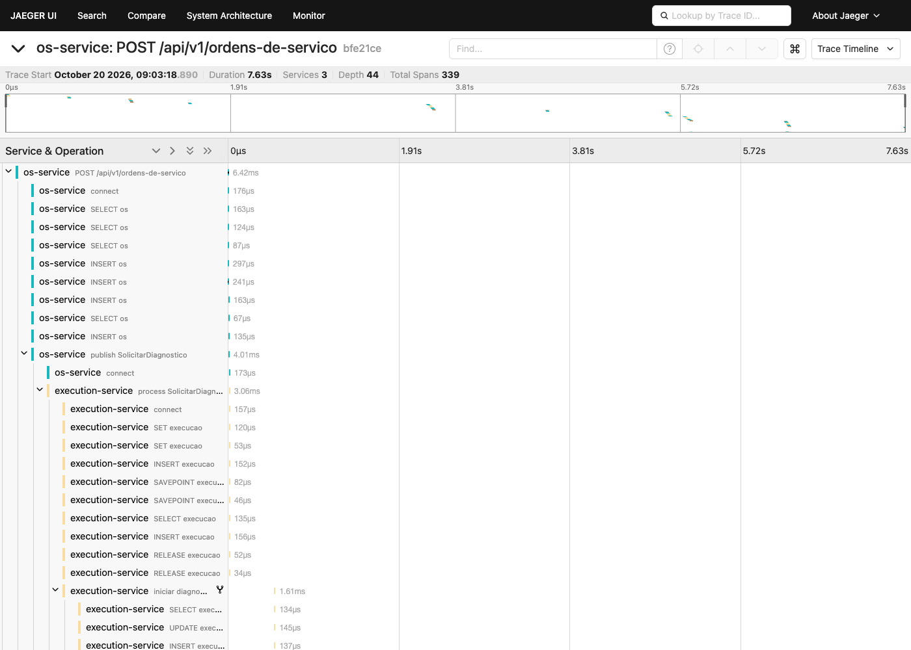

Fonte: trace `bfe21ce701ea69d6afc008a870d2ce21`, da mesma busca.

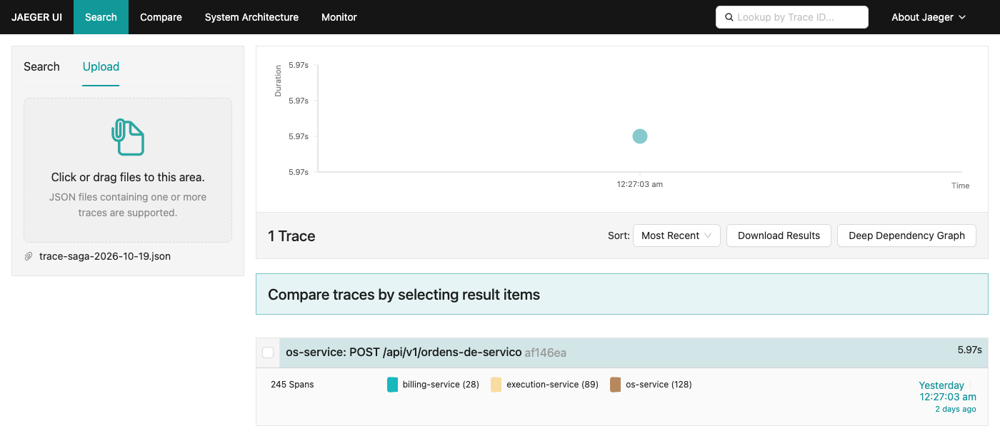

Fonte: [trace-saga-2026-10-19.json](evidencias/trace-saga-2026-10-19.json), trace `af146ea716424dfc2ac5b25960b8e9ae`.

## B3 — Swagger pela borda

O Swagger de cada serviço pelo Kong do kind, em `https://localhost/<prefixo>/docs`; o campo Servers mostra o prefixo.

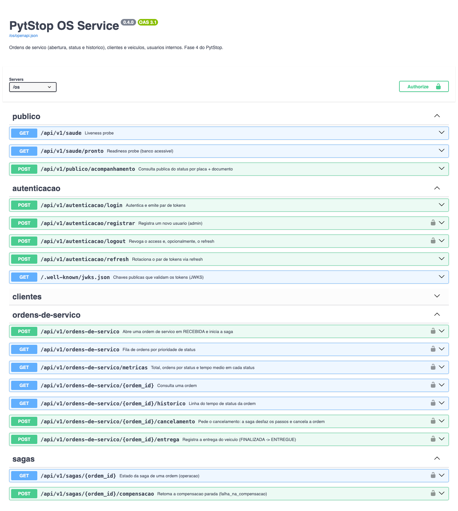

Fonte: `https://localhost/os/docs`, 20/10/2026.

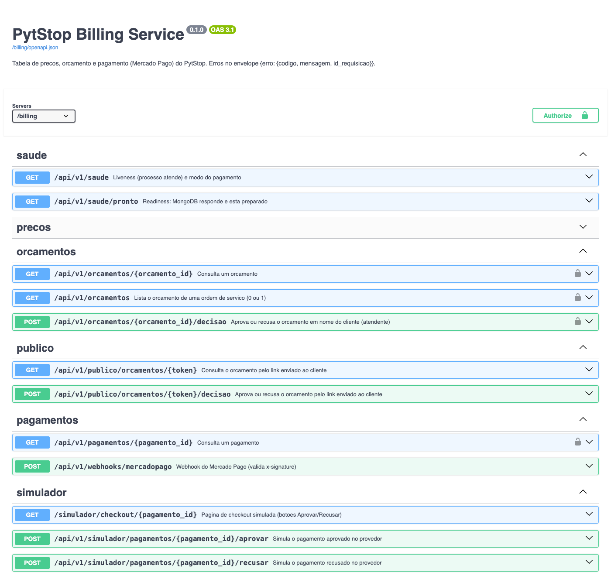

Fonte: `https://localhost/billing/docs`, 20/10/2026.

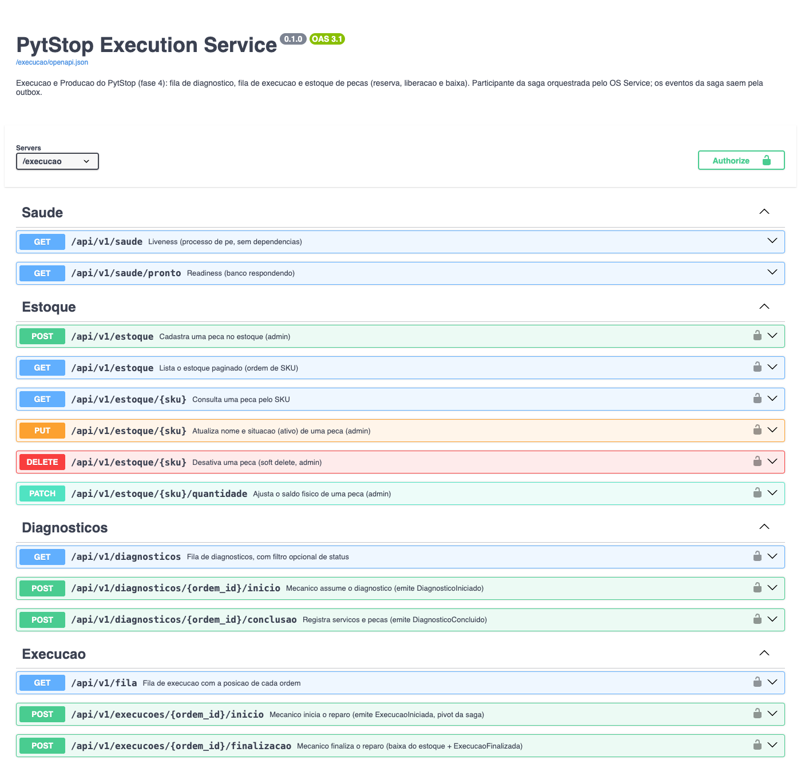

Fonte: `https://localhost/execucao/docs`, 20/10/2026.

## B4 — Newman e ZAP no CD do `platform`

O job `e2e` roda o BDD, o Newman e o ZAP no mesmo kind; os resumos são montados com os números dos artefatos do run.

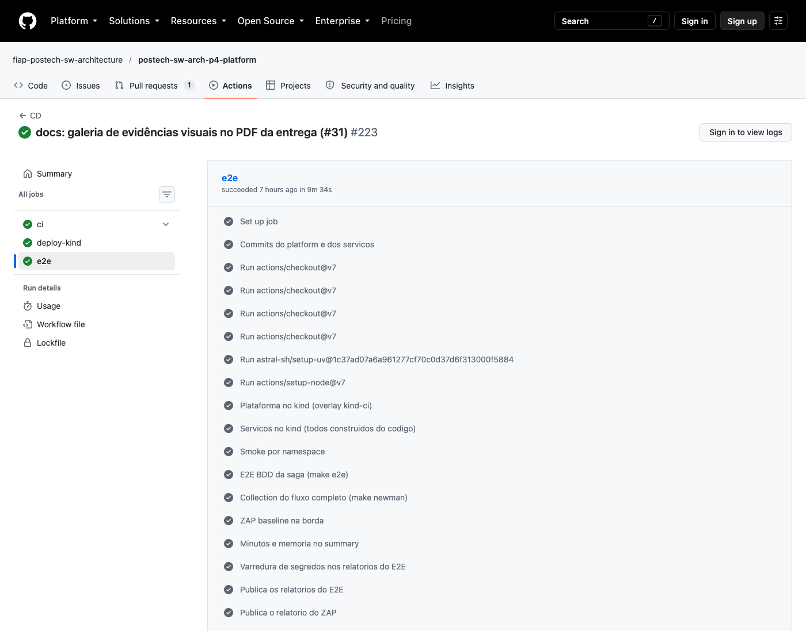

Fonte: [job e2e do run 39458619627](https://github.com/fiap-postech-sw-architecture/postech-sw-arch-p4-platform/actions/runs/39458619627/job/118755242258), commit `d703200`.

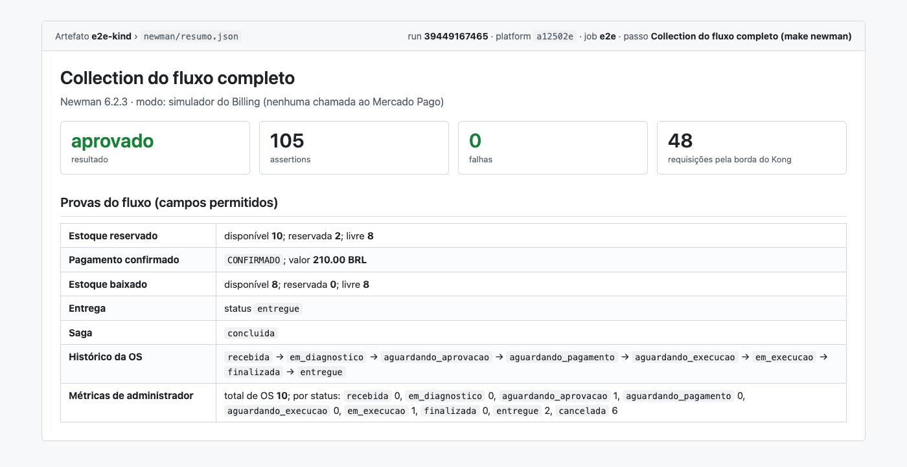

Fonte: artefato `e2e-kind` do mesmo run, `newman/resumo.json`.

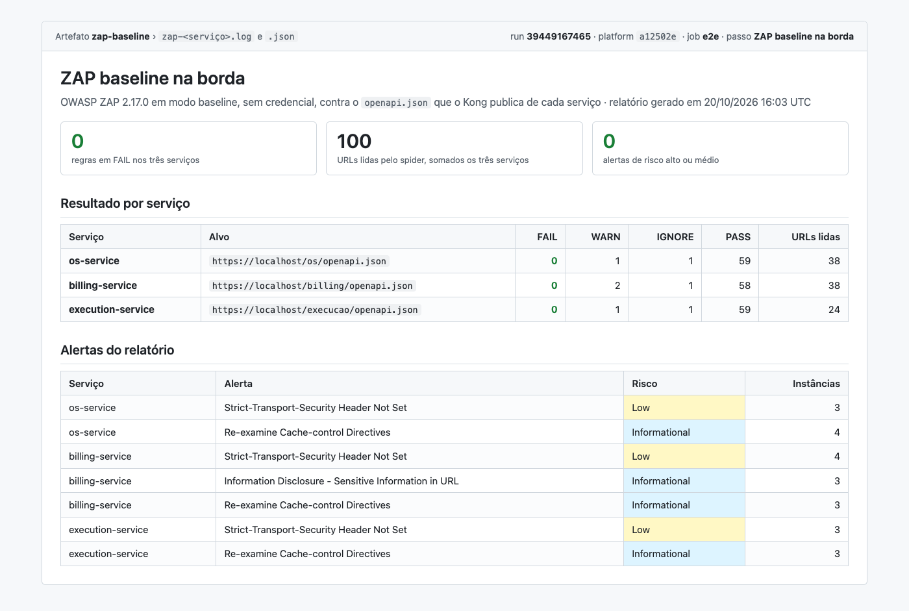

Fonte: artefato `zap-baseline` do mesmo run.

## B5 — Alerta de fila sem consumidor

No kind local, em 19/10/2026, o consumidor do Billing ficou parado por quatro minutos; a regra `pytstop-fila-sem-consumidor` disparou para `billing.comandos` e voltou ao normal depois da restauração ([horários no relatório](evidencias/observabilidade.md#alertas-e-recuperação)).

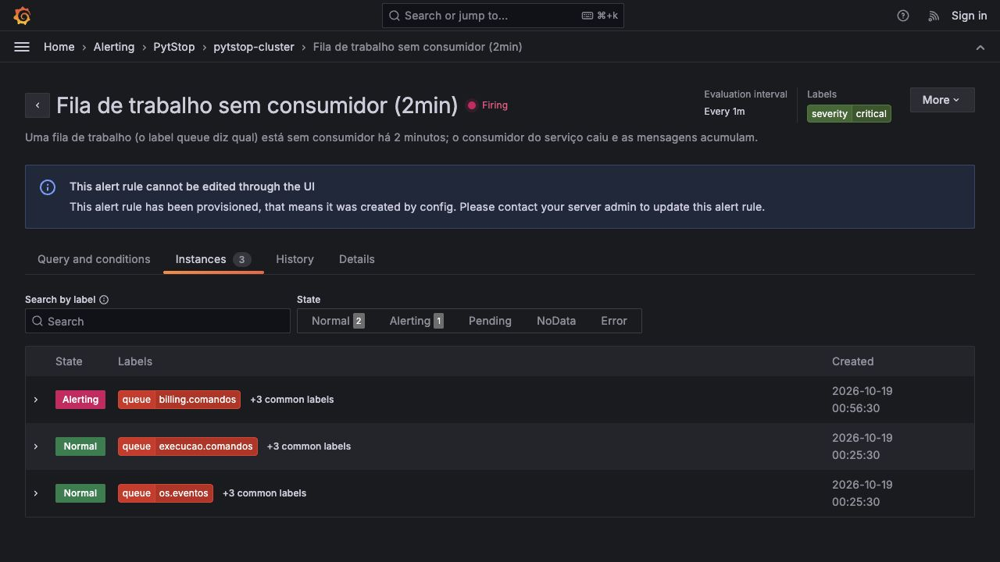

Fonte: Grafana do kind, 19/10/2026, 00:56 (horário de Brasília).

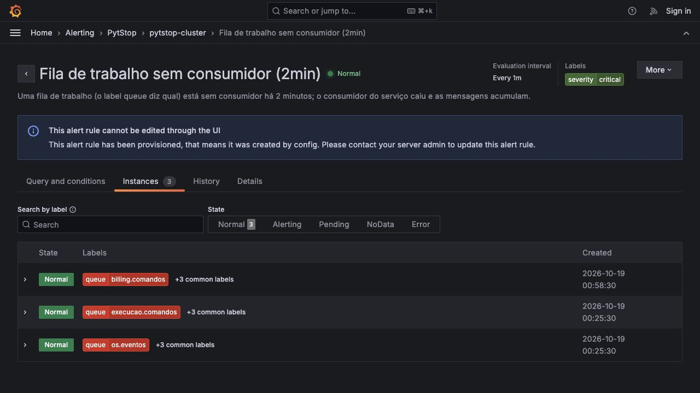

Fonte: Grafana do kind, 19/10/2026, 00:58 (horário de Brasília).

## B6 — Dashboards do Grafana

Os nove dashboards (Atendimento, Orçamentos, Pagamentos, Execução, Saga, Mensageria, Serviços, Bancos e Plataforma) entram aqui depois da captura de 22/10/2026, com três dias de histórico no kind. Captura pendente.
