# Documento de Entrega — Tech Challenge Fase 4

> Versão de 20/10/2026, sobre a `main` dos quatro repositórios nessa data. O vídeo, a prova na sandbox real do Mercado Pago, as capturas dos dashboards com três dias de histórico e a tag `entrega-fase-4` estão pendentes ([seção 15](#15-pendências-até-a-submissão)).

Documento de entrega da fase 4 do Tech Challenge da Pós-Graduação em Arquitetura de Software (FIAP). O PytStop é o sistema de gestão de uma oficina mecânica: registra cada ordem de serviço (OS) da abertura à entrega do veículo. Nas fases 1 a 3 ele foi um monólito modular. Na fase 4 virou três microsserviços, cada um com repositório, banco e pipeline próprios, coordenados por uma saga orquestrada.

O OS Service cuida da OS, dos clientes e da identidade e orquestra a saga. O Billing Service cuida dos preços, do orçamento e do pagamento no Mercado Pago. O Execution Service cuida do diagnóstico, do estoque de peças e da execução do reparo.

## Como ler este documento

Os repositórios são a fonte de verdade. Este documento resume o que está neles e diz onde conferir cada item. Os diagramas são os blocos Mermaid da [RFC-004](../../arquitetura/rfc/fase4/rfc-004-microsservicos-saga.md), a proposta técnica da fase, copiados sem alteração: o gerador do PDF recusa o documento se um deles divergir da RFC. As decisões estão nos ADRs 034 a 043. Os números de testes, cobertura, scans e deploy vêm dos runs do CI/CD na `main` de 20/10/2026, cada um com o link para conferir.

O PDF pedido pelo enunciado (l. 124 a 133) tem seis itens:

| Item do enunciado | Onde está |
|---|---|
| Nome e identificação dos participantes | [Seção 1](#1-identificação-do-grupo) |
| Links dos repositórios | [Seção 2](#2-links-dos-repositórios) |
| Link do vídeo de até 15 minutos | [Seção 3](#3-link-do-vídeo) |
| Diagrama geral da arquitetura final, com microsserviços, bancos e comunicação | [Seção 5.1](#51-diagrama-geral), com o detalhe nas seções 5.2 a 5.6 |
| Estratégia escolhida para o Saga Pattern | [Seção 7](#7-estratégia-da-saga) |
| Justificativa da divisão dos microsserviços e das tecnologias | [Seção 6](#6-divisão-dos-serviços-e-tecnologias) |

As demais seções mostram como os outros requisitos foram atendidos: testes e qualidade (8), CI/CD e deploy (9), segurança (10), observabilidade (11) e a rastreabilidade de cada requisito até a evidência (12). Os anexos trazem os scans de segurança (A), as capturas de tela (B) e o [índice da entrega](../../../INDICE-DA-ENTREGA.md) (C), que liga cada artefato exigido.

Siglas usadas: ADR (registro de decisão de arquitetura), AMQP (protocolo de mensagens do RabbitMQ), BDD (desenvolvimento guiado por comportamento, aqui em Gherkin), CI/CD (integração e entrega contínuas), DLQ (fila de mensagens mortas), E2E (teste de ponta a ponta), GHCR (registro de imagens do GitHub), HPA (escalonamento horizontal de pods), JWKS (conjunto de chaves públicas do JWT), JWT (token assinado), kind (Kubernetes em contêineres Docker), LGPD (Lei Geral de Proteção de Dados), OS (ordem de serviço), PR (pull request), RF, RNF e RN (requisito funcional, requisito não funcional e regra de negócio), RFC (proposta técnica), RS256 (assinatura RSA com SHA-256), SBOM (lista dos componentes de uma imagem), SKU (código de estoque da peça) e TTL (tempo de vida).

## 1. Identificação do grupo

| Campo | Valor |
|---|---|
| Nome do grupo | PytStop |
| Grupo | 158 |
| Turma | 15SOAT — Pós-Graduação em Arquitetura de Software (FIAP) |

### Participantes

Os mesmos integrantes das fases 1 a 3.

| Nome | RM | Discord |
|---|---|---|
| João Amaral | RM373448 | joao_13997 |
| Allan Aurélio | RM372116 | all66_ |
| Carlos Silva | RM374191 | carlossilva156 |
| Guilherme Sousa | RM373609 | romen0 |
| Nicolas Gerbi | RM372644 | sethiiz_gerbi |

## 2. Links dos repositórios

Os quatro repositórios são públicos, na organização `fiap-postech-sw-architecture`, e o usuário `soat-architecture` é colaborador de leitura nos quatro (conferido pela API do GitHub em 20/10/2026). São os três repositórios de microsserviço que o enunciado pede, mais o `platform`, que guarda o que os três compartilham. O `platform` não é microsserviço: não tem domínio, API de negócio nem banco ([ADR-034](../../arquitetura/adr/fase4/034-decomposicao-em-microsservicos.md)).

| Componente | URL | Papel na fase 4 |
|---|---|---|
| OS Service | [https://github.com/fiap-postech-sw-architecture/postech-sw-arch-p4-os-service](https://github.com/fiap-postech-sw-architecture/postech-sw-arch-p4-os-service) | Ordens de serviço e histórico, clientes e veículos com as rotas da LGPD, usuários internos, emissão do JWT e orquestração da saga. Banco: PostgreSQL 16 |
| Billing Service | [https://github.com/fiap-postech-sw-architecture/postech-sw-arch-p4-billing-service](https://github.com/fiap-postech-sw-architecture/postech-sw-arch-p4-billing-service) | Tabela de preços, orçamento com link de decisão, pagamento no Mercado Pago, conciliação e estorno. Banco: MongoDB 7 |
| Execution Service ("Execução", no texto) | [https://github.com/fiap-postech-sw-architecture/postech-sw-arch-p4-execution-service](https://github.com/fiap-postech-sw-architecture/postech-sw-arch-p4-execution-service) | Fila de diagnóstico, estoque e reserva de peças, fila e execução do reparo. Banco: PostgreSQL 16 |
| Plataforma (`platform`) | [https://github.com/fiap-postech-sw-architecture/postech-sw-arch-p4-platform](https://github.com/fiap-postech-sw-architecture/postech-sw-arch-p4-platform) | Infraestrutura compartilhada (RabbitMQ, Kong, observabilidade, Mailpit), contratos de mensageria, E2E da saga, arquitetura global e documentos da entrega |

Cada repositório de serviço tem README com o propósito, o modo de rodar e testar e a seção Cobertura, com o link do run. Tem também o código em `src/`, nas camadas `dominio`, `aplicacao`, `infraestrutura` e `interfaces`; o `Dockerfile`; os manifestos Kubernetes em `k8s/`, com base e overlays `kind`, `kind-ci` e `k3s`; os workflows `ci.yml`, `security.yml` e `cd.yml`; a arquitetura do serviço em `docs/arquitetura.md`; e o OpenAPI e a collection Postman em `docs/api/`.

### 2.1 Estado do CI/CD e gate local

O CD da `main` passou nos quatro repositórios em 20/10/2026. O gate local de cada repositório é o `make check`, que roda na máquina os mesmos gates de código do CI. Os números abaixo são dos jobs desses runs.

| Repositório | Último CD da `main` | O que o `make check` roda | Resultado no CD |
|---|---|---|---|
| OS Service | [run 39449191933](https://github.com/fiap-postech-sw-architecture/postech-sw-arch-p4-os-service/actions/runs/39449191933), commit `3ce582b` | lock do uv, ruff, import-linter, actionlint, mypy strict, bandit, pytest com gate de 95% e `diff-cover` de 90% no código novo | 10.312 testes, cobertura de 99,61% (linhas e ramos), SonarQube aprovado, imagem `sha256:7e4d5d03…` no GHCR, E2E com 14 cenários |
| Billing | [run 39449241713](https://github.com/fiap-postech-sw-architecture/postech-sw-arch-p4-billing-service/actions/runs/39449241713), commit `76b5f9b` | os mesmos gates do OS Service | 1.731 testes, 100,00%, SonarQube aprovado, imagem `sha256:340abc00…`, E2E com 14 cenários |
| Execução | [run 39449216419](https://github.com/fiap-postech-sw-architecture/postech-sw-arch-p4-execution-service/actions/runs/39449216419), commit `5b1bef4` | os mesmos, sem o actionlint | 1.475 testes, 100,00%, SonarQube aprovado, imagem `sha256:c53d1882…`, E2E com 14 cenários |
| `platform` | [run 39458619627](https://github.com/fiap-postech-sw-architecture/postech-sw-arch-p4-platform/actions/runs/39458619627), commit `d703200` | ruff, mypy strict, bandit, shellcheck, actionlint, pytest, prova do retry num RabbitMQ avulso e `make manifests` (kubeconform, trivy e promtool) | 3.366 testes (o repositório não tem código de produção em Python; a cobertura de 99,85% mede o código de teste, gate de 90%), smoke da plataforma, E2E com os três serviços, Newman e ZAP |

Os testes de integração de cada serviço rodam no job `test` contra o banco do serviço e o RabbitMQ reais, em contêineres (testcontainers). O enunciado pede cobertura de 80%; os três serviços usam gate de 95%. A tabela por contexto e camada de cada serviço está no [registro de cobertura](evidencias/coverage.md).

### 2.2 Proteção da `main`

Cada repositório tem um ruleset ativo na `main`. O ruleset aparece para quem só tem leitura no repositório, como o avaliador; a proteção clássica de branch só aparece para administradores. As regras são as mesmas nos quatro: pull request obrigatório, merge só por squash, conversas resolvidas antes do merge, histórico linear, sem force push e sem exclusão da branch, e nenhum ator pode contorná-las.

| Repositório | Ruleset | Checks obrigatórios |
|---|---|---|
| OS Service | [24594457](https://github.com/fiap-postech-sw-architecture/postech-sw-arch-p4-os-service/rules/24594457) | `lint`, `type-check`, `security`, `test`, `sonarqube`, `build`, `pip-audit`, `gitleaks`, `trivy` |
| Billing | [24594468](https://github.com/fiap-postech-sw-architecture/postech-sw-arch-p4-billing-service/rules/24594468) | os mesmos nove |
| Execução | [24594458](https://github.com/fiap-postech-sw-architecture/postech-sw-arch-p4-execution-service/rules/24594458) | os mesmos nove |
| `platform` | [24599837](https://github.com/fiap-postech-sw-architecture/postech-sw-arch-p4-platform/rules/24599837) | `manifests`, `contratos`, `gitleaks`, `deploy-kind` |

Em 20/10/2026, a `main` tinha 32 commits no `platform`, 26 no OS Service, 24 no Billing e 20 na Execução. Todos entraram por pull request, menos o `Initial commit` que o GitHub cria com o repositório. A conferência, com o comando para repetir, está em [proteção da `main`](evidencias/protecao-da-main.md).

## 3. Link do vídeo

Vídeo de até 15 minutos, no YouTube, com as quatro demonstrações do enunciado (l. 118 a 122). A gravação está pendente; o link entra nesta tabela e no índice da entrega depois da publicação.

| Recurso | URL |
|---|---|
| Vídeo de demonstração (YouTube, não listado) | pendente: gravação e publicação |

O [roteiro](roteiro-video.md) prevê 14 minutos de gravação sobre os commits congelados:

| Tempo | Demonstração | O que mostra |
|---|---|---|
| 00:00–00:30 | Apresentação | Integrantes, os quatro repositórios e o diagrama com os bancos separados |
| 00:30–04:30 | Fluxo completo de uma OS (`make demo`, bloco 1) | Abertura, diagnóstico, orçamento por e-mail, aprovação, reserva, pagamento, fila, execução, finalização, entrega e os oito status do histórico; recusa de CPF inválido |
| 04:30–08:30 | Saga e tratamento de falhas (bloco 2) | Falta de peça; cancelamento pago com estorno; 409 depois do início; consumidor parado e retomada sem DLQ; API do Billing fora, com 503 e circuito aberto |
| 08:30–11:00 | Deploy automatizado de um serviço | PR com checks obrigatórios, testes e cobertura, SonarQube, imagem com digest, deploy no kind, smoke e E2E no mesmo run |
| 11:00–14:00 | Monitoramento e rastreamento | Trace da saga nos três serviços, correlação no Loki, latência p95, erro 5xx e taxa de sucesso, volume diário de OS e tempo médio por status, alerta e runbook |

O pagamento do vídeo usa o simulador do Mercado Pago, e o roteiro manda dizer isso na tela. A prova na sandbox real é outra execução, feita com as credenciais de teste de um integrante ([seção 15](#15-pendências-até-a-submissão)).

## 4. Links da documentação

Toda a documentação está versionada nos repositórios. A arquitetura global, os requisitos e as evidências ficam no `platform`; a arquitetura de cada serviço, no repositório dele.

### 4.1 Índice geral

| Recurso | Onde está |
|---|---|
| Índice da entrega: um link por artefato exigido (também no Anexo C) | [INDICE-DA-ENTREGA.md](../../../INDICE-DA-ENTREGA.md) |
| Enunciado da fase 4, transcrito, com o PDF original ao lado | [desafio-tech-fase-4.md](../../requisitos/fase4/desafio-tech-fase-4.md) |
| Gap analysis: cada linha do enunciado com um ID (RF, RNF ou RN) e a situação no código da fase 3 | [gap-analysis-fase-4.md](../../requisitos/fase4/gap-analysis-fase-4.md) |
| Matriz de rastreabilidade dos 44 requisitos, com PR, código e trecho do vídeo | [matriz-de-rastreabilidade.md](../matriz-de-rastreabilidade.md) |
| README do `platform`: componentes e versões, segredos, mensageria, borda, E2E, ZAP e CI | [README.md](../../../README.md) |
| README de cada serviço | [OS Service](https://github.com/fiap-postech-sw-architecture/postech-sw-arch-p4-os-service/blob/main/README.md), [Billing](https://github.com/fiap-postech-sw-architecture/postech-sw-arch-p4-billing-service/blob/main/README.md), [Execução](https://github.com/fiap-postech-sw-architecture/postech-sw-arch-p4-execution-service/blob/main/README.md) |
| Arquitetura de cada serviço: camadas, modelo completo do banco, fluxos e mensageria | [OS Service](https://github.com/fiap-postech-sw-architecture/postech-sw-arch-p4-os-service/blob/main/docs/arquitetura.md), [Billing](https://github.com/fiap-postech-sw-architecture/postech-sw-arch-p4-billing-service/blob/main/docs/arquitetura.md), [Execução](https://github.com/fiap-postech-sw-architecture/postech-sw-arch-p4-execution-service/blob/main/docs/arquitetura.md) |
| Runbook da saga: saga parada, falha na compensação, retomada e redrive da DLQ | [runbook-saga.md](../../operacao/runbook-saga.md) |
| Ensaio integrado: os três serviços no kind, com tempo, memória e CPU por pod | [ensaio-integrado.md](../../operacao/ensaio-integrado.md) |
| Nuvem opcional: o deploy remoto desligado e as receitas de EKS e k3s | [nuvem-opcional.md](../../operacao/nuvem-opcional.md) |
| Observabilidade: dashboards técnicos, alertas e catálogo de métricas; dashboards de negócio | [observabilidade/README.md](../../../observabilidade/README.md), [negocio.md](../../../observabilidade/negocio.md) |
| Contratos de mensageria: AsyncAPI 3.0 e um JSON Schema por mensagem | [contratos/asyncapi.yaml](../../../contratos/asyncapi.yaml) |
| Registro de evidências e auditoria pré-entrega com a dívida técnica | [evidencias/README.md](evidencias/README.md), [auditoria-e-divida-tecnica.md](auditoria-e-divida-tecnica.md) |

### 4.2 Decisões de arquitetura da fase 4

As decisões pontuais estão em ADRs, cada um com contexto, decisão, alternativas consideradas e consequências. A RFC-004 junta as decisões num desenho único. As decisões das fases 1 a 3 (ADR-001 a ADR-033) continuam no repositório da fase 3 e são citadas onde a fase 4 as herda.

| Artefato | Decisão |
|---|---|
| [RFC-004](../../arquitetura/rfc/fase4/rfc-004-microsservicos-saga.md) | Desenho integrado: diagrama geral, divisão dos serviços, saga, mensageria, APIs, dados, segurança, observabilidade, implantação e riscos |
| [ADR-034](../../arquitetura/adr/fase4/034-decomposicao-em-microsservicos.md) | Decomposição em três microsserviços e uma plataforma |
| [ADR-035](../../arquitetura/adr/fase4/035-saga-orquestrada.md) | Saga orquestrada pelo OS Service |
| [ADR-036](../../arquitetura/adr/fase4/036-mensageria-rabbitmq.md) | RabbitMQ com outbox transacional e consumidor idempotente |
| [ADR-037](../../arquitetura/adr/fase4/037-banco-por-servico.md) | PostgreSQL no OS Service e na Execução, MongoDB no Billing |
| [ADR-038](../../arquitetura/adr/fase4/038-borda-e-comunicacao-sincrona.md) | Kong na borda e REST síncrono só quando a resposta é necessária na hora |
| [ADR-039](../../arquitetura/adr/fase4/039-autenticacao-entre-servicos.md) | JWT RS256 emitido pelo OS Service e validado por JWKS |
| [ADR-040](../../arquitetura/adr/fase4/040-integracao-mercado-pago.md) | Mercado Pago via Checkout Pro, com webhook verificado e simulador para o CI |
| [ADR-041](../../arquitetura/adr/fase4/041-estrategia-de-testes-e-qualidade.md) | Estratégia de testes e qualidade por serviço |
| [ADR-042](../../arquitetura/adr/fase4/042-cicd-e-deploy-kubernetes.md) | CI/CD por serviço com deploy em kind, com as emendas de 18 e 19/10/2026 |
| [ADR-043](../../arquitetura/adr/fase4/043-observabilidade-distribuida.md) | Stack de observabilidade da fase 3 com rastreamento da saga de ponta a ponta |

### 4.3 API: Swagger e Postman

Cada serviço publica o Swagger em `/docs`; pela borda, em `/os/docs`, `/billing/docs` e `/execucao/docs`. O OpenAPI exportado do app e a collection Postman, com uma requisição por rota, ficam em `docs/api/`, e um teste reprova os dois arquivos se ficarem atrás do código. O README de cada serviço traz um `curl` por rota. A collection do fluxo completo, no `platform`, leva uma OS pelos três serviços e roda no CD com o Newman ([seção 8.4](#84-collection-com-newman)).

| Serviço | OpenAPI | Collection Postman |
|---|---|---|
| OS Service | [openapi.json](https://github.com/fiap-postech-sw-architecture/postech-sw-arch-p4-os-service/blob/main/docs/api/openapi.json) | [os-service.postman_collection.json](https://github.com/fiap-postech-sw-architecture/postech-sw-arch-p4-os-service/blob/main/docs/api/os-service.postman_collection.json) |
| Billing | [openapi.json](https://github.com/fiap-postech-sw-architecture/postech-sw-arch-p4-billing-service/blob/main/docs/api/openapi.json) | [billing.postman_collection.json](https://github.com/fiap-postech-sw-architecture/postech-sw-arch-p4-billing-service/blob/main/docs/api/billing.postman_collection.json) |
| Execução | [openapi.json](https://github.com/fiap-postech-sw-architecture/postech-sw-arch-p4-execution-service/blob/main/docs/api/openapi.json) | [execucao.postman_collection.json](https://github.com/fiap-postech-sw-architecture/postech-sw-arch-p4-execution-service/blob/main/docs/api/execucao.postman_collection.json) |
| Fluxo completo, pela borda | os três acima | [fluxo-completo.postman_collection.json](../../api/fluxo-completo.postman_collection.json) |

## 5. Desenho da arquitetura

Os diagramas desta seção vêm da RFC-004. No GitHub, o documento e a RFC mostram os mesmos desenhos.

### 5.1 Diagrama geral

Três serviços, um banco para cada um e dois canais de comunicação: REST pela borda e entre a Execução e o Billing, e mensagens AMQP pelo RabbitMQ. Tudo roda num cluster Kubernetes (kind, na máquina local e no CI).

No diagrama, REST são chamadas HTTP síncronas, e AMQP, as mensagens do RabbitMQ. O Kong é a única entrada de fora do cluster. A única chamada síncrona de negócio entre serviços é a validação de preços, da Execução para o Billing. A outra dependência HTTP é a chave pública do JWT (JWKS), que Billing e Execução leem do OS Service com cache de 10 minutos. Só o Billing fala com o Mercado Pago. No CI, o overlay `kind-ci` roda Prometheus e Jaeger; Grafana e Loki ficam só no kind local.

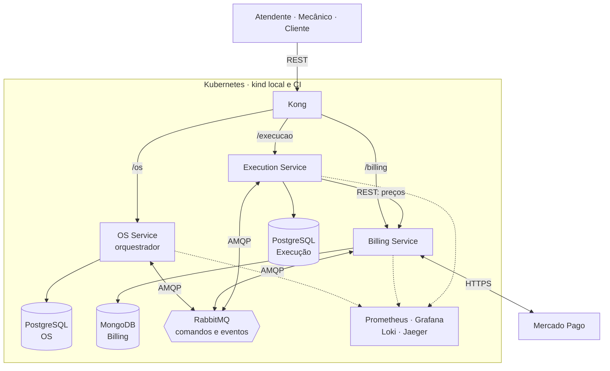

### 5.2 Processos e integrações

Cada serviço roda processos separados, cada um num Deployment: a `api` (REST), o `consumidor` (lê a fila do serviço), o `relay` (publica a outbox no RabbitMQ) e, no OS Service e no Billing, o `prazos` (prazos técnicos, validade do orçamento e do pagamento e conciliação com o Mercado Pago). O OS Service tem ainda o `notificador`, que entrega os e-mails ao cliente. O processo que muda estado grava o efeito e a mensagem de saída na mesma transação (a outbox), e o relay publica depois.

Linhas cheias são REST, HTTP e mensagens; pontilhadas, telemetria. Comandos saem do relay do OS Service para o consumidor do participante, e eventos fazem o caminho inverso. O cliente da oficina não tem login: acompanha a OS pelo acompanhamento público, decide o orçamento por um link assinado e paga no checkout do Mercado Pago, cujo webhook entra pelo Kong.

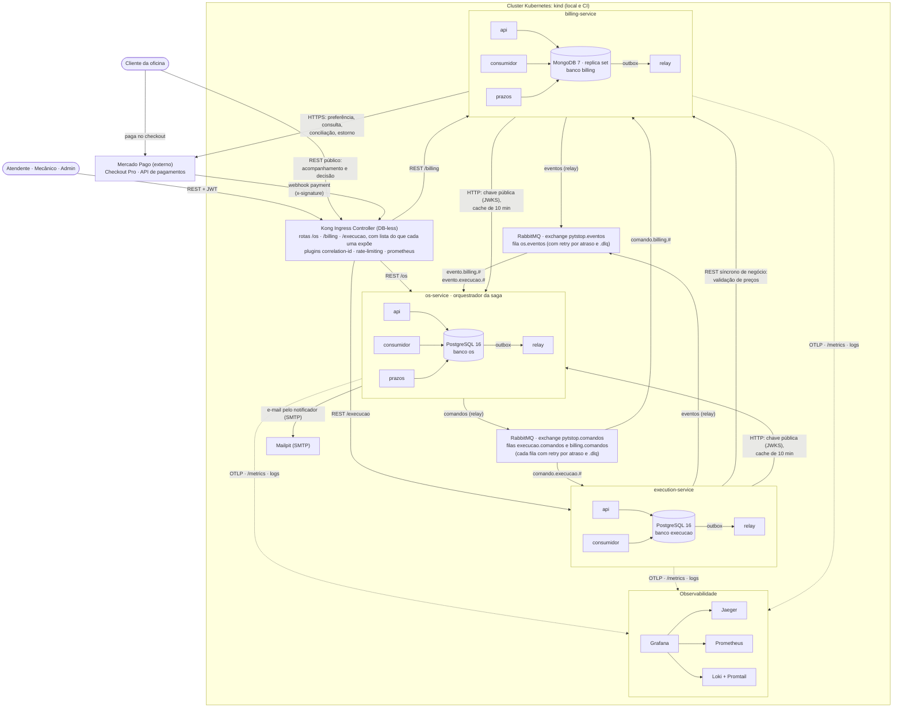

### 5.3 Mapa de contextos

Os contextos delimitados da fase 3 foram para o serviço cuja capacidade sustentam. As setas vão do fornecedor para o cliente (*upstream* para *downstream*). Os contratos de mensagem são a linguagem publicada entre os três serviços (*Published Language*), e a validação de preços é um *Open Host Service* do Billing. Cada consumidor traduz o contrato alheio para o próprio modelo (camada anticorrupção), sem importar código de outro serviço. A saga não é um contexto à parte: é um *process manager* na camada de aplicação do OS Service.

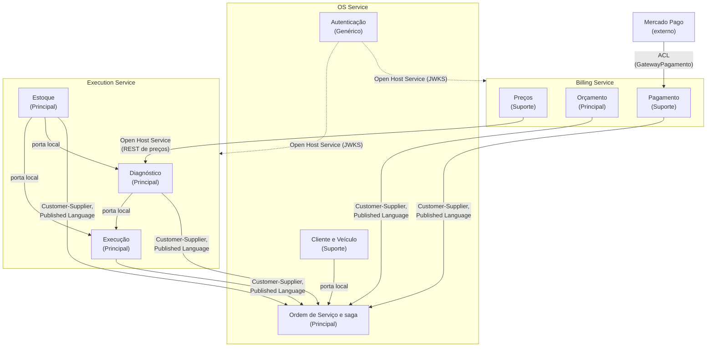

### 5.4 Mensageria

São quatro exchanges: `pytstop.comandos` e `pytstop.eventos` (topic), `pytstop.retry` (topic, com bindings de chave exata) e `pytstop.dlx` (direct). Cada uma das três filas de trabalho é lida por um serviço só e tem cinco filas de retry por atraso e uma DLQ: 21 filas, todas quorum e duráveis. Os participantes só consomem comandos, e só o orquestrador consome eventos.

| Fila | Consumidor | Binding |
|---|---|---|
| `billing.comandos` | Billing | `pytstop.comandos`, chave `comando.billing.#` |
| `execucao.comandos` | Execução | `pytstop.comandos`, chave `comando.execucao.#` |
| `os.eventos` | OS Service | `pytstop.eventos`, chaves `evento.billing.#` e `evento.execucao.#` |
| `<fila>.retry.1s` a `<fila>.retry.300s` | nenhum: quando o TTL da fila vence, a mensagem volta à fila de trabalho | `pytstop.retry`, chave igual ao nome da fila |
| `<fila>.dlq` | nenhum: análise e redrive | `pytstop.dlx`, chave `<fila>`; cada mensagem fica até 7 dias |

A topologia tem uma fonte só, o `definitions.json` que o `platform` carrega no broker, e os serviços só conferem o que usam, por declaração passiva. Cada serviço conecta com usuário próprio, sem permissão de configure, e a permissão de tópico limita o que ele publica: o usuário `os` só publica `comando.*`, o `billing` só `evento.billing.*` e a `execucao` só `evento.execucao.*`. O consumidor confere o `user_id` da mensagem contra o produtor que o catálogo associa ao tipo; divergência vai para a DLQ.

Toda mensagem usa o mesmo envelope JSON: `id`, `tipo`, `versao`, `origem`, `correlation_id` (o `ordem_id`), `causation_id` (a mensagem que causou esta), `ocorrido_em` e `dados`, com o `traceparent` nos headers AMQP. O catálogo tem 34 mensagens, 11 comandos e 23 eventos, cada uma com um JSON Schema em `contratos/` e o conjunto descrito em AsyncAPI 3.0. Cada serviço copia os schemas que produz e consome e os valida em teste de contrato no CI; outro teste compara a cópia com o `platform` no commit de origem. Dinheiro trafega como string decimal (`"350.00"`) e moeda `BRL`, nunca em ponto flutuante.

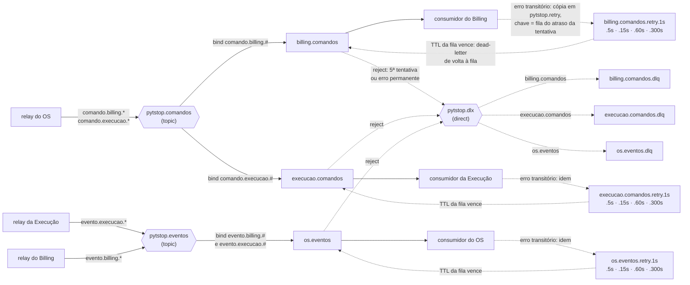

### 5.5 Modelo de dados

Cada serviço é o único dono do seu banco, com credencial própria montada só nos pods dele. Nenhum serviço conhece o endereço ou a senha do banco de outro, e a NetworkPolicy de cada namespace só deixa o próprio namespace chegar ao banco. Os dois diagramas depois das descrições do OS Service e da Execução mostram as tabelas de que a saga e os contratos dependem; o modelo completo, com todas as colunas, fica no `docs/arquitetura.md` de cada serviço.

**OS Service (PostgreSQL 16).** Clientes, veículos, consentimentos, usuários e tokens revogados vêm da fase 3 sem mudança; o documento do cliente fica cifrado, com um hash para a busca. A OS perdeu o orçamento em JSONB e ganhou versão para o lock otimista e o resumo do orçamento e do pagamento, copiado dos eventos, para responder sem chamar o Billing. O `historico_status_ordem` só recebe inserções, com o ator de cada transição. A tabela `sagas` guarda a instância da saga, uma por OS, e a `notificacoes`, os e-mails que o `notificador` entrega.

**Execution Service (PostgreSQL 16).** Reservar não consome o saldo: a reserva move quantidade de disponível para reservada, a liberação devolve e a finalização dá baixa. O `ordem_id` é único em reserva, diagnóstico e execução, o que torna os três idempotentes por OS. Diagnóstico e execução guardam o retrato do veículo (placa, marca, modelo e ano), para o mecânico achar o carro no pátio, e o `traceparent` da mensagem que os abriu.

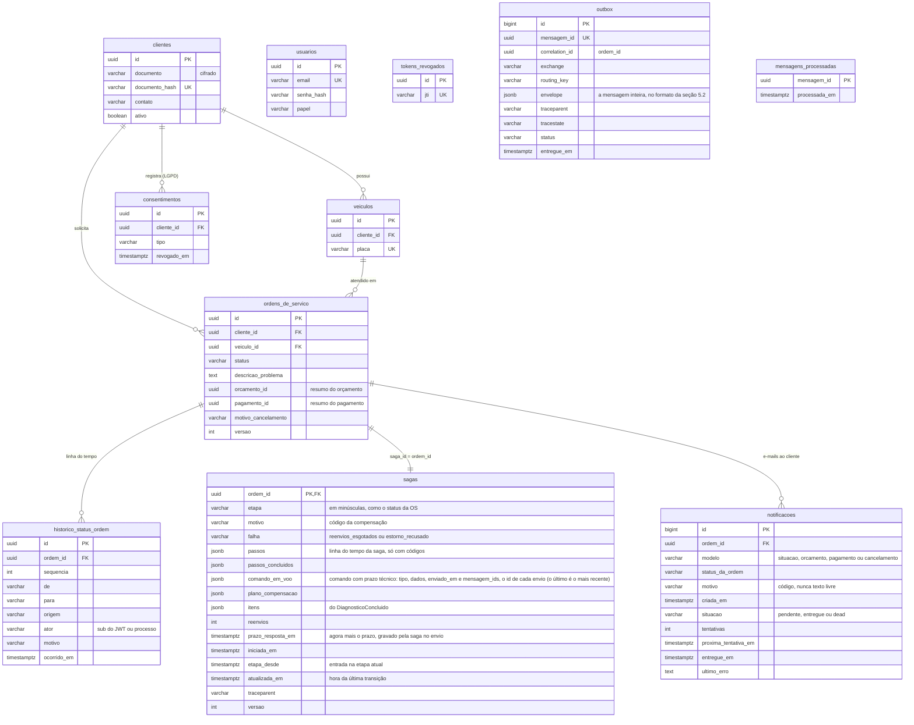


**Billing Service (MongoDB 7).** Orçamento e pagamento são documentos lidos e gravados inteiros. O orçamento leva as linhas com os preços congelados, o total e a validade. O pagamento leva o status que o provedor informou em cada notificação e os estornos automáticos, sem nenhum dado do pagador ou do cartão. O replica set de um nó existe para a transação multidocumento, que grava o documento e a mensagem da outbox juntos. Dinheiro fica em `Decimal128`.

| Coleção | Conteúdo e índices |
|---|---|
| `precos_servicos`, `precos_pecas` | código ou `sku`, descrição, preço, moeda e `ativo`; índices únicos `{codigo: 1}` e `{sku: 1}`. O `sku` liga a peça ao estoque da Execução |
| `orcamentos` | um por OS (índice único `{ordem_id: 1}`), imutável depois de gerado, com as linhas e o total; `{status: 1, valido_ate: 1}` para a expiração |
| `pagamentos` | uma cobrança por orçamento (índice único e parcial `{orcamento_id: 1}`); único `{ordem_id: 1}`, pelo qual a compensação acha a cobrança; único e parcial `{referencia_pagamento: 1}`, para o webhook; `{status: 1, expira_em: 1}` para expiração e conciliação |
| `outbox`, `mensagens_processadas` | `_id` igual ao `id` da mensagem; índice para o *claim* do relay e índices TTL que apagam a outbox entregue em 7 dias e as mensagens processadas em 30 |

Exemplo de orçamento aprovado, em Extended JSON (RFC-004, seção 7.4):

```json
{
  "_id": "6d2a9b14-8c3e-4f5a-a7b6-1c9d0e2f3a45",
  "ordem_id": "3c9a7e10-5b2f-4f6d-8a41-0e2d9b7c6f55",
  "status": "APROVADO",
  "linhas": [
    {"tipo": "servico", "codigo": "SRV-TROCA-OLEO", "descricao": "Troca de óleo", "quantidade": 1,
     "preco_unitario": {"valor": {"$numberDecimal": "120.00"}, "moeda": "BRL"}},
    {"tipo": "peca", "codigo": "PEC-OLEO-5W30", "descricao": "Óleo 5W30, 1 litro", "quantidade": 4,
     "preco_unitario": {"valor": {"$numberDecimal": "45.00"}, "moeda": "BRL"}}
  ],
  "total": {"valor": {"$numberDecimal": "300.00"}, "moeda": "BRL"},
  "criado_em": {"$date": "2026-10-06T14:32:06Z"},
  "valido_ate": {"$date": "2026-10-09T14:32:06Z"},
  "decisao": {"canal": "link", "decidido_em": {"$date": "2026-10-06T15:02:11Z"}, "decidido_por": null},
  "motivo_cancelamento": null,
  "aberto_por": {"mensagem_id": "8f6b1c2e-4d3a-4e8b-9f1a-2b7c5d9e0a13",
                 "traceparent": "00-4bf92f3577b34da6a3ce929d0e0e4736-00f067aa0ba902b7-01"}
}
```

### 5.6 Implantação e pipeline

O ambiente entregue é o kind, Kubernetes em contêineres Docker, na máquina local e no runner do CI ([ADR-042](../../arquitetura/adr/fase4/042-cicd-e-deploy-kubernetes.md)). Cada serviço tem namespace próprio, com o banco em StatefulSet, os Secrets, o Job de migração (no Billing, de inicialização) e um Deployment por processo. A plataforma fica em `pytstop-plataforma`.

| Namespace | O que roda | Quem implanta |
|---|---|---|
| `pytstop-plataforma` | RabbitMQ, Kong (proxy e Ingress Controller), Prometheus, Grafana, Loki, Promtail, Jaeger, kube-state-metrics e Mailpit | `platform` (`make deploy`) |
| `pytstop-os` | `api`, `relay`, `consumidor`, `prazos` e `notificador`; PostgreSQL 16 com o `postgres_exporter`; Job de migração | OS Service |
| `pytstop-billing` | `api`, `relay`, `consumidor` e `prazos`; MongoDB 7 (replica set `rs0`) com o `mongodb_exporter`; Job de inicialização | Billing |
| `pytstop-execucao` | `api`, `relay` e `consumidor`; PostgreSQL 16 com o `postgres_exporter`; Job de migração | Execução |
| `kube-system` | metrics-server, que o HPA usa | `platform` |

A API de cada serviço tem HPA de 1 a 2 réplicas, por CPU a 70% (no `kind-ci` do CD, uma réplica); os outros processos rodam com uma réplica. A NetworkPolicy de cada namespace de serviço nega toda entrada e libera só o necessário: o Kong e o Prometheus para a API, as APIs do Billing e da Execução para o JWKS do OS Service, a API da Execução para a do Billing, o Prometheus para as portas de métricas e o próprio namespace para o banco. Os pods das APIs rodam sem root (usuário 1001), sem escalar privilégio, sem capability e com a raiz somente leitura. Os Secrets não são versionados: o deploy os gera no cluster.

O diagrama mostra o CD de cada serviço. O push na `main` passa pelos gates, o job `image` publica a imagem no GHCR e o `deploy-kind` sobe um kind efêmero no runner, com a plataforma e os três serviços, roda o smoke de cada namespace e o E2E. O deploy num cluster persistente é um gancho desligado ([seção 9.5](#95-deploy-remoto-opcional)).

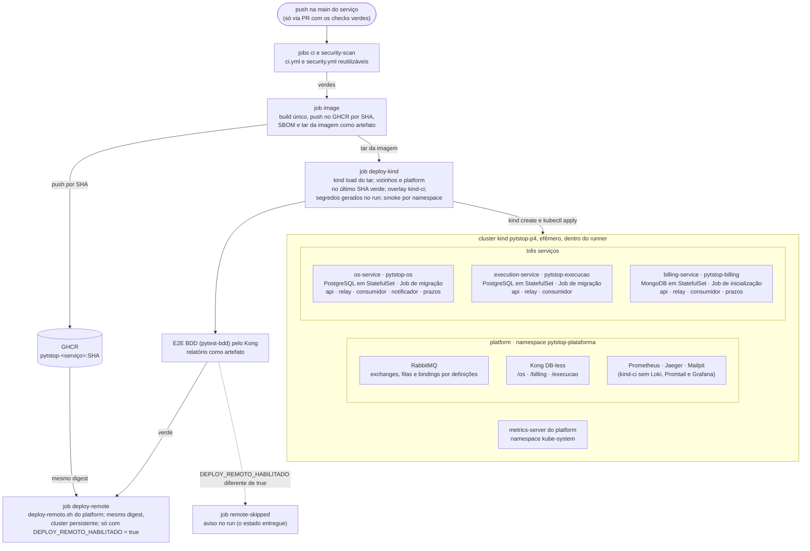

## 6. Divisão dos serviços e tecnologias

### 6.1 Critérios do recorte

O enunciado sugere três serviços: o de ordens de serviço, o de orçamento e pagamento e o de execução e produção (l. 31 a 55). O recorte seguiu três critérios, nesta ordem ([ADR-034](../../arquitetura/adr/fase4/034-decomposicao-em-microsservicos.md)):

1. as capacidades sugeridas pelo enunciado definem os serviços;
2. cada contexto delimitado da fase 3 vai inteiro para o serviço cuja capacidade sustenta, com duas exceções: o contexto Ordem de Serviço, que misturava atendimento, orçamento e execução, se reparte entre os três serviços, e a peça perde o preço para o Billing, porque preço e saldo têm donos diferentes;
3. a regra que depende de transação local com lock fica num serviço só: a reserva de peças não atravessa a rede.

Os três também mudam por motivos diferentes. O OS Service muda com o atendimento e a identidade; o Billing, com a regra de preço e com o provedor de pagamento; a Execução, com o trabalho da oficina. Juntar dois misturaria esses ritmos num deploy só. Separar mais poria passos locais da saga na rede.

| Serviço | Operações | Integrações | Banco |
|---|---|---|---|
| OS Service | Abrir a OS; atualizar o status pelas respostas da saga; consultar status, histórico, etapa e tempo médio por status; cancelar antes do pivot; registrar a entrega; clientes, veículos e consentimentos da LGPD; login interno e emissão do JWT; orquestrar a saga; notificar o cliente por e-mail, inclusive com o orçamento | Comandos à Execução e ao Billing e eventos dos dois; publica o JWKS; e-mail pelo `notificador` | PostgreSQL 16 |
| Billing | Preços de serviços e peças; validação de códigos; orçamento com preços congelados, link de decisão e validade; decisão do cliente; solicitação, confirmação, recusa, expiração, cancelamento e estorno do pagamento; conciliação com o Mercado Pago | Mercado Pago (Checkout Pro, consulta, estorno e webhook); atende a Execução por REST; lê o JWKS do OS Service | MongoDB 7 |
| Execução | Fila de diagnóstico, com o retrato do veículo; reserva, liberação e baixa de peças; fila de execução (agendamento, início e finalização); estoque físico | Valida preços no Billing por REST; lê o JWKS do OS Service | PostgreSQL 16 |

O código partiu do commit `08dcffe` da fase 3, recortado por contexto:

| Componente da fase 3 | Destino na fase 4 |
|---|---|
| `cliente_veiculo`, `autenticacao` e o núcleo de `ordem_servico` (agregado, máquina de status e notificação) | OS Service, que ganhou o histórico de status e o orquestrador |
| `catalogo_servicos`; o orçamento e a decisão externa, que estavam em `ordem_servico` | Billing: tabela de preços e orçamento como documento |
| `estoque` e os itens da OS | Execução: saldo, reserva, liberação e baixa; itens apontados no diagnóstico |
| `compartilhado` e `relay/` | Cópia em cada serviço; o relay passou a publicar no RabbitMQ |
| `ui/` (NiceGUI) | Fora do escopo: a demonstração usa Swagger, Postman e scripts |
| Lambda de autenticação por CPF | Não migrou: lia a tabela `clientes` direto, o que o enunciado proíbe (l. 67) |

Há um desvio deliberado do enunciado, que põe o envio do orçamento no Billing (l. 43). O Billing gera o orçamento e o link de decisão, e o e-mail sai do OS Service, dono do contato, quando ele recebe `OrcamentoGerado`. Assim, nome, documento e contato do cliente não saem do OS Service.

A base técnica (entidades, `Dinheiro`, unidade de trabalho, outbox, logging e métricas) foi copiada em cada serviço, sem pacote compartilhado, para manter versão e deploy independentes. A divergência que quebraria a integração, o formato das mensagens, é pega pelo teste de contrato.

### 6.2 Alternativas descartadas

| Alternativa | Por que não |
|---|---|
| Quatro ou mais serviços, com preço e estoque separados | Orçamento, validação do diagnóstico, reserva e baixa chamariam outro serviço no meio da saga: mais saltos de rede nos mesmos passos, o sintoma do monólito distribuído |
| Serviço próprio de clientes e identidade | Toda abertura de OS validaria cliente e veículo por chamada síncrona, e o e-mail de cada etapa dependeria do contato guardado em outro serviço |
| Estoque no Billing | Reserva, liberação e baixa acontecem no fluxo da oficina e pedem lock de linha com saldo nunca negativo; o Billing teria de ir para o SQL |
| Pacote compartilhado para a base técnica | Toda mudança na base exigiria publicar versão e atualizar três repositórios em ordem, e a persistência do Billing (MongoDB) não seria comum |
| Monólito modular com bancos separados | Descartado pelo próprio enunciado: um repositório e um pipeline só (l. 27 e 99) |

### 6.3 Banco por serviço

O enunciado pede banco próprio por serviço, com pelo menos um relacional e um não relacional (l. 57 a 60). Cada escolha segue o uso do serviço ([ADR-037](../../arquitetura/adr/fase4/037-banco-por-servico.md)):

| Critério | OS Service | Execução | Billing |
|---|---|---|---|
| Transação | transição da OS, histórico, etapa da saga e outbox num commit | reserva tudo ou nada com lock de linha, saldo nunca negativo | orçamento ou pagamento e outbox numa transação de documentos |
| Modelo e esquema | cliente, veículo e OS ligados por chave estrangeira; esquema estável | peça, reserva por OS e fila com posição; esquema estável | orçamento com as linhas embutidas; pagamento com o resultado das consultas ao provedor |
| Padrão de acesso | por id, por status com ordenação, junção de cliente, veículo e OS | lock das linhas de estoque em ordem fixa, fila ordenada | documento inteiro por id ou por `ordem_id` |
| Operação | mesma imagem, migrações e ferramentas da fase 3 | idem | motor novo, um nó, monitorado na mesma stack |

O Billing usa documentos porque orçamento e pagamento já eram JSONB na fase 3, e o exemplo de documento da disciplina é uma fatura com itens. OS Service e Execução precisam de integridade relacional e de lock pessimista. Ficaram de fora o PostgreSQL nos três (não atenderia o NoSQL), o DynamoDB (só existe na AWS, cuja conta acadêmica tem credencial de 4 horas), o Redis como banco (persistência opcional para um registro financeiro), o Cassandra (feito para volume analítico, sem a transação de que orçamento e outbox precisam) e o MongoDB também na Execução (a reserva tudo ou nada é o caso do lock de linha).

### 6.4 Comunicação síncrona e assíncrona

A regra do recorte é REST quando quem chama precisa da resposta para continuar e a operação só lê, e mensagem quando a operação muda estado em outro serviço.

**Mensageria.** RabbitMQ 4.3.6, citado no enunciado e usado na prática da disciplina de SAGA Pattern, com outbox no produtor e consumidor idempotente nos três serviços ([ADR-036](../../arquitetura/adr/fase4/036-mensageria-rabbitmq.md)). Tópicos, dead letter, TTL por fila, confirmação do broker e `user_id` validado são nativos, então retry com atraso, DLQ e conferência do produtor saem de configuração. O Kafka não tem retry com atraso nem DLQ nativos e pede mais memória num kind já carregado. O Amazon SQS seria um emulador no kind, e a conta acadêmica expira. No Redis Streams, DLQ e atraso seriam código próprio, e um Redis comum aos três serviços seria lido como banco compartilhado.

**REST síncrono.** Há uma chamada de negócio só: na conclusão do diagnóstico, a Execução valida os códigos de serviço e de peça no Billing (`POST /api/v1/precos/validacao`). A chamada tem timeout de 2 s, 2 retries com jitter e circuit breaker que abre com 5 falhas e fica aberto por 30 s. Com o circuito aberto, a conclusão responde 503 e não grava nada; um 4xx do Billing vira 502, sem retry. A chamada fica síncrona porque o mecânico precisa saber na hora que um código não existe, e a autoridade continua no Billing: o `GerarOrcamento` falha com `GeracaoDeOrcamentoFalhou` se a tabela mudar entre a validação e o orçamento ([ADR-038](../../arquitetura/adr/fase4/038-borda-e-comunicacao-sincrona.md)).

### 6.5 Borda e identidade

**Kong na borda.** O Kong Ingress Controller, sem banco, é o API Gateway das aulas de Estrutura de Microsserviços, aqui configurado por manifestos versionados. Publica `/os`, `/billing` e `/execucao` e remove o prefixo. Cada serviço expõe só `/api/v1/*`, `/docs` e `/openapi.json`, além do JWKS do OS Service e da página de checkout do simulador do Billing. O `/metrics` e o `/api/v1/admin/*` respondem 404 na borda. Os plugins fazem o `X-Request-ID` de correlação, o rate limit por IP do cliente e as métricas da borda. Ficaram de fora o ingress-nginx, aposentado pelo Kubernetes com manutenção até março de 2026; o Traefik, que não aparece no material; e um BFF, porque a fase não tem interface própria.

**Identidade.** O OS Service é o único emissor de tokens: JWT RS256 com chave RSA de 2048 bits e validade de 15 minutos. Billing e Execução validam o token localmente, com a chave pública do JWKS do OS Service em cache de 10 minutos, sem chamar o OS Service a cada requisição ([ADR-039](../../arquitetura/adr/fase4/039-autenticacao-entre-servicos.md)). Nenhum segredo é compartilhado entre serviços: um Billing comprometido não emite token. O HS256 da fase 3 poria o mesmo segredo nos três serviços; validar no Kong deixaria sem validação a requisição que não passa pela borda; mTLS identifica a carga de trabalho, não o usuário; um provedor externo (Keycloak ou Cognito) seria mais um serviço com banco, ou a dependência da AWS.

### 6.6 Tecnologias utilizadas

| Camada | Tecnologia e versão | Por quê | Decisão |
|---|---|---|---|
| Linguagem e API | Python 3.14, uv, FastAPI, Pydantic v2 | código de domínio da fase 3, recortado sem reescrita | ADR-001 e ADR-014 da fase 3 |
| Arquitetura interna | DDD com camadas Onion, conferidas pelo import-linter | fronteiras entre camadas viram gate de CI | ADR-003 da fase 3 |
| Banco relacional | PostgreSQL 16.15, SQLAlchemy 2.0 com mapeamento imperativo, Alembic | transação ACID e lock pessimista no OS Service e na Execução | ADR-037 |
| Banco de documentos | MongoDB 7.0.43 em replica set de um nó, PyMongo | orçamento e pagamento como documento, gravados com a outbox | ADR-037 |
| Mensageria | RabbitMQ 4.3.6 com filas quorum, pika; AsyncAPI 3.0 e JSON Schema | citado no enunciado; retry, DLQ e permissões por configuração | ADR-036 |
| Borda | Kong 3.9.3 com o Kong Ingress Controller 3.5.13, sem banco | gateway das aulas; rate limit e correlação por plugin | ADR-038 |
| REST entre serviços | httpx com timeout, retry com jitter e circuit breaker | uma chamada só, protegida | ADR-038 |
| Identidade | JWT RS256 com JWKS (PyJWT 2.15.1 ou superior), senhas com bcrypt | nenhum segredo compartilhado entre serviços | ADR-039 |
| Pagamento | Mercado Pago Checkout Pro, com simulador para o CI e a demonstração | exigido pelo enunciado (l. 47); o pagador conclui na página do provedor | ADR-040 |
| Testes e qualidade | pytest, testcontainers, pytest-bdd 8 com Gherkin em português, SonarQube Community 26.9 no CI | pirâmide por serviço e BDD do fluxo completo | ADR-041 |
| Segurança na cadeia | bandit, pip-audit, gitleaks, trivy, SBOM em SPDX, OWASP ZAP 2.17.0 | gates no CI e varredura da borda no CD | ADR-041 e ADR-042 |
| CI/CD e implantação | GitHub Actions, GHCR, Docker multi-stage, Kustomize, kind com nó Kubernetes 1.35 | deploy automatizado sem credencial externa | ADR-042 |
| Observabilidade | OpenTelemetry, Jaeger 1.76.0, Prometheus 2.54.1, Grafana 11.1.0, Loki 2.9.8 com Promtail 3.6.11, exporters de PostgreSQL e MongoDB | a stack da fase 3 (l. 102), estendida a três serviços | ADR-043 |
| E-mail ao cliente | SMTP, com o Mailpit na demonstração | herdado da fase 2 | ADR-018 da fase 3 |

A tabela completa de versões fixadas, com o endereço de cada componente no cluster, está no [README do `platform`](../../../README.md#componentes-e-versões).

## 7. Estratégia da saga

### 7.1 Por que orquestração

A saga é orquestrada. O OS Service é o orquestrador: envia comandos aos outros dois serviços pelo RabbitMQ, e os participantes respondem com eventos, sem conhecer a saga. A justificativa está no [ADR-035](../../arquitetura/adr/fase4/035-saga-orquestrada.md) e no [README do OS Service](https://github.com/fiap-postech-sw-architecture/postech-sw-arch-p4-os-service/blob/main/README.md#por-que-orquestração), como pede o enunciado (l. 77).

- **O tamanho da saga.** São nove passos (T1 a T9) em três serviços, mais a entrega local (T10), com esperas humanas (mecânico e cliente), um provedor externo e seis compensações. A Aula 02 de SAGA Pattern, citando Richardson, recomenda a coreografia para sagas simples, e esta não é.
- **Um lugar que sabe a etapa.** Com coreografia, os passos ficariam espalhados nos três serviços, sem um lugar que diga em que etapa a OS está. Prazos, ordem das compensações e o ponto sem retorno exigiriam que cada serviço assinasse eventos dos outros dois, com risco de ciclo.
- **Orquestrador no serviço que inicia a saga.** Como nos exemplos do material, o orquestrador fica no OS Service, e não num quarto serviço. Etapa da saga e status da OS mudam na mesma transação local.
- **Os contras da orquestração, contidos.** O orquestrador só conhece a ordem dos passos, as compensações e os prazos; preço, validade e pagamento ficam com os participantes. Ele também não é ponto único de falha: o estado fica no banco, as mensagens em filas duráveis, e o consumidor recriado pelo Kubernetes segue do ponto gravado.

| Alternativa | Por que não |
|---|---|
| Coreografia por eventos | Passos espalhados, sem um lugar que diga a etapa; cada serviço assinaria eventos dos outros dois |
| Orquestrador como quarto serviço | Status da OS e etapa da saga ficariam em bancos diferentes, e mantê-los coerentes pediria outra saga |
| Motor de workflow (Temporal, Camunda, AWS Step Functions) | Servidor e banco próprios no cluster; o Step Functions prende a saga à AWS |
| Apache Camel, como nas aulas | É Java, num projeto em Python, e as rotas do exemplo não guardam estado nem compensam |
| Pivot no pagamento, com estorno fora da saga | O trecho entre pagar e começar o reparo ficaria sem compensação automática |
| Vencimento das esperas humanas no orquestrador | A validade é dado do Billing; vencer em outro serviço disputaria com a decisão do cliente |

### 7.2 Etapas da saga e status da OS

Há uma instância por OS, com `saga_id = ordem_id`, que também é o `correlation_id` de todas as mensagens. A saga é um *process manager* da camada de aplicação do OS Service, persistido na tabela `sagas`, no mesmo PostgreSQL da outbox. Etapa e status são campos diferentes: a etapa é o estado do orquestrador, e o status é o que o cliente e o atendente veem na OS.

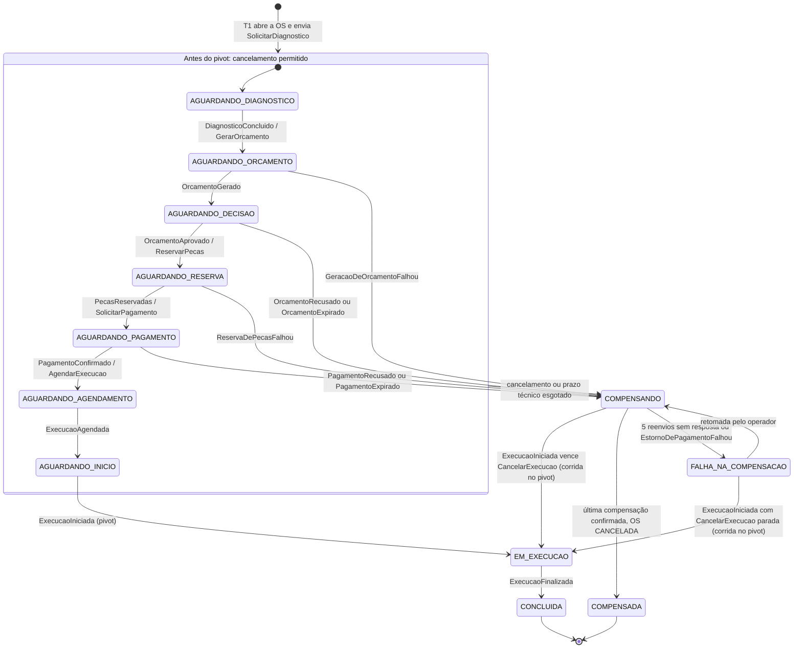

Antes do pivot, todas as etapas `AGUARDANDO_*` aceitam cancelamento. Uma falha de negócio, um cancelamento ou um prazo técnico esgotado levam a `COMPENSANDO`. A última compensação confirmada leva a saga a `COMPENSADA` e a OS a `CANCELADA`.

| Etapa | Status da OS | A saga espera |
|---|---|---|
| `AGUARDANDO_DIAGNOSTICO` | `RECEBIDA`; `EM_DIAGNOSTICO` com `DiagnosticoIniciado` | o mecânico |
| `AGUARDANDO_ORCAMENTO` | `EM_DIAGNOSTICO` | o Billing (técnico) |
| `AGUARDANDO_DECISAO` | `AGUARDANDO_APROVACAO` | o cliente, com validade no Billing |
| `AGUARDANDO_RESERVA` | `AGUARDANDO_APROVACAO` | a Execução (técnico) |
| `AGUARDANDO_PAGAMENTO` | `AGUARDANDO_PAGAMENTO` | o Billing até `PagamentoSolicitado` (técnico); depois o cliente, com validade no Billing |
| `AGUARDANDO_AGENDAMENTO` | `AGUARDANDO_EXECUCAO` | a Execução (técnico) |
| `AGUARDANDO_INICIO` | `AGUARDANDO_EXECUCAO` | o mecânico |
| `EM_EXECUCAO` | `EM_EXECUCAO` | o mecânico |
| `CONCLUIDA` | `FINALIZADA`; `ENTREGUE` no T10, fora da saga | ninguém |
| `COMPENSANDO`, `FALHA_NA_COMPENSACAO` | mantém o anterior; o histórico mostra a compensação | os participantes; o operador, por alerta |
| `COMPENSADA` | `CANCELADA`, com o motivo | ninguém |

"Técnico" é a espera por resposta automática, com prazo no orquestrador. A `MaquinaDeStatus` da fase 3 continua como guarda, com a lista de transições permitidas:

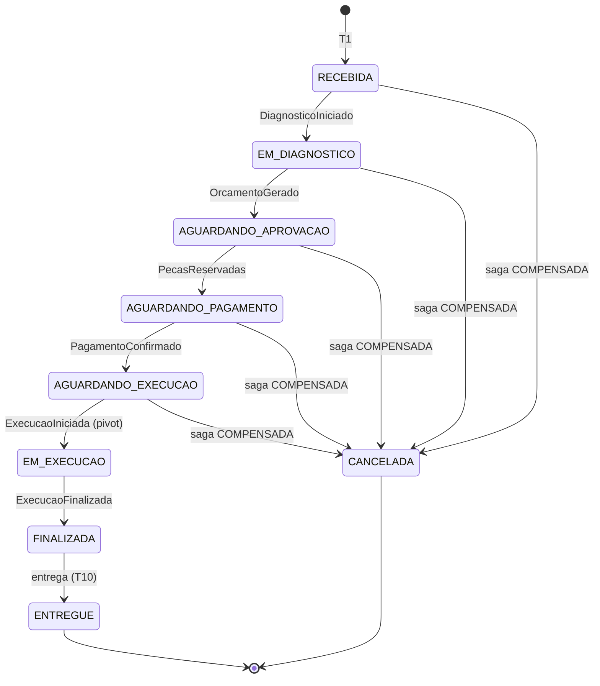

A OS só chega a `CANCELADA` a partir de status anteriores a `EM_EXECUCAO`. `AGUARDANDO_PAGAMENTO` e `AGUARDANDO_EXECUCAO` são status novos. O orçamento complementar da fase 1 saiu do escopo: com o pagamento integral e antecipado, seria uma segunda cobrança sobre OS já paga, e um serviço extra achado na execução vira OS nova.

### 7.3 Passos, compensações e tipos

| Passo (dono) | Comando | Sucesso | Falha de negócio | Compensação | Tipo |
|---|---|---|---|---|---|
| T1 abrir OS (OS Service) | nenhum | OS `RECEBIDA` | nenhuma | OS `CANCELADA` | compensável |
| T2 diagnóstico (Execução) | `SolicitarDiagnostico` | `DiagnosticoIniciado`, `DiagnosticoConcluido` | nenhuma | `DescartarDiagnostico` | compensável |
| T3 orçamento (Billing) | `GerarOrcamento` | `OrcamentoGerado` | `GeracaoDeOrcamentoFalhou` | `CancelarOrcamento` | compensável |
| T4 decisão do cliente (Billing) | nenhum (espera humana) | `OrcamentoAprovado` | `OrcamentoRecusado`, `OrcamentoExpirado` | nenhuma | desfecho de negócio |
| T5 reserva de peças (Execução) | `ReservarPecas` | `PecasReservadas` | `ReservaDePecasFalhou` | `LiberarReserva` | compensável |
| T6 pagamento (Billing e Mercado Pago) | `SolicitarPagamento` | `PagamentoSolicitado`, `PagamentoConfirmado` | `PagamentoRecusado`, `PagamentoExpirado` | `EstornarPagamento` | compensável |
| T7 agendamento (Execução) | `AgendarExecucao` | `ExecucaoAgendada` | nenhuma | `CancelarExecucao` | compensável |
| T8 início da execução (Execução, pelo mecânico) | nenhum | `ExecucaoIniciada` | nenhuma | nenhuma | pivot |
| T9 finalização (Execução) | nenhum | `ExecucaoFinalizada`, com a baixa do estoque | nenhuma | nenhuma | reprocessável |
| T10 entrega (OS Service, fora da saga) | nenhum | OS `ENTREGUE` | nenhuma | nenhuma | reprocessável |

Compensável, pivot e reprocessável são os termos de Richardson, referência da disciplina. "Nenhuma" na coluna de falha quer dizer sem evento de falha de negócio: a falha técnica é coberta pelo prazo técnico, quando o passo tem resposta automática, ou pela DLQ com alerta. A reserva (T5) vem antes do pagamento (T6), como no exemplo da Aula 01 de SAGA Pattern, e a OS só entra na fila de execução (T7) com o pagamento confirmado (RN-027). Assim, a falta de peça aparece antes da cobrança, sem estorno.

### 7.4 Sequências

Os quatro diagramas de sequência vêm depois das descrições, na mesma ordem. Neles, setas de ponta aberta são mensagens assíncronas (outbox, relay, exchange, fila e consumidor), e as chamadas REST de fora do cluster passam pelo Kong, omitido.

**(a) Caminho feliz, da abertura à entrega.** O atendente abre a OS; a transação grava a OS `RECEBIDA`, a saga em `AGUARDANDO_DIAGNOSTICO` e o comando na outbox. O mecânico conclui o diagnóstico depois de a Execução validar os preços no Billing por REST. O Billing gera o orçamento, o OS Service manda o e-mail com o link, o cliente aprova, a Execução reserva as peças e o Billing cria a cobrança no Mercado Pago. A confirmação chega pelo webhook ou, sem ele, pela conciliação em até 30 s. Depois vêm o agendamento, o início (o pivot), a finalização com a baixa das peças e a entrega.

**(b) Orçamento recusado ou expirado.** O cliente recusa pelo link, ou o `prazos` do Billing expira o orçamento ainda sem decisão. O orçamento já está encerrado no Billing, então o plano só descarta o diagnóstico e cancela a OS (RN-024).

**(c) Falta de peça na reserva.** A Execução trava os itens com lock pessimista, acha saldo insuficiente e não reserva nada. Nenhum pagamento foi solicitado: a saga cancela o orçamento, descarta o diagnóstico e cancela a OS sem cobrar o cliente (RN-026).

**(d) Cancelamento depois do pagamento, com estorno.** Com a OS paga e na fila, o atendente cancela e recebe 202 com a etapa `COMPENSANDO`. A execução sai da fila antes do estorno, para nenhum mecânico começar o reparo de uma OS com o pagamento devolvido. O Billing confere o pagamento no Mercado Pago e estorna com a chave de idempotência `estorno-{pagamento_id}`. Se o provedor recusar o estorno, a saga vai a `FALHA_NA_COMPENSACAO` e espera o operador.

**Pagamento recusado ou expirado.** A RFC não tem diagrama próprio para este caso. O Billing publica `PagamentoRecusado`, na recusa de número `PAGAMENTO_MAX_RECUSAS` (padrão 3), ou `PagamentoExpirado`, quando o `prazos` vence a cobrança depois de `PAGAMENTO_VALIDADE_MINUTOS` (padrão 60). A saga segue o trecho (d) a partir de `LiberarReserva`, sem estorno, porque nada foi cobrado: `LiberarReserva`, `CancelarOrcamento`, `DescartarDiagnostico` e OS `CANCELADA` (RN-025). O cenário BDD "Pagamento recusado no simulador libera a reserva e cancela o orçamento" confere essa ordem ([seção 8.3](#83-bdd)).

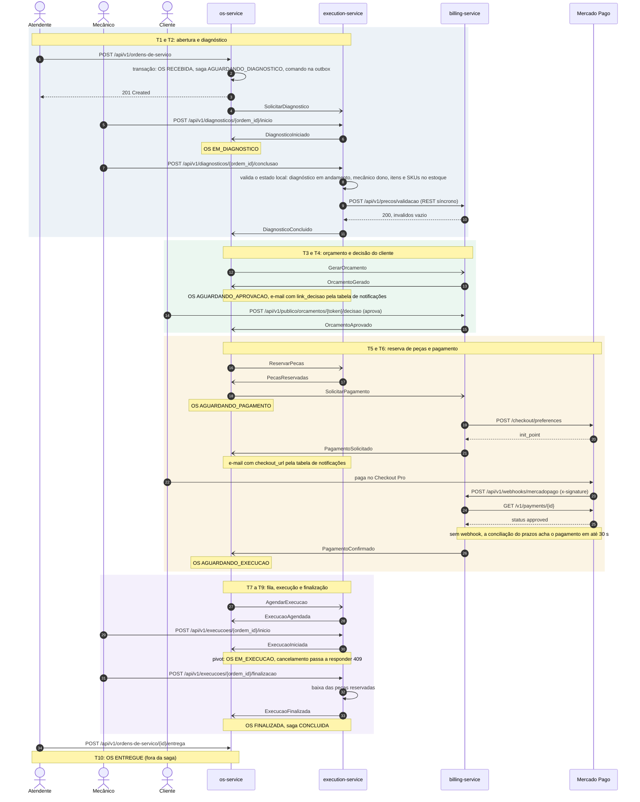

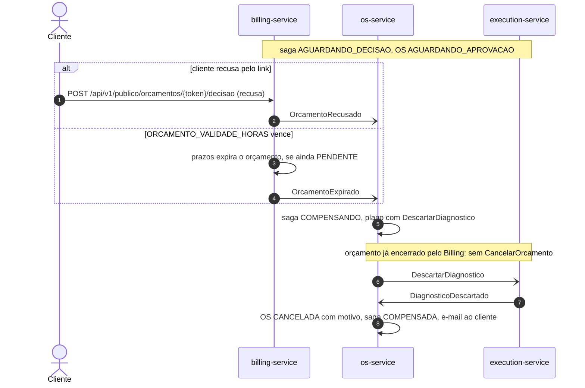

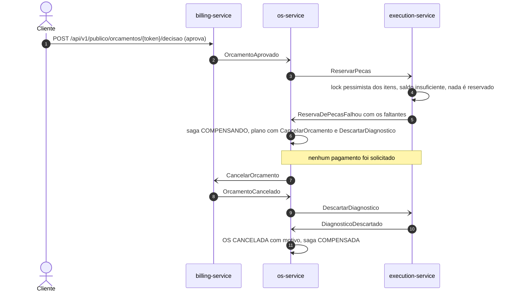

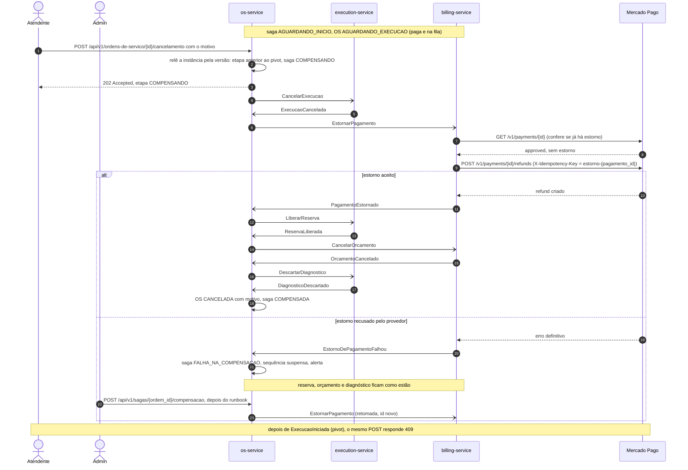

### 7.5 Plano de compensação

As compensações rodam em sequência, cada uma esperando a resposta da anterior, na ordem inversa dos passos: `CancelarExecucao`, `EstornarPagamento`, `LiberarReserva`, `CancelarOrcamento`, `DescartarDiagnostico`, OS `CANCELADA` e saga `COMPENSADA`. O plano inclui os passos concluídos e o passo em voo, cujo comando saiu e ainda não teve resposta: ele pode estar na fila ou em retry, e o efeito dele também precisa ser desfeito. O passo que falhou por regra de negócio fica de fora, porque o participante já o encerrou.

| Etapa | Gatilho | Compensações, em ordem |
|---|---|---|
| `AGUARDANDO_DIAGNOSTICO` | cancelamento | `DescartarDiagnostico` |
| `AGUARDANDO_ORCAMENTO` | `GeracaoDeOrcamentoFalhou` | `DescartarDiagnostico` |
| `AGUARDANDO_ORCAMENTO` | cancelamento ou prazo técnico esgotado, com `GerarOrcamento` em voo | `CancelarOrcamento`, `DescartarDiagnostico` |
| `AGUARDANDO_DECISAO` | `OrcamentoRecusado` ou `OrcamentoExpirado` | `DescartarDiagnostico` |
| `AGUARDANDO_DECISAO` | cancelamento | `CancelarOrcamento`, `DescartarDiagnostico` |
| `AGUARDANDO_RESERVA` | `ReservaDePecasFalhou` | `CancelarOrcamento`, `DescartarDiagnostico` |
| `AGUARDANDO_RESERVA` | cancelamento ou prazo técnico esgotado, com `ReservarPecas` em voo | `LiberarReserva`, `CancelarOrcamento`, `DescartarDiagnostico` |
| `AGUARDANDO_PAGAMENTO` | `PagamentoRecusado` ou `PagamentoExpirado` | `LiberarReserva`, `CancelarOrcamento`, `DescartarDiagnostico` |
| `AGUARDANDO_PAGAMENTO` | cancelamento ou prazo técnico esgotado | `EstornarPagamento`, `LiberarReserva`, `CancelarOrcamento`, `DescartarDiagnostico` |
| `AGUARDANDO_AGENDAMENTO` | cancelamento ou prazo técnico esgotado, com `AgendarExecucao` em voo | `CancelarExecucao`, `EstornarPagamento`, `LiberarReserva`, `CancelarOrcamento`, `DescartarDiagnostico` |
| `AGUARDANDO_INICIO` | cancelamento | `CancelarExecucao`, `EstornarPagamento`, `LiberarReserva`, `CancelarOrcamento`, `DescartarDiagnostico` |
| `EM_EXECUCAO` e depois | cancelamento | nenhuma: 409 `TRANSICAO_STATUS_INVALIDA` (RN-029) |

O `EstornarPagamento` compensa o T6 em qualquer estado do pagamento: com a cobrança aberta, o Billing a cancela e responde `PagamentoCancelado`; com o pagamento confirmado, estorna no Mercado Pago e responde `PagamentoEstornado`. Uma aprovação que chega depois do cancelamento, da expiração ou da recusa é estornada pelo próprio Billing, com o motivo `pagamento_apos_encerramento`.

### 7.6 Pivot e cancelamento

O pivot é o início da execução física (T8): depois que o mecânico começa a desmontar o carro, o trabalho não se desfaz por mensagem (RN-029). Até ali tudo compensa, inclusive o pagamento, por estorno. As respostas do cancelamento e da retomada dependem da etapa:

| Pedido | Etapa da saga | Resposta |
|---|---|---|
| `POST /api/v1/ordens-de-servico/{id}/cancelamento` | `AGUARDANDO_*`, antes do pivot | 202 com a etapa `COMPENSANDO`; a compensação começa |
| cancelamento, inclusive repetido | `COMPENSANDO` ou `FALHA_NA_COMPENSACAO` | 202 com a etapa atual, sem novo efeito |
| cancelamento | `EM_EXECUCAO` ou `CONCLUIDA` | 409 `TRANSICAO_STATUS_INVALIDA`, "Cancelamento recusado: execução já iniciada" |
| cancelamento | `COMPENSADA` | 409, "Ordem já cancelada" |
| `POST /api/v1/sagas/{ordem_id}/compensacao` (admin) | `FALHA_NA_COMPENSACAO` | 202 com a etapa `COMPENSANDO`; a compensação que parou sai de novo |
| retomada | qualquer outra | 409 |

Na corrida do pivot, decide a transação da Execução. Se o início vencer, o `ExecucaoIniciada` que chega com só o `CancelarExecucao` sem resposta devolve a saga a `EM_EXECUCAO`, e o pedido de cancelamento é descartado. A Execução dá *ack* no `CancelarExecucao` atrasado e o ignora: quem resolve a corrida é o evento.

### 7.7 Idempotência, outbox e isolamento

**Outbox transacional.** Nos três serviços, a mensagem de saída é gravada na transação do efeito. No PostgreSQL (OS Service e Execução), o relay da fase 3 continua, com `pg_notify`, polling de segurança, `FOR UPDATE SKIP LOCKED` e lease, e a linha só vira entregue depois da confirmação do broker. No MongoDB (Billing), a coleção `outbox` entra na transação multidocumento, e o relay faz polling com *claim* atômico. Com o broker fora, as mensagens esperam na outbox e nada se perde.

**Consumidor idempotente (RN-028).** O consumidor grava o `id` da mensagem em `mensagens_processadas` na transação do efeito. Evento repetido recebe *ack* sem efeito. Comando repetido, pelo mesmo `id` ou pela mesma chave de negócio (uma reserva por OS, uma cobrança por orçamento), republica a resposta registrada. A entrega é pelo menos uma vez; o efeito acontece uma vez.

**Correlação.** O orquestrador reconhece a resposta ao comando em voo pelo `causation_id`, que leva o `id` do comando respondido. A instância guarda o `id` de cada envio desse comando (o original, os reenvios e o da retomada), e a resposta a qualquer um deles vale. O tipo ou o motivo do evento não bastariam: um estorno automático também chega como `PagamentoEstornado`.

**Isolamento.** A saga não tem o "I" do ACID, e o ADR-035 aplica as contramedidas da Aula 03 de SAGA Pattern. Cada transição relê a OS e a instância e grava conferindo a versão (lock otimista). O estorno só sai depois de `ExecucaoCancelada` (visão pessimista). As etapas `AGUARDANDO_*` recusam comandos fora de hora. Evento de etapa já passada é ignorado com log; evento adiantado volta pelo retry até a saga alcançá-lo. A compensação que chega antes do comando original cria o registro já no estado final (lápide), e o comando atrasado é descartado ao chegar.

**Reserva tudo ou nada.** A Execução trava os itens com `SELECT ... FOR UPDATE`, limitado por `lock_timeout` e sempre em ordem de `sku`, para duas reservas nunca travarem em ordem oposta. Quem perde a disputa pela última unidade recebe `ReservaDePecasFalhou`, e não um erro de lock.

### 7.8 Retentativas, DLQ e prazos

| Parâmetro | Padrão | Efeito |
|---|---|---|
| Atrasos das filas de retry | 1, 5, 15, 60 e 300 s | uma fila por atraso, porque o TTL só vence na cabeça da fila; a falha seguinte à quinta vai para a DLQ |
| `delivery-limit` das filas de trabalho | 5 entregas | a mensagem que derruba o consumidor a cada entrega vai para a DLQ na sexta |
| TTL das `.dlq` | 7 dias | mensagem não reprocessada expira; ela pode levar a placa do veículo |
| `SAGA_PRAZO_RESPOSTA_SEGUNDOS` | 120 s | espera por resposta a um comando, contada da saída da outbox |
| `SAGA_MAX_REENVIOS` | 5 | esgotados, a saga compensa; numa compensação, vai a `FALHA_NA_COMPENSACAO` |
| `ORCAMENTO_VALIDADE_HORAS` | 72 h | validade do orçamento e do link de decisão |
| `PAGAMENTO_VALIDADE_MINUTOS` | 60 min | validade da cobrança e da preferência no Mercado Pago |
| `PAGAMENTO_MAX_RECUSAS` | 3 | recusas do provedor até o pagamento virar `RECUSADO` |
| `PRAZOS_INTERVALO_SEGUNDOS` | 30 s | ciclo do `prazos`; no Billing, também da conciliação |
| Retenção da outbox e de `mensagens_processadas` | 7 e 30 dias | a janela de idempotência fica bem acima dos 7 dias da DLQ |

Com os padrões, o comando original e os cinco reenvios cobrem 12 minutos, mais que a soma dos atrasos de retry do consumidor (381 s). Um teste da configuração do OS Service confere essa relação. O prazo só corre depois que o comando sai da outbox, e, sem consumidor na fila `os.eventos` ou com o broker fora, o `prazos` não reenvia nem esgota prazo, porque a resposta pode estar parada na fila. A mensagem esgotada vai para a DLQ e dispara o alerta. Corrigida a causa, volta à fila com `make -C platform redrive FILA=<fila>`, conforme o [runbook da saga](../../operacao/runbook-saga.md).

### 7.9 Falha na compensação e retomada

Uma compensação que esgota os reenvios, ou um `EstornoDePagamentoFalhou`, leva a saga a `FALHA_NA_COMPENSACAO`. A sequência para, o alerta "Saga parada" dispara, e o que já foi compensado continua compensado. O operador segue o [runbook da saga](../../operacao/runbook-saga.md): consulta `GET /api/v1/sagas/{ordem_id}`, resolve a causa (no estorno recusado, faz o estorno pelo painel do Mercado Pago) e retoma com `POST /api/v1/sagas/{ordem_id}/compensacao`, rota restrita ao admin. A retomada reenvia a compensação que parou, com `id` novo, e segue o plano até `COMPENSADA`. Como o Billing consulta o pagamento antes de estornar, o estorno feito no painel é reconhecido sem nova chamada ao provedor.

## 8. Testes e qualidade

O enunciado pede testes unitários em todos os serviços, ao menos um fluxo completo com BDD, cobertura mínima de 80% por serviço e SonarQube ou similar no CI (l. 81 a 84). Cada repositório prova o que lhe cabe no próprio CI, e o fluxo completo roda com os três serviços no kind ([ADR-041](../../arquitetura/adr/fase4/041-estrategia-de-testes-e-qualidade.md)).

### 8.1 Pirâmide por serviço

| Nível | OS Service | Billing | Execução |
|---|---|---|---|
| Unitários | domínio e aplicação; tabela de etapas da saga; matriz de classificação dos eventos (12 etapas, 10 perfis de OS e 23 tipos); plano de compensação; testes de propriedade com mil sementes, com eventos embaralhados, repetidos e atrasados | domínio; matrizes de transição do orçamento e do pagamento; link assinado; contrato do adapter do Mercado Pago; circuit breaker; JWKS com chave RSA gerada no teste | domínio; status do diagnóstico e da execução; reserva e saldo; cliente da validação de preços (timeout, retry com jitter, circuit breaker e 4xx virando 502); placa; JWT |
| Integração, com testcontainers | PostgreSQL 16 e RabbitMQ 4.3.6 reais: relay, consumidor, retry, DLQ, prazos com duas réplicas, redrive e o trace da saga | MongoDB 7 em replica set e RabbitMQ: outbox atômica, idempotência e corridas entre decisão, webhook e expiração | PostgreSQL 16 e RabbitMQ: comando de ponta a ponta, relay com duas réplicas, disputa pela última unidade e papéis do banco |
| BDD de componente | 28 cenários e 7 esquemas de cenário, com um barramento em memória no lugar do RabbitMQ | sem Gherkin: os casos ficam nos testes acima | sem Gherkin: os casos ficam nos testes acima |
| Contrato | schemas de mensagem copiados do `platform`, com o checksum conferido | o mesmo, mais o adapter do Mercado Pago | o mesmo |
| Testes no CD da `main` de 20/10/2026 | 10.312 | 1.731 | 1.475 |

O fluxo completo em BDD roda no `platform`, contra os três serviços ([seção 8.3](#83-bdd)). O `platform` tem os próprios 3.366 testes: os contratos de mensageria (com negativos gerados a partir dos exemplos), a consistência dos dashboards e alertas, os scripts de deploy e smoke e o código auxiliar do E2E.

### 8.2 Cobertura

O gate é de 95%, com linhas e ramos somados, no `.coveragerc` de cada serviço, e de 90% no código novo de cada pull request (`diff-cover`). O enunciado pede 80%. Ficam fora da medição só o que não tem lógica executável: os `__init__.py`, os `Protocol` de portas e repositórios e o `if __name__ == "__main__"` dos processos.

| Serviço | Linhas | Ramos | No gate | Medido em |
|---|---|---|---|---|
| OS Service | 6.254 | 928 | 99,61% | job `test` do [CD 39449191933](https://github.com/fiap-postech-sw-architecture/postech-sw-arch-p4-os-service/actions/runs/39449191933) |
| Billing | 4.536 | 624 | 100,00% | job `test` do [CD 39449241713](https://github.com/fiap-postech-sw-architecture/postech-sw-arch-p4-billing-service/actions/runs/39449241713) |
| Execução | 3.681 | 492 | 100,00% | job `test` do [CD 39449216419](https://github.com/fiap-postech-sw-architecture/postech-sw-arch-p4-execution-service/actions/runs/39449216419) |

A seção Cobertura do README de cada serviço traz a tabela por contexto e por camada, gerada do `coverage.xml` de um run do CI por `scripts/cobertura_resumo.py`; um teste reprova a tabela editada à mão. O [registro de cobertura](evidencias/coverage.md) guarda as três tabelas para quando os artefatos expirarem. No OS Service, o número oscila entre 99,61% e 99,62% com o mesmo código: um ramo de concorrência de `encryption.py` só roda quando as threads do teste se cruzam no lock.

### 8.3 BDD

O fluxo completo roda em Gherkin, em português, no [`e2e/features/saga_atendimento.feature`](../../../e2e/features/saga_atendimento.feature) do `platform`, com 14 cenários contra os três serviços implantados no kind. Roda no `deploy-kind` do CD de cada serviço e no job `e2e` do CD do `platform`. O pagamento usa o simulador do Mercado Pago, que percorre o mesmo caso de uso do webhook. Cada cenário cria os próprios clientes, peças e OS. No último CD do `platform` ([run 39458619627](https://github.com/fiap-postech-sw-architecture/postech-sw-arch-p4-platform/actions/runs/39458619627)), os 14 passaram em 206,65 s.

| Cenário | Tags | O que prova |
|---|---|---|
| A OS percorre os três serviços da abertura à entrega | `@caminho-feliz` | os oito status em ordem; orçamento de R$ 210,00; e-mail com o link; reserva e baixa do estoque; saga concluída; trace com spans dos três serviços; `X-Request-ID` do Kong no log do OS Service |
| O cliente recusa o orçamento pelo link | `@compensacao` | OS cancelada; só o `DescartarDiagnostico` é enviado |
| Falta de peça cancela a OS sem cobrar o cliente | `@compensacao` | `CancelarOrcamento` e `DescartarDiagnostico`; nenhum pagamento solicitado; saldo intacto |
| Pagamento recusado no simulador libera a reserva e cancela o orçamento | `@compensacao` | `LiberarReserva`, `CancelarOrcamento` e `DescartarDiagnostico`; pagamento `RECUSADO`, sem estorno |
| Cancelamento depois do pagamento estorna o valor e devolve as peças | `@compensacao` `@estorno` | as cinco compensações na ordem; pagamento `ESTORNADO`; e-mail de cancelamento |
| CPF com dígito verificador errado é recusado e o acompanhamento não o distingue de um CPF inexistente | `@validacao` | 422 `VALOR_INVALIDO`; o mesmo 404 para CPF inválido e para CPF inexistente |
| Depois do início da execução a OS não pode mais ser cancelada | `@ponto-de-nao-retorno` | 409 `TRANSICAO_STATUS_INVALIDA`; a OS continua `em_execucao` |
| Orçamento sem decisão vence e a OS é cancelada | `@expiracao` | `OrcamentoExpirado` e `DescartarDiagnostico`, com a validade de 72 s do overlay `kind-ci` |
| Consumidor do Billing parado por 20 segundos não perde o fluxo | `@resiliencia` | a saga espera em `aguardando_orcamento` e segue na volta, sem mensagem nova nas DLQs |
| API do Billing parada abre o circuito e a conclusão volta com o Billing | `@resiliencia` | duas respostas 503, circuito aberto, conclusão aceita depois que o Billing volta |
| O Swagger de cada serviço abre pelo Kong sob o prefixo do serviço (três exemplos) | `@borda` | `/os/docs`, `/billing/docs` e `/execucao/docs` |
| As métricas das OS pela borda exigem o administrador e trazem os nove status | `@borda` | 401 sem token e 200 para o admin, com os nove status |

O `make demo` roda os cenários marcados com `@demo` e mostra o status da OS depois de cada verificação; são os blocos 1 e 2 do vídeo. Os três cenários de `e2e/features/mercadopago_sandbox.feature` usam a sandbox real do Mercado Pago e ficam fora do CI, porque o CD não tem credencial ([seção 15](#15-pendências-até-a-submissão)).

No OS Service, o BDD de componente ([`tests/bdd/`](https://github.com/fiap-postech-sw-architecture/postech-sw-arch-p4-os-service/tree/main/tests/bdd)) tem 28 cenários e 7 esquemas de cenário, com o serviço sobre o PostgreSQL de teste e um barramento em memória no lugar do RabbitMQ. Cobre cada falha de negócio, o cancelamento em cada etapa com a ordem das compensações, a corrida do pivot nos dois sentidos, o estorno recusado, os reenvios e o esgotamento do prazo técnico e a retomada.

### 8.4 Collection com Newman

A [collection do fluxo completo](../../api/fluxo-completo.postman_collection.json) autentica admin, atendente e mecânico e leva uma OS pelos três serviços até a entrega, pela borda do Kong e com o simulador do Mercado Pago. Roda com o Newman 6.2.3 no job `e2e` do CD do `platform`, depois do BDD.

| Execução | Assertions | Requisições | Falhas |
|---|---|---|---|
| CI do [platform #24](https://github.com/fiap-postech-sw-architecture/postech-sw-arch-p4-platform/pull/24), [run 39230026573](https://github.com/fiap-postech-sw-architecture/postech-sw-arch-p4-platform/actions/runs/39230026573), 19/10/2026 | 105 | 48 | 0 |
| CD da `main` em `bfa8c72`, [run 39231733886](https://github.com/fiap-postech-sw-architecture/postech-sw-arch-p4-platform/actions/runs/39231733886), 19/10/2026 | 105 | 48 | 0 |
| CD da `main` em `d703200`, [run 39458619627](https://github.com/fiap-postech-sw-architecture/postech-sw-arch-p4-platform/actions/runs/39458619627), 20/10/2026 | 108 | 49 | 0 |

O número de assertions varia com as consultas de espera assíncrona. Cada execução confere o histórico de oito status, o pagamento de R$ 210,00 confirmado, o estoque reservado (10 disponíveis e 2 reservados) e depois baixado (8 disponíveis e nenhum reservado), a saga concluída e a rota de métricas: 401 sem token, 403 para atendente e mecânico e 200 para o admin, com os nove status. O [resumo das execuções](evidencias/newman-resumo.md) guarda os JSON sanitizados.

### 8.5 Teste de mutação

A cobertura diz que a linha rodou; a mutação diz se a suíte percebe quando ela está errada. Não é gate de CI. O `mutmut` 3.8.0 não roda em pacote chamado `src`, o caso dos três serviços. Por isso cada serviço tem uma lista de mutantes escritos à mão nos módulos críticos (`scripts/mutantes.toml`) e o mesmo script, que aplica um por vez numa cópia do código e roda só os testes que deveriam pegá-lo (`make mutacao`).

| Serviço | Mutantes | Mortos | Equivalentes | Medido em | Áreas |
|---|---|---|---|---|---|
| OS Service | 60 | 60 | 0 | 18/10/2026 | status da OS, classificação, transições, prazos e compensação da saga, orquestrador, consumidor, idempotência, relay, JWT e CPF |
| Billing | 74 | 72 | 2 | 19/10/2026 | `Dinheiro`, status do orçamento e do pagamento, JWT, idempotência, consumidor, relay, compensação e observabilidade |
| Execução | 95 | 94 | 1 | 18/10/2026 | status da execução e do diagnóstico, reserva e saldo, saga, idempotência e concorrência, placa, JWT, consumidor e relay |

Os equivalentes ficam fora da conta, com o motivo registrado no `mutantes.toml`. Cada sobrevivente achado virou teste, listado na seção Mutação do README do serviço. A lista é curada: o percentual diz que a suíte pega esses defeitos, e não se compara ao de uma ferramenta que gera mutantes sozinha.

### 8.6 SonarQube

Cada CI sobe um SonarQube Community efêmero no runner, analisa o código com o `coverage.xml` do job `test` e reprova o run se o quality gate falhar. O gate, versionado em `.sonar/quality-gate.json`, é o mesmo nos três serviços: cobertura de pelo menos 80%, no máximo 3% de linhas duplicadas e nota A em confiabilidade, segurança e manutenibilidade. Resultado no último CD da `main`, tirado do artefato `sonarqube` de cada run:

| Serviço | Linhas analisadas | Cobertura (Sonar) | Bugs, vulnerabilidades e hotspots | Code smells | Duplicação | Gate |
|---|---|---|---|---|---|---|
| OS Service | 11.107 | 97,2% | 0, 0 e 0 | 138 | 0,0% | aprovado |
| Billing | 7.790 | 98,8% | 0, 0 e 0 | 91 | 0,0% | aprovado |
| Execução | 6.077 | 98,6% | 0, 0 e 0 | 18 | 0,0% | aprovado |

Os code smells têm nota A de manutenibilidade e não reprovam o gate; os principais estão na dívida aceita ([seção 14](#14-dívida-técnica-aceita)). O SonarQube calcula a cobertura com fórmula própria, por isso o número difere do gate do coverage.py. O servidor é efêmero e não guarda histórico: a evidência permanente são os logs, os artefatos e o [resumo do SonarQube](evidencias/coverage.md#sonarqube).

## 9. CI/CD e deploy

### 9.1 Workflows e jobs

Cada serviço tem três workflows, com jobs de nome estável, que são os checks obrigatórios do ruleset ([ADR-042](../../arquitetura/adr/fase4/042-cicd-e-deploy-kubernetes.md)):

| Workflow | Gatilho | Jobs |
|---|---|---|
| `ci.yml` | pull request; chamado pelo `cd.yml` na `main` | `lint` (ruff e import-linter), `type-check` (mypy strict), `security` (bandit), `test` (unitários, integração, contrato e BDD, com os gates de cobertura), `sonarqube` e `build` (manifestos e smoke da imagem) |
| `security.yml` | pull request; chamado pelo `cd.yml`; toda segunda-feira | `pip-audit`, `gitleaks` e `trivy` |
| `cd.yml` | push na `main`; disparo manual com SHAs fixos | `ci` e `security-scan`, depois `image`, `deploy-kind` e `deploy-remote` (desligado) ou `remote-skipped` |
| `ci.yml` do `platform` | pull request; chamado pelo CD | `manifests`, `contratos` e `gitleaks` |
| `cd.yml` do `platform` | pull request, push na `main` e disparo manual | `ci`, depois `deploy-kind` (plataforma e smoke) e `e2e` (plataforma, três serviços, smoke, BDD, Newman e ZAP), em paralelo |

O CD só começa depois que o CI do mesmo commit passa: o `cd.yml` chama o `ci.yml` e o `security.yml` como workflows reutilizáveis, e o `image` depende dos dois. A execução semanal do `security.yml` acha CVE nova em dependência ou imagem base sem esperar o próximo PR. Só roda um CD por vez em cada repositório, sem cancelar o que está em curso, para dois pushes seguidos não implantarem fora de ordem.

### 9.2 O CD de cada serviço

O diagrama da [seção 5.6](#56-implantação-e-pipeline) mostra o caminho do push ao kind. O job `deploy-kind` faz, nesta ordem:

1. escolhe o commit do `platform` e dos dois serviços vizinhos: o do último CD verde de cada um na `main`, para que a `main` quebrada de um vizinho não derrube o CD dos outros;
2. baixa o tar da imagem que o `image` acabou de publicar, para o E2E testar a mesma imagem que foi ao GHCR;
3. cria o kind com kind e kubectl de versão e sha256 fixados e implanta a plataforma no overlay `kind-ci`, gerando os Secrets no próprio run;
4. implanta os três serviços: este pelo tar, os vizinhos construídos do código, esperando o banco, o Job de migração e os Deployments, nessa ordem;
5. roda o smoke de cada namespace: rollouts, saúde e Swagger pela borda, `/metrics` fora da borda, `up` de cada pod no Prometheus e a NetworkPolicy do banco, que recusa conexão de outro namespace;
6. roda o E2E BDD da saga pela borda;
7. sempre, mesmo com falha: escreve minutos e memória no summary, varre os relatórios atrás de segredo e publica o artefato `e2e-kind` por 90 dias.

O job só fica verde se o E2E passar. O kind some com o job; o que fica são os relatórios e o summary do run.

### 9.3 CD compartilhado

Os jobs `image`, `deploy-kind`, `deploy-remote` e `remote-skipped` têm uma definição só, no `platform`, em `.github/workflows/cd-servico.yml`, chamada pelo `cd.yml` de cada serviço com o nome do serviço e os quatro SHAs ([platform #22](https://github.com/fiap-postech-sw-architecture/postech-sw-arch-p4-platform/pull/22); [OS #20](https://github.com/fiap-postech-sw-architecture/postech-sw-arch-p4-os-service/pull/20), [Execução #15](https://github.com/fiap-postech-sw-architecture/postech-sw-arch-p4-execution-service/pull/15) e [Billing #19](https://github.com/fiap-postech-sw-architecture/postech-sw-arch-p4-billing-service/pull/19)). Cada serviço fixa a definição por um SHA literal do `platform` e mantém os próprios gatilhos, concorrência e gates. A independência que o enunciado pede (l. 90) está no que é de cada serviço: build, testes, análise, imagem e deploy saem do pipeline dele, disparados pelo commit dele, e nenhum pipeline publica a imagem de outro.

### 9.4 Runs de referência

| Repositório | Primeiro CD compartilhado na `main` | CD na `main` de 20/10/2026 | SBOM |
|---|---|---|---|
| OS Service | [run 39233375064](https://github.com/fiap-postech-sw-architecture/postech-sw-arch-p4-os-service/actions/runs/39233375064), `5e4ed2a` | [run 39449191933](https://github.com/fiap-postech-sw-architecture/postech-sw-arch-p4-os-service/actions/runs/39449191933), `3ce582b` | 171 pacotes |
| Billing | [run 39355822794](https://github.com/fiap-postech-sw-architecture/postech-sw-arch-p4-billing-service/actions/runs/39355822794), `735a0c2` | [run 39449241713](https://github.com/fiap-postech-sw-architecture/postech-sw-arch-p4-billing-service/actions/runs/39449241713), `76b5f9b` | 147 pacotes |
| Execução | [run 39237570013](https://github.com/fiap-postech-sw-architecture/postech-sw-arch-p4-execution-service/actions/runs/39237570013), `c33824f` | [run 39449216419](https://github.com/fiap-postech-sw-architecture/postech-sw-arch-p4-execution-service/actions/runs/39449216419), `5b1bef4` | 162 pacotes |
| `platform` | não se aplica | [run 39458619627](https://github.com/fiap-postech-sw-architecture/postech-sw-arch-p4-platform/actions/runs/39458619627), `d703200` | sem imagem própria |

As imagens ficam em `ghcr.io/fiap-postech-sw-architecture/pytstop-<serviço>:<commit>`, com SBOM em SPDX e proveniência mínima. Os quatro commits de cada implantação dos primeiros CDs compartilhados estão no [registro de evidências](evidencias/README.md#cd-compartilhado-dos-serviços). Os digests publicados pelos CDs de 20/10/2026:

| Serviço | Digest da imagem |
|---|---|
| OS Service | `sha256:7e4d5d0312d7bc244f8b4c18997422f38232e106121304e0c4e1bf6e80320d59` |
| Billing | `sha256:340abc00151ffd49d835e14ceb93a02691c3147aa1f4931bda38f5973b641488` |
| Execução | `sha256:c53d188243ff3fc2b454502bcd47e77e21b0a32a856d0b8a0e167bd7e40d75f1` |

Tempo e memória do kind no runner padrão de 16 GB, medidos pelo `scripts/medir-kind.sh` e escritos no summary:

| Etapa | CD do OS Service ([run 39449191933](https://github.com/fiap-postech-sw-architecture/postech-sw-arch-p4-os-service/actions/runs/39449191933)) | Job `e2e` do `platform` ([run 39458619627](https://github.com/fiap-postech-sw-architecture/postech-sw-arch-p4-platform/actions/runs/39458619627)) |
|---|---|---|
| Criação do kind | 0 min 45 s | 0 min 44 s |
| Plataforma | 1 min 01 s | 0 min 58 s |
| Três serviços | 1 min 33 s | 1 min 37 s |
| Smoke | 0 min 21 s | 0 min 20 s |
| E2E BDD | 3 min 33 s | 3 min 33 s |
| Newman e ZAP | não roda | 0 min 37 s e 1 min 25 s |
| Total | 7 min 13 s | 9 min 18 s |
| Pico de memória do nó do kind | 7.414 MiB, com o cache de arquivos; *working set* de até 2.844 MiB | 7.431 MiB; *working set* de até 2.948 MiB |

### 9.5 Deploy remoto opcional

A fase 4 não liga nuvem: o deploy obrigatório e único é o kind efêmero do runner, e a infraestrutura AWS da fase 3 já foi desmontada. O enunciado pede deploy automatizado em Kubernetes e não cita nuvem. Para o caso de a avaliação pedir um ambiente que fique de pé, o CD tem o job `deploy-remote`, neutro de provedor e desligado pela variável `DEPLOY_REMOTO_HABILITADO`. Ligado, ele implantaria num cluster persistente o mesmo digest que passou no kind, pelo `scripts/ci/deploy-remoto.sh` do `platform`. Desligado, roda o `remote-skipped`, que só registra o aviso, como nos runs de 20/10/2026. As receitas de EKS no AWS Academy e de k3s numa VM da Azure, não executadas nesta fase, estão em [nuvem opcional](../../operacao/nuvem-opcional.md).

## 10. Relatório de análise de vulnerabilidades

A postura de segurança da fase 4 é verificada no CI de cada serviço, em todo pull request, a cada push na `main` e toda segunda-feira. O ZAP varre a borda no CD do `platform`. A tabela abaixo traz o resultado na `main` de 20/10/2026; o detalhe por ferramenta e por serviço está no [Anexo A](#anexo-a--scans-de-segurança-da-fase-4).

### 10.1 Ferramentas e resultado na `main`

| Ferramenta | Tipo | Alvo | Resultado em 20/10/2026 |
|---|---|---|---|
| bandit 1.9.4 | análise estática de segurança (SAST) | `src/` dos três serviços (no OS Service, também `scripts/`), sem filtro de severidade | nenhum achado nos três |
| pip-audit 2.10.1 | dependências com vulnerabilidade conhecida (SCA) | dependências de runtime exportadas do `uv.lock`: 70 no OS Service, 57 no Billing e 61 na Execução | nenhuma vulnerabilidade conhecida nos três |
| trivy 0.72.0 | vulnerabilidade na imagem | imagem de cada serviço (Debian 13.7 e os pacotes Python do `.venv`), HIGH e CRITICAL com correção | nenhum achado nos três |
| gitleaks | segredos no histórico | todo o histórico do commit testado: 26 commits no OS Service, 24 no Billing, 20 na Execução e 32 no `platform` | nenhum vazamento; o controle negativo do job confirma que as regras pegam senha gerada fora do lugar |
| SonarQube Community 26.9 | qualidade e segurança | código e cobertura de cada serviço | gate aprovado; 0 bugs, 0 vulnerabilidades e 0 hotspots nos três |
| OWASP ZAP 2.17.0 (baseline) | análise dinâmica (DAST) da borda | `openapi.json` de cada serviço pelo Kong, com o spider chamando cada operação | nenhuma regra em FAIL; avisos de risco baixo explicados no Anexo A |
| SBOM em SPDX | inventário de componentes | imagem publicada de cada serviço | 171, 147 e 162 pacotes |
| kubeconform e `trivy config` | manifestos | overlays `kind`, `kind-ci` e `k3s` de cada repositório | aprovados no job `build` dos serviços e no `manifests` do `platform` |

### 10.2 Postura de segurança

- **Identidade e papéis.** JWT RS256 emitido só pelo OS Service, com validade de 15 minutos e algoritmo fixo na validação; Billing e Execução validam pelo JWKS. Toda falha de credencial responde 401 com a mesma mensagem nos três serviços, inclusive um refresh usado no lugar do access; papel válido e insuficiente responde 403. A matriz de papel por rota (admin, atendente e mecânico) é única ([ADR-039](../../arquitetura/adr/fase4/039-autenticacao-entre-servicos.md)) e vira teste de 401 e 403 em cada serviço.
- **Canais públicos assinados.** O link de decisão do orçamento é assinado com HMAC-SHA256, vale uma vez e responde o mesmo 404 para token inválido, expirado ou já usado; o token nunca vai para log nem para atributo de span. O webhook do Mercado Pago confere o `x-signature` e lê o estado sempre na API do provedor, nunca no corpo da notificação. O estorno usa chave de idempotência.
- **Borda.** O Kong não revela produto nem versão (`KONG_HEADERS=off`), barra `/metrics` e `/api/v1/admin/*`, responde 404 a caminho com barra codificada (`%2F` ou `%5C`) e limita a taxa por IP do cliente: 5 por minuto no login; 10 no refresh, no logout, no acompanhamento público, no link de decisão e no simulador; 120 no webhook, em balde próprio; 60 nas demais rotas. Nos overlays do kind, os limites são multiplicados por 10, para o E2E e a demonstração.
- **Rede.** NetworkPolicy por namespace de serviço, que nega toda entrada e libera só o tráfego previsto, e o banco aceita só o próprio namespace. O smoke do CD prova o bloqueio: o banco recusa conexão de outro namespace e aceita a do próprio serviço. O `notificador` só sai para o DNS, o banco e o Mailpit.
- **Banco.** Cada PostgreSQL tem um papel por uso: o superusuário só inicializa o banco, o dono das tabelas faz a migração, a aplicação só tem DML e o exporter só `pg_monitor`. A autenticação é `scram-sha-256` também na loopback, para um sidecar não entrar sem senha. O MongoDB tem usuários separados para o serviço e o exporter, com keyfile no replica set.
- **Broker.** Um usuário por serviço, sem permissão de configure, com permissão de tópico só nas próprias routing keys, e o consumidor confere o `user_id` de cada mensagem.
- **Segredos.** Nenhum segredo de aplicação fica no GitHub. As senhas, a chave RSA do JWT, a chave HMAC do link e a chave que cifra os dados pessoais nascem no cluster no primeiro deploy, pelo `scripts/gerar-segredos.sh`; o CD publica imagem só com o `GITHUB_TOKEN` do workflow.
- **LGPD.** O documento do cliente fica cifrado no OS Service, com um hash para a busca, e as mensagens não levam nome, documento nem contato. A placa vai à Execução porque o mecânico precisa achar o carro; na eliminação de dados, o OS Service envia `AnonimizarVeiculo`, e a Execução troca a placa por um marcador e apaga os textos livres do diagnóstico. Texto livre nunca vai para log. O acompanhamento público valida CPF e CNPJ pelo dígito verificador (módulo 11) antes de consultar o banco e dá o mesmo 404 para documento inválido e para OS não encontrada.
- **Pods.** As APIs rodam como o usuário 1001, sem root, sem escalar privilégio, sem capability, com seccomp `RuntimeDefault` e raiz somente leitura.

### 10.3 Riscos aceitos

| Risco | Tratamento |
|---|---|
| Tráfego interno do cluster sem TLS | NetworkPolicy por namespace; risco aceito do ambiente de demonstração |
| Token revogado no logout ainda vale por até 15 minutos no Billing e na Execução | Validade curta, na faixa da Aula 04 de Estrutura de Microsserviços; a revogação vale de imediato no OS Service |
| Mailpit da demonstração sem autenticação nem regra de entrada | Só dados fictícios; um SMTP real exigiria STARTTLS e credencial em Secret |
| Controller do Kong com `list` e `watch` nos Secrets dos quatro namespaces | Alcance limitado aos quatro namespaces da fase; tirar a regra de Secrets das Roles está na dívida técnica |
| Imagens da plataforma herdadas da fase 3 com CVE sem correção na própria linha (Prometheus 2.54.1, Loki 2.9.8, kube-state-metrics 2.13.0) e exporters com achados HIGH em bibliotecas Go compiladas | Rodam só dentro do cluster, sem Ingress; sair delas é trocar de linha (Prometheus 3, Loki 3), com mudança de configuração |
| Promtail em fim de vida desde 02/03/2026 | Mantido porque o enunciado pede as ferramentas da fase 3 (l. 102); a saída é o Grafana Alloy |
| Simulador do Mercado Pago ligado num ambiente com URL pública | O boot recusa o simulador com `ENVIRONMENT=production`, salvo liberação explícita; as rotas dele exigem token HMAC e têm rate limit |

### 10.4 Documentos completos

| Documento | Onde está |
|---|---|
| Scans de segurança da fase 4, por ferramenta e por serviço | [Anexo A](#anexo-a--scans-de-segurança-da-fase-4) |
| ZAP baseline: comando, regras e o que cada aviso significa | [README do `platform`, ZAP baseline na borda](../../../README.md#zap-baseline-na-borda) |
| Segredos gerados no deploy, com a regra de rotação | [README do `platform`, Segredos gerados](../../../README.md#segredos-gerados) e [ADR-042](../../arquitetura/adr/fase4/042-cicd-e-deploy-kubernetes.md) |
| Decisões e limites da plataforma, com as CVEs aceitas | [README do `platform`, Decisões e limites](../../../README.md#decisões-e-limites) |
| Riscos e limitações da arquitetura | [RFC-004, seção 11](../../arquitetura/rfc/fase4/rfc-004-microsservicos-saga.md#11-riscos-limitações-e-pontos-em-aberto) |

## 11. Observabilidade

### 11.1 Componentes

A stack da fase 3 passou para o `platform` e serve os três serviços, cada um com `service.name` próprio ([ADR-043](../../arquitetura/adr/fase4/043-observabilidade-distribuida.md)): Prometheus para métricas, Grafana para dashboards e alertas, Loki com Promtail para os logs e Jaeger para os traces, recebidos por OpenTelemetry. A única peça nova são os exporters dos bancos, ao lado de cada PostgreSQL e do MongoDB. No kind local, o Prometheus guarda 15 dias num volume persistente de 2 GiB, porque o painel de volume diário de OS pede dias de histórico.

### 11.2 Métricas, logs e correlação

Todo processo expõe a porta `metrics`, e o Prometheus descobre os pods dos namespaces `pytstop-*`. As métricas novas levam o prefixo `pytstop_`; as herdadas da fase 3 mantêm o nome (`outbox_pendentes`, `outbox_dead` e `http_request_duration_seconds`) para reaproveitar regras e painéis.

| Grupo | Exemplos |
|---|---|
| Saga | sagas iniciadas e finalizadas por resultado, compensações por motivo, duração por etapa, reenvios e prazos esgotados, sagas ativas por etapa, idade da mais antiga e maior prazo vencido |
| Mensageria | mensagens publicadas e consumidas por tipo e resultado, mensagens da outbox à espera e mortas, idade da mais antiga à espera, reconexões ao broker e, do RabbitMQ, profundidade de cada fila e DLQ |
| Integrações | chamadas ao Mercado Pago por operação e resultado, circuit breaker por dependência, estornos por motivo |
| Negócio | OS criadas, OS por status, tempo médio por status, tempo até a decisão do orçamento, valor dos pagamentos em centavos, tempo de execução por serviço e peças em falta |
| Segurança | webhooks com assinatura inválida, falhas na busca do JWKS e respostas 401, 403 e 429 do Kong |
| Bancos | conexões, transações, locks e tamanho de cada PostgreSQL; documentos, tamanho e estado do replica set do MongoDB |

O catálogo completo, com tipo, rótulos e o processo que emite cada métrica, está no [`observabilidade/README.md`](../../../observabilidade/README.md#catálogo-de-métricas), e um teste reprova painel ou alerta que use métrica fora dele.

Os logs são JSON, sem dado pessoal, com `correlation_id` (o `ordem_id`), `trace_id`, `span_id` e `request_id`. Uma busca por `correlation_id` no Loki traz a OS nos três serviços, e o `trace_id` leva ao trace no Jaeger. O `X-Request-ID` nasce na borda, no plugin `correlation-id` do Kong.

### 11.3 Rastreamento da saga

Cada saga é um trace no Jaeger, com raiz na abertura da OS. A propagação pela mensageria é código próprio: a outbox grava o `traceparent` de quem a escreveu, o relay publica como filho desse contexto e escreve o `traceparent` nos headers AMQP, e o consumidor processa como filho da publicação. Na chamada REST de negócio, o httpx propaga o contexto. Os passos que esperam uma pessoa ou o provedor guardam o `traceparent` da mensagem que os pôs em espera, e o evento seguinte sai como filho desse contexto, com *span link* para a requisição de quem retomou.

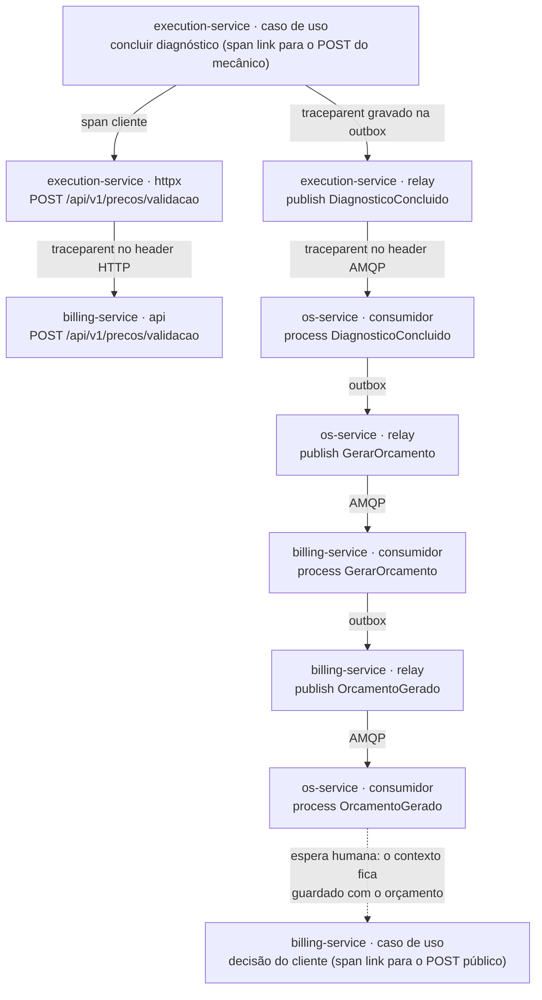

No ensaio de 19/10/2026, o trace `af146ea716424dfc2ac5b25960b8e9ae` reuniu 245 spans do OS Service, do Billing e da Execução, inclusive a chamada da Execução ao Billing em `/api/v1/precos/validacao`. A exportação está em [trace-saga-2026-10-19.json](evidencias/trace-saga-2026-10-19.json), e as capturas do Jaeger, no Anexo B. O cenário de caminho feliz do E2E consulta a API do Jaeger em todo CD e exige spans dos três serviços no mesmo trace.

### 11.4 Dashboards

São nove dashboards, um arquivo JSON cada, em [`observabilidade/dashboards/`](../../../observabilidade/dashboards). Os de negócio ficam em JSON separado dos técnicos, como a banca da fase 3 pediu, e cada painel tem descrição no JSON igual à coluna "Como ler" da documentação; um teste reprova a divergência.

| Dashboard | Tag | Responde |
|---|---|---|
| Negócio: Atendimento | negócio | volume diário de OS e tempo médio por status (o RF-027 da fase 3), OS por status agora, funil, desfecho das sagas, motivos de cancelamento e erros de integração |
| Negócio: Orçamentos | negócio | orçamentos por desfecho, taxa de aprovação, tempo até a decisão e quem ainda não decidiu |
| Negócio: Pagamentos | negócio | faturamento no período e por dia, pagamentos por desfecho, estornos e cobranças abertas |
| Negócio: Execução e estoque | negócio | filas da oficina, tempo de espera, tempo de execução por tipo de serviço (o RF-008 da fase 1) e peças em falta |
| Saga | técnico | prazo técnico vencido, sagas em falha na compensação, ativas e idade por etapa, duração por etapa, reenvios e último ciclo do `prazos` |
| Mensageria dos serviços | técnico | publicadas e consumidas por tipo e resultado, retry por nível, DLQ por tipo, outbox e reconexões |
| Serviços | técnico | requisições, erro 5xx, latência p95 e taxa de sucesso por serviço, rotas mais lentas, recusas do Kong, circuitos, Mercado Pago, sinais de segurança, CPU e memória por pod |
| Bancos | técnico | exporters, conexões, transações, locks, tamanho dos bancos e replica set do MongoDB |
| Plataforma | técnico | DLQs, consumidores, alarmes do broker, filas, alvos do Prometheus e tráfego da borda |

Depois do E2E, o CD confere no Prometheus a consulta de cada painel de negócio: no último CD do `platform`, as 47 consultas voltaram com série. As capturas dos nove dashboards com três dias de histórico estão pendentes ([Anexo B](#anexo-b--evidências-visuais)).

### 11.5 Alertas

São 21 regras de alerta, provisionadas como código em `observabilidade/grafana/`, com severidade de aviso ou crítica. Cada uma tem, no promtool, um caso que dispara e um que não dispara, rodados pelo `make manifests`. A tabela completa, com consulta, janela e painel relacionado, está no [`observabilidade/README.md`](../../../observabilidade/README.md#regras-de-alerta-pasta-pytstop).

| Alerta | Dispara quando | Janela | Severidade |
|---|---|---|---|
| DLQ com mensagens | alguma fila `.dlq` tem mensagem | 1 min | crítica |
| Saga parada | prazo técnico vencido há mais de 60 s, saga em `falha_na_compensacao` ou coletor das sagas indisponível | 5 min | crítica |
| Compensações acima do normal | mais da metade das sagas iniciadas em 30 minutos terminou em compensação | 30 min | aviso |
| Serviço com mais de 1% de 5xx | por serviço, a regra da fase 3 | 5 min | crítica |
| Latência p95 acima de 500 ms | por serviço, sem as sondas, a regra da fase 3 | 5 min | aviso |
| Circuito aberto | algum disjuntor aberto | 1 min | aviso |
| Outbox parada | a mensagem mais antiga à espera na outbox passou de 300 s | 5 min | crítica |
| Outbox com mensagem dead | o relay desistiu de publicar uma linha | 1 min | crítica |
| Fila de trabalho sem consumidor | `billing.comandos`, `execucao.comandos` ou `os.eventos` sem consumidor | 2 min | crítica |
| Serviço fora do ar (um por serviço) | nenhuma réplica da API de pé | 2 min | crítica |
| Banco fora do ar | o exporter não alcança o banco | 1 min | crítica |
| Assinatura inválida no webhook e falha na busca do JWKS | crescimento contínuo | 5 min | aviso |
| Plataforma (seis regras) | RabbitMQ fora ou com alarme de memória ou disco, Kong fora, gateway com mais de 1% de 5xx, alvo de métricas fora e CPU de pod acima de 80% do limite | de 1 a 10 min | crítica; aviso na CPU |

O procedimento para "Saga parada" e "DLQ com mensagens" está no [runbook da saga](../../operacao/runbook-saga.md).

### 11.6 Ensaio de observabilidade

Em 19/10/2026, o grupo exercitou a stack num kind local com os três serviços ([relatório do ensaio](evidencias/observabilidade.md)):

- o E2E passou com 14 cenários, e o trace do caminho feliz reuniu os três serviços;
- numa janela de 600,9 s sem tráfego de clientes, os 28 pods mantiveram identificadores e reinícios, e os 18 grupos de alvos e os três exporters dos bancos ficaram disponíveis;
- com o consumidor do Billing pausado por quatro minutos, a regra `pytstop-fila-sem-consumidor` disparou para `billing.comandos` às 03:56:30 UTC e voltou a normal às 03:58:30 UTC; as capturas estão no Anexo B;
- o `make demo` passou com seis cenários.

A chamada HTTP do Billing ao Mercado Pago real e a observação ociosa nesse modo dependem da sandbox real ([seção 15](#15-pendências-até-a-submissão)).

## 12. Rastreabilidade requisito → evidência

Cada requisito da fase 4 tem um ID na [gap analysis](../../requisitos/fase4/gap-analysis-fase-4.md), com a linha do enunciado (l.). São 44: 11 requisitos funcionais, 26 não funcionais e 7 regras de negócio. A [matriz de rastreabilidade](../matriz-de-rastreabilidade.md) traz, para cada um, os pull requests, os links do código e o trecho do vídeo. As tabelas abaixo resumem onde cada requisito está e como foi verificado.

### 12.1 Requisitos funcionais

| ID | Requisito | Onde está | Evidência |
|---|---|---|---|
| RF-028 | Abertura da OS (l. 35) | OS Service: `POST /api/v1/ordens-de-servico` abre a OS e a saga na mesma transação ([OS #2](https://github.com/fiap-postech-sw-architecture/postech-sw-arch-p4-os-service/pull/2), [OS #6](https://github.com/fiap-postech-sw-architecture/postech-sw-arch-p4-os-service/pull/6)) | BDD do caminho feliz no CD da `main` |
| RF-029 | Atualização de status (l. 36) | OS Service: a saga muda o status pelas respostas dos participantes, com a `MaquinaDeStatus` como guarda | BDD: os oito status em ordem |
| RF-030 | Consulta de status e histórico (l. 37) | `GET /api/v1/ordens-de-servico/{id}`, com a etapa e o resumo do orçamento e do pagamento, e `GET .../{id}/historico`, com as mudanças de status e os passos da saga ([OS #17](https://github.com/fiap-postech-sw-architecture/postech-sw-arch-p4-os-service/pull/17)) | BDD e Newman: histórico de oito status |
| RF-031 | Geração e envio de orçamentos para aprovação (l. 43) | O Billing gera o orçamento e o link de decisão; o OS Service envia o e-mail ([Billing #2](https://github.com/fiap-postech-sw-architecture/postech-sw-arch-p4-billing-service/pull/2), [Billing #3](https://github.com/fiap-postech-sw-architecture/postech-sw-arch-p4-billing-service/pull/3), [OS #9](https://github.com/fiap-postech-sw-architecture/postech-sw-arch-p4-os-service/pull/9)) | BDD: orçamento de R$ 210,00 e e-mail com o link |
| RF-032 | Registro e verificação de pagamentos (l. 44) | Billing: uma cobrança por orçamento, com o estado lido sempre na API do provedor, pelo webhook ou pela conciliação | BDD com o simulador: pagamento confirmado, recusado e estornado |
| RF-033 | Atualização do status da OS após o pagamento (l. 45) | `PagamentoConfirmado` leva a OS a `AGUARDANDO_EXECUCAO` | BDD e Newman |
| RF-034 | Integração com o Mercado Pago (l. 47) | Adapter real (Checkout Pro, webhook com `x-signature`, conciliação e estorno idempotente) e simulador para o CI ([Billing #17](https://github.com/fiap-postech-sw-architecture/postech-sw-arch-p4-billing-service/pull/17)) | Teste de contrato do adapter; prova na sandbox real pendente |
| RF-035 | Gerenciar a fila de execução (l. 53) | Execução: `GET /api/v1/fila`, por prioridade e ordem de agendamento ([Execução #2](https://github.com/fiap-postech-sw-architecture/postech-sw-arch-p4-execution-service/pull/2), [Execução #3](https://github.com/fiap-postech-sw-architecture/postech-sw-arch-p4-execution-service/pull/3)) | BDD: a OS só entra na fila depois do pagamento |
| RF-036 | Atualizar o status durante diagnóstico e reparos (l. 54) | Execução: início e conclusão do diagnóstico, início e finalização da execução | BDD: `em_diagnostico`, `em_execucao` e `finalizada` |
| RF-037 | Comunicar a finalização ao OS Service (l. 55) | Evento `ExecucaoFinalizada`, com a baixa das peças | BDD: saldo de 8 com 0 reservadas e saga concluída |
| RF-038 | Saga Pattern no fluxo da OS (l. 71 e 72) | Orquestrador no OS Service ([OS #6](https://github.com/fiap-postech-sw-architecture/postech-sw-arch-p4-os-service/pull/6), [OS #8](https://github.com/fiap-postech-sw-architecture/postech-sw-arch-p4-os-service/pull/8), [OS #10](https://github.com/fiap-postech-sw-architecture/postech-sw-arch-p4-os-service/pull/10)) | BDD de compensações e do pivot ([platform #13](https://github.com/fiap-postech-sw-architecture/postech-sw-arch-p4-platform/pull/13)); runbook |

### 12.2 Requisitos não funcionais

| ID | Requisito | Onde está | Evidência |
|---|---|---|---|
| RNF-031 | Três microsserviços com repositório, infraestrutura e banco próprios (l. 27 e 57) | Três repositórios, cada um com código, `Dockerfile`, `k8s/` e banco | Repositórios públicos; banco implantado no CD de cada serviço |
| RNF-032 | Ao menos um banco relacional (l. 59) | PostgreSQL 16 no OS Service e na Execução ([OS #7](https://github.com/fiap-postech-sw-architecture/postech-sw-arch-p4-os-service/pull/7), [Execução #5](https://github.com/fiap-postech-sw-architecture/postech-sw-arch-p4-execution-service/pull/5)) | StatefulSet implantado no CD |
| RNF-033 | Ao menos um banco não relacional (l. 60) | MongoDB 7 no Billing ([Billing #5](https://github.com/fiap-postech-sw-architecture/postech-sw-arch-p4-billing-service/pull/5)) | StatefulSet implantado no CD do Billing |
| RNF-034 | APIs REST síncronas quando necessário (l. 65) | Validação de preços da Execução no Billing, com timeout, retry e circuit breaker | BDD: API do Billing parada, 503 e circuito aberto |
| RNF-035 | Mensageria assíncrona (l. 66) | RabbitMQ, AsyncAPI e um JSON Schema por mensagem ([platform #2](https://github.com/fiap-postech-sw-architecture/postech-sw-arch-p4-platform/pull/2)) | BDD: consumidor do Billing parado sem perder o fluxo |
| RNF-036 | Nenhum serviço acessa o banco de outro (l. 67) | Credencial e Secret por serviço; NetworkPolicy do banco ([platform #25](https://github.com/fiap-postech-sw-architecture/postech-sw-arch-p4-platform/pull/25)) | Smoke do CD: o banco recusa conexão de outro namespace |
| RNF-037 | Orquestração ou coreografia, com a escolha justificada no README (l. 74 a 77) | README do OS Service e ADR-035 | Seção 7.1 |
| RNF-038 | Testes unitários em todos os serviços (l. 81) | Job `test` de cada serviço | 10.312, 1.731 e 1.475 testes no CD de 20/10/2026 |
| RNF-039 | Um fluxo completo testado com BDD (l. 82) | `e2e/features/saga_atendimento.feature` | 14 cenários no CD de cada serviço e no do `platform` |
| RNF-040 | Cobertura mínima de 80% por serviço (l. 83) | `fail_under = 95` no `.coveragerc` | 99,61%, 100,00% e 100,00% |
| RNF-041 | SonarQube ou similar no CI (l. 84) | Job `sonarqube`, com o gate versionado | Gate aprovado nos três serviços |
| RNF-042 | Pipeline independente com build, testes, qualidade e deploy em Kubernetes (l. 88 a 94 e 100) | `ci.yml`, `security.yml` e `cd.yml` em cada serviço, com o CD compartilhado | CD da `main` aprovado nos três, com E2E no kind |
| RNF-043 | `main` protegida, com PR obrigatório e checagens automáticas (l. 95) | Ruleset em cada repositório | Seção 2.2 |
| RNF-044 | Cada microsserviço no próprio repositório (l. 99) | Três repositórios de serviço | Seção 2 |
| RNF-045 | Mensageria para orquestração ou coreografia (l. 101) | Comandos e eventos da saga no RabbitMQ | BDD da saga |
| RNF-046 | Ferramentas de monitoramento e observabilidade da fase 3 (l. 102) | Prometheus, Grafana, Loki, Promtail e Jaeger no `platform`; nove dashboards e 21 alertas | Parcial: trace e alerta provados localmente; capturas com três dias de histórico pendentes |
| RNF-047 | Código-fonte (l. 108) | `src/` de cada serviço | Seção 2 |
| RNF-048 | Dockerfile e manifestos Kubernetes (l. 109) | `Dockerfile` e `k8s/` de cada serviço | Imagem e deploy em cada CD |
| RNF-049 | Pipelines de CI/CD (l. 110) | Workflows de cada repositório | Runs da seção 9.4 |
| RNF-050 | Evidências de cobertura (l. 111) | Seção Cobertura do README de cada serviço | Tabelas geradas do `coverage.xml`, com o link do run |
| RNF-051 | Documentação da arquitetura do serviço (l. 112) | `docs/arquitetura.md` de cada serviço | Seção 4.1 |
| RNF-052 | Swagger ou collection Postman atualizada (l. 113) | OpenAPI e collection por serviço; collection do fluxo completo | Newman no CD: 108 assertions, nenhuma falha |
| RNF-053 | Vídeo de até 15 minutos com as quatro demonstrações (l. 115 a 122) | Roteiro de 14 minutos | Pendente: gravação e publicação |
| RNF-054 | PDF no portal com os seis itens (l. 124 a 133) | Este documento e o índice da entrega | Pendente: submissão no portal |
| RNF-055 | Tolerância a falhas na comunicação: timeout, retry com backoff, DLQ e circuit breaker (l. 15) | Retry por atraso, DLQ com redrive, prazos com reenvio e circuit breaker na validação de preços | BDD de resiliência: consumidor parado e circuito aberto |
| RNF-056 | Rastreamento dos fluxos distribuídos (l. 122) | OpenTelemetry nos três serviços, com o contexto propagado pela outbox e pelos headers AMQP | Trace com os três serviços no BDD e no Jaeger; trace da chamada ao Mercado Pago pendente da sandbox |

### 12.3 Regras de negócio

| ID | Regra | Onde está | Evidência |
|---|---|---|---|
| RN-023 | Rollback e compensação em caso de falha em qualquer etapa (l. 73) | Plano de compensação por etapa e gatilho ([seção 7.5](#75-plano-de-compensação)) | Quatro cenários BDD de compensação; prazo técnico no BDD de componente do OS Service |
| RN-024 | Orçamento recusado ou expirado: diagnóstico descartado e OS cancelada, sem cancelar o orçamento já encerrado (l. 73) | Plano da etapa `AGUARDANDO_DECISAO` | BDD: recusa pelo link e expiração |
| RN-025 | Pagamento recusado ou expirado: reserva liberada, orçamento cancelado, diagnóstico descartado, sem estorno (l. 73) | Plano da etapa `AGUARDANDO_PAGAMENTO` | BDD: pagamento recusado no simulador |
| RN-026 | Falta de peça cancela sem cobrar; o cancelamento pago antes do início estorna, na ordem da saga (l. 73) | Reserva antes do pagamento; plano da etapa `AGUARDANDO_INICIO` | BDD: falta de peça e cancelamento com estorno |
| RN-027 | A OS só entra na fila de execução com orçamento aprovado, peças reservadas e pagamento confirmado (l. 45 e 72) | Ordem dos passos T4, T5, T6 e T7 | BDD: a OS não está na fila antes do pagamento |
| RN-028 | Comando ou evento reentregue não repete efeito (l. 17) | `mensagens_processadas` e chave de negócio nos três serviços | Testes de reentrega: [resposta repetida](https://github.com/fiap-postech-sw-architecture/postech-sw-arch-p4-os-service/blob/main/tests/unitarios/ordem_servico/test_orquestrador.py#L473) e [estorno repetido](https://github.com/fiap-postech-sw-architecture/postech-sw-arch-p4-os-service/blob/main/tests/unitarios/ordem_servico/test_orquestrador_compensacoes.py#L500) no OS Service, [mensagem duplicada](https://github.com/fiap-postech-sw-architecture/postech-sw-arch-p4-billing-service/blob/main/tests/integracao/test_consumidor.py#L700) no Billing e [comando repetido](https://github.com/fiap-postech-sw-architecture/postech-sw-arch-p4-execution-service/blob/main/tests/unitarios/execucao/test_use_cases_execucao.py#L512) na Execução |
| RN-029 | Depois do início da execução física a OS não pode ser cancelada: o pivot, com 409 (l. 73) | `MaquinaDeStatus` e etapa `EM_EXECUCAO` | BDD: 409 `TRANSICAO_STATUS_INVALIDA` |

## 13. Feedback da fase 3

O [registro do tratamento](https://github.com/fiap-postech-sw-architecture/postech-sw-arch-p3/blob/main/docs/entrega/fase3/feedback-professor.md) lista cada ponto da avaliação. A tabela mostra como a fase 4 os trata.

| Ponto da avaliação da fase 3 | Como a fase 4 trata |
|---|---|
| Validar os dígitos verificadores do CPF antes da consulta ao banco | O OS Service valida CPF e CNPJ pelo módulo 11 antes de qualquer consulta, com o mesmo 404 para documento inválido e para OS não encontrada; o cenário BDD `@validacao` prova a recusa no CD ([CPF](https://github.com/fiap-postech-sw-architecture/postech-sw-arch-p4-os-service/blob/main/src/compartilhado/dominio/cpf.py), [CNPJ](https://github.com/fiap-postech-sw-architecture/postech-sw-arch-p4-os-service/blob/main/src/compartilhado/dominio/cnpj.py)) |
| Muitos commits diretos na `main`; exigir PR em todos os repositórios | Os quatro repositórios nasceram com ruleset: nenhum commit direto, só o `Initial commit` do GitHub ([seção 2.2](#22-proteção-da-main)) |
| Versionar os dashboards de negócio (volume diário de OS e tempo médio por status) como JSON separado e documentar cada painel | Quatro dashboards de negócio em JSON separado, cada painel documentado em [`negocio.md`](../../../observabilidade/negocio.md), com teste que reprova a divergência ([seção 11.4](#114-dashboards)) |
| Material muito extenso; concentrar os artefatos pedidos num índice | Índice único da entrega, com um link por artefato ([INDICE-DA-ENTREGA.md](../../../INDICE-DA-ENTREGA.md), também no Anexo C), e este documento abre com o mapa dos seis itens do PDF |
| Vídeo, repositório extra de processo e observação geral | Sem pendência na fase 3; a entrega da fase 4 tem só os quatro repositórios da seção 2 |

O índice da entrega também liga os painéis de taxa de sucesso, latência p95 e erro 5xx por serviço, que estão no dashboard Serviços.

## 14. Dívida técnica aceita

A lista completa, com o limite atual e quando revisar cada item, está na [auditoria pré-entrega](auditoria-e-divida-tecnica.md). Os itens de maior peso:

| Item | Limite atual |
|---|---|
| BDD de componente só no OS Service | O ADR-041 previa cenários Gherkin também no Billing e na Execução; nos dois, os casos de borda da saga ficam em testes unitários e de integração do pytest, como a compensação que chega antes do comando e as corridas entre decisão, webhook e expiração |
| Code smells do SonarQube (138, 91 e 18) | Nota A, sem reprovar o gate; os principais são funções acima de 50 linhas (onze no OS Service e três no Billing) e agregados com máquina de estados acima de 300 linhas |
| Import-linter do OS Service | A camada de aplicação de dois contextos captura um erro do SQLAlchemy, e faltam dois contratos que o Billing e a Execução têm |
| Base `compartilhado` copiada e divergente | Conceitos de domínio na base do OS Service e da Execução; `IntegrationEvent` e o sufixo das exceções diferem entre os serviços |
| Detalhe do cliente devolve o documento completo ao atendente e ao admin | Comportamento herdado; a listagem mascara o valor, e as rotas de dados pessoais têm auditoria |
| Controller do Kong com acesso aos Secrets dos quatro namespaces | Avaliar tirar a regra de Secrets das Roles do controller |
| Redrive manual depois de uma eliminação de dados | O runbook proíbe o redrive da fila da Execução nesse caso, mas o script não tem trava |

## 15. Pendências até a submissão

| Pendência | Quem fecha | Como fecha |
|---|---|---|
| Vídeo de até 15 minutos | Grupo | Gravar pelo [roteiro](roteiro-video.md), publicar no YouTube (não listado) e pôr o link na seção 3 e no índice |
| Prova na sandbox real do Mercado Pago | Integrante com as credenciais de teste | `make mp-sandbox` no kind local: cobrança, aprovação e estorno reais, com a saída higienizada em `docs/entrega/fase4/evidencias/` ([README do `platform`](../../../README.md#mercado-pago-na-sandbox)) |
| Capturas dos nove dashboards com três dias de histórico | `platform` | Captura no kind com o Prometheus em volume persistente, alimentado pelo `make demo` diário, para a seção B6 do Anexo B |
| Tag `entrega-fase-4` nos quatro repositórios | Grupo | Criar a tag nos commits congelados, repetir as provas do CD e regenerar o PDF com `scripts/build-entrega-pdf.sh --final` |
| Submissão do PDF no portal | Grupo | Depois da tag e do vídeo; o modo final do gerador recusa o documento enquanto houver texto pendente |

# Anexo A — Scans de segurança da fase 4

Bateria da `main` de 20/10/2026, nos runs do CD dos três serviços e do `platform`. Cada ferramenta roda num job próprio, em todo pull request, a cada push na `main` e, no `security.yml`, toda segunda-feira. Os números abaixo foram lidos nos logs e nos artefatos desses runs.

## Escopo

| Serviço | Run | Commit | Jobs |
|---|---|---|---|
| OS Service | [39449191933](https://github.com/fiap-postech-sw-architecture/postech-sw-arch-p4-os-service/actions/runs/39449191933) | `3ce582b` | `ci / security` (bandit), `security-scan / pip-audit`, `security-scan / trivy`, `security-scan / gitleaks`, `ci / sonarqube`, `cd / image` (SBOM) |
| Billing | [39449241713](https://github.com/fiap-postech-sw-architecture/postech-sw-arch-p4-billing-service/actions/runs/39449241713) | `76b5f9b` | os mesmos |
| Execução | [39449216419](https://github.com/fiap-postech-sw-architecture/postech-sw-arch-p4-execution-service/actions/runs/39449216419) | `5b1bef4` | os mesmos |
| `platform` | [39458619627](https://github.com/fiap-postech-sw-architecture/postech-sw-arch-p4-platform/actions/runs/39458619627) | `d703200` | `ci / gitleaks`, `ci / manifests`, `e2e` (ZAP baseline contra os três serviços em `3ce582b`, `76b5f9b` e `5b1bef4`) |

## Resumo

| Ferramenta | OS Service | Billing | Execução |
|---|---|---|---|
| bandit 1.9.4 (SAST) | 0 achados | 0 achados | 0 achados |
| pip-audit 2.10.1 (SCA) | 70 dependências, 0 vulnerabilidades | 57, 0 | 61, 0 |
| trivy 0.72.0 (imagem) | 73 alvos, 0 HIGH ou CRITICAL com correção | 59 alvos, 0 | 64 alvos, 0 |
| gitleaks (segredos) | 26 commits, 0 vazamentos | 24 commits, 0 | 20 commits, 0 |
| SonarQube Community 26.9 | gate aprovado; 0 bugs, 0 vulnerabilidades, 0 hotspots | gate aprovado; 0, 0, 0 | gate aprovado; 0, 0, 0 |
| OWASP ZAP 2.17.0 (DAST na borda) | 38 URLs; 0 FAIL, 1 WARN, 59 PASS | 38 URLs; 0 FAIL, 2 WARN, 58 PASS | 24 URLs; 0 FAIL, 1 WARN, 59 PASS |
| SBOM em SPDX | 171 pacotes | 147 pacotes | 162 pacotes |

## Análise estática (bandit)

O job `security` roda o bandit 1.9.4 sem filtro de severidade: qualquer achado, até de severidade baixa, reprova o job. No OS Service o alvo é `src/` e `scripts/`; no Billing e na Execução, `src/`. Os três jobs passaram sem achado.

## Dependências (pip-audit)

O job exporta do `uv.lock` só as dependências de runtime, com os extras da imagem (`uv export --no-dev --all-extras`), e roda o `pip-audit` 2.10.1 com `--strict`. Resultado nos três serviços: `No known vulnerabilities found`, sem nenhum `--ignore-vuln`. Foram 70 dependências no OS Service, 57 no Billing e 61 na Execução. O Dependabot abre PR semanal para as dependências, as actions e as imagens base, e cada PR passa pelos mesmos checks.

## Imagem (trivy)

O job constrói a imagem do serviço e roda o trivy 0.72.0 com `--severity HIGH,CRITICAL --ignore-unfixed --exit-code 1`. Os três relatórios mostram 0 em todos os alvos: o sistema da imagem (Debian 13.7) e cada pacote Python do `.venv`, 73 alvos no OS Service, 59 no Billing e 64 na Execução. As imagens de terceiros dos manifestos (bancos e exporters) entram no mesmo job só como relatório no summary. No `platform`, as CVEs conhecidas das imagens da fase 3 e dos exporters estão aceitas na seção 10.3, com os números no [README](../../../README.md#decisões-e-limites).

## Segredos (gitleaks)

O job varre todo o histórico do commit testado, então um segredo commitado e apagado no commit seguinte também reprova. Nos três serviços e no `platform`, o resultado foi `no leaks found`, em 26, 24, 20 e 32 commits. Em seguida, o `scripts/ci/testa-gitleaks.sh` roda o controle negativo: planta senhas geradas e URLs de banco e de broker com senha e confere que as regras as pegam, que o valor de demonstração só passa nos arquivos que a configuração permite e que uma senha apagada num commit seguinte continua acusada no histórico. Os valores de demonstração ficam marcados com `gitleaks:allow`.

## SonarQube

O job `sonarqube` sobe o `sonarqube:26.9.0.129388-community` como service container, troca a senha padrão por uma aleatória, aplica o gate de `.sonar/quality-gate.json` e analisa com o `sonar-scanner-cli` 12.2. Senha e token morrem com o runner. O job reprova se a análise não trouxer cobertura e linhas de código, para não aprovar análise vazia.

| Medida | OS Service | Billing | Execução |
|---|---|---|---|
| Arquivos indexados | 352 | 166 | 186 |
| Linhas de código | 11.107 | 7.790 | 6.077 |
| Cobertura (Sonar), linhas e ramos | 97,2% (96,9% e 98,7%) | 98,8% (98,6% e 100,0%) | 98,6% (98,4% e 100,0%) |
| Bugs, vulnerabilidades e hotspots | 0, 0 e 0 | 0, 0 e 0 | 0, 0 e 0 |
| Notas de confiabilidade, segurança e manutenibilidade | A, A e A | A, A e A | A, A e A |
| Code smells | 138 | 91 | 18 |
| Duplicação | 0,0% | 0,0% | 0,0% |
| Quality gate | aprovado | aprovado | aprovado |

## DAST (OWASP ZAP baseline)

O ZAP 2.17.0, fixado por digest, roda no job `e2e` do CD do `platform`, depois do E2E e no mesmo kind, contra a borda como um cliente de fora a vê: `https://localhost/<prefixo>/openapi.json` de cada serviço. O modo baseline só olha as respostas, sem as injeções do scan ativo, mas o spider importa o OpenAPI e chama cada operação uma vez, inclusive `POST`, `PUT` e `DELETE`; por isso a varredura só roda num kind descartável. O scan roda sem credencial, então quase toda operação protegida responde 401, e o ZAP avalia os cabeçalhos dessas respostas.

| Serviço | URLs lidas | FAIL | WARN | IGNORE | PASS |
|---|---|---|---|---|---|
| OS Service | 38 | 0 | 1 | 1 | 59 |
| Billing | 38 | 0 | 2 | 1 | 58 |
| Execução | 24 | 0 | 1 | 1 | 59 |

| Achado | Onde | Tratamento |
|---|---|---|
| 10035, `Strict-Transport-Security` ausente (WARN) | Só nos 404 que o próprio Kong gera para `/`, o prefixo, `/robots.txt` e `/sitemap.xml`; toda resposta dos serviços traz o cabeçalho | Fica em WARN: o Kong sem rota casada não executa plugin |
| 10024, informação sensível na URL (WARN, só no Billing) | O checkout do simulador e as rotas de aprovar e recusar dele, que levam o `token` na query | Por desenho do simulador, que só existe com `MP_MODE=simulado`; o Promtail mascara o `token=` antes de ele chegar ao Loki |
| 10015, diretivas de `Cache-Control` (IGNORE) | `saude`, `saude/pronto` e `openapi.json`, que respondem `no-store`, e o JWKS, com `public, max-age=600` de propósito | `no-store` já proíbe o cache; o ZAP quer também `no-cache` e `must-revalidate` |

Ficam em FAIL, e reprovam o job, o nome e a versão de produto nos cabeçalhos `Server` e `X-Powered-By` e a falta de `X-Content-Type-Options`. O Kong roda com `headers=off` e os serviços sem o `server` do uvicorn: sem essas regras, qualquer um dos dois voltaria a anunciar a versão. As regras e o motivo de cada uma estão no [README do `platform`](../../../README.md#regras-e-allowlist).

## SBOM

O job `image` gera o SBOM em SPDX pelo BuildKit, extrai o documento, reprova se ele não listar nenhum pacote e o publica como artefato por 90 dias: 171 pacotes no OS Service, 147 no Billing e 162 na Execução, nas imagens publicadas em 20/10/2026.

## Manifestos

O `make manifests` valida os overlays `kind`, `kind-ci` e `k3s` no kubeconform, contra os schemas do Kubernetes 1.35, recusando `Secret` versionado, e roda o `trivy config` com HIGH e CRITICAL. No `platform`, o mesmo alvo testa no promtool cada consulta de painel e cada regra de alerta. Os dois jobs (`build` nos serviços e `manifests` no `platform`) passaram nos runs da tabela de escopo.

## Relação com outros documentos

- [Seção 10](#10-relatório-de-análise-de-vulnerabilidades): ferramentas, postura de segurança e riscos aceitos.
- [README do `platform`](../../../README.md): segredos gerados, ZAP baseline, decisões e limites.
- [ADR-039](../../arquitetura/adr/fase4/039-autenticacao-entre-servicos.md), [ADR-041](../../arquitetura/adr/fase4/041-estrategia-de-testes-e-qualidade.md) e [ADR-042](../../arquitetura/adr/fase4/042-cicd-e-deploy-kubernetes.md): identidade, testes e segurança na cadeia.
- Relatório de vulnerabilidades da fase 1, com o mapeamento do OWASP Top 10, no [repositório da fase 3](https://github.com/fiap-postech-sw-architecture/postech-sw-arch-p3/blob/main/docs/seguranca/relatorio-vulnerabilidades.md).

# Anexo B — Evidências visuais

As capturas vêm de páginas públicas do GitHub, do cluster kind do ensaio, `pytstop-p4-codex`, lido sem alterações, e dos artefatos dos mesmos runs. O cluster roda os commits de 19/10/2026 do [relatório do ensaio](evidencias/observabilidade.md#ambiente-e-commits), e o congelamento pede novas capturas. Cada imagem tem a data e a fonte logo abaixo. O [registro de evidências](evidencias/README.md#capturas-de-tela) lista os arquivos e a origem de cada um.

## B1 — CD da `main`

O CD da `main` de cada repositório passou em 20/10/2026. O grafo mostra os jobs verdes de CI, segurança, SonarQube, imagem e implantação no kind. O job `remote-skipped` registra que o deploy remoto está desligado, porque o deploy entregue é o kind ([ADR-042](../../arquitetura/adr/fase4/042-cicd-e-deploy-kubernetes.md)). No `platform`, o grafo tem o CI e os jobs `deploy-kind` e `e2e`.


Fonte: [run 39449191933](https://github.com/fiap-postech-sw-architecture/postech-sw-arch-p4-os-service/actions/runs/39449191933), commit `3ce582b`, 20/10/2026.


Fonte: [run 39449241713](https://github.com/fiap-postech-sw-architecture/postech-sw-arch-p4-billing-service/actions/runs/39449241713), commit `76b5f9b`, 20/10/2026.


Fonte: [run 39449216419](https://github.com/fiap-postech-sw-architecture/postech-sw-arch-p4-execution-service/actions/runs/39449216419), commit `5b1bef4`, 20/10/2026.


Fonte: [run 39449167465](https://github.com/fiap-postech-sw-architecture/postech-sw-arch-p4-platform/actions/runs/39449167465), commit `a12502e`, 20/10/2026.

## B2 — Trace da saga no Jaeger

O Jaeger do kind guarda os traces só na memória. Os dois primeiros traces são do ensaio de 20/10/2026, às 09:03 (horário de Brasília), no `pytstop-p4-codex`; as capturas saíram no mesmo dia, com o `svc/jaeger` acessado por `kubectl port-forward`. O trace do caminho feliz, de 19/10/2026, já saiu da memória do Jaeger: a exportação publicada foi aberta na aba Upload de um Jaeger 1.76.0 avulso, em Docker, removido depois da captura. Cada trace atravessa os três serviços.


Fonte: Jaeger 1.76.0, serviço `os-service`, janela de 09:03:10 a 09:03:40 de 20/10/2026.


Fonte: trace `bfe21ce701ea69d6afc008a870d2ce21`, da mesma busca.


Fonte: arquivo [trace-saga-2026-10-19.json](evidencias/trace-saga-2026-10-19.json), trace `af146ea716424dfc2ac5b25960b8e9ae`, do [ensaio de 19/10/2026](evidencias/observabilidade.md#fluxo-e-trace).

## B3 — Swagger pela borda

O Swagger de cada serviço abre pelo Kong do kind, em `https://localhost/<prefixo>/docs`, com certificado autoassinado. O campo Servers mostra o prefixo do serviço.


Fonte: `https://localhost/os/docs`, kind `pytstop-p4-codex`, 20/10/2026.


Fonte: `https://localhost/billing/docs`, kind `pytstop-p4-codex`, 20/10/2026.


Fonte: `https://localhost/execucao/docs`, kind `pytstop-p4-codex`, 20/10/2026.

## B4 — Newman e ZAP no CD do `platform`

O job `e2e` do CD do `platform` roda o BDD, o Newman e o ZAP no mesmo kind. Os relatórios saem como artefatos do run.


Fonte: [job e2e do run 39449167465](https://github.com/fiap-postech-sw-architecture/postech-sw-arch-p4-platform/actions/runs/39449167465/job/118731446687), 20/10/2026.


Fonte: artefato `e2e-kind` do [run 39449167465](https://github.com/fiap-postech-sw-architecture/postech-sw-arch-p4-platform/actions/runs/39449167465), arquivo `newman/resumo.json`. A tabela é montada com os números do arquivo.


Fonte: artefato `zap-baseline` do mesmo run, arquivos `zap-<serviço>.log` e `zap-<serviço>.json`. A tabela é montada com os números dos arquivos.

## B5 — Alerta de fila sem consumidor

No ensaio de 19/10/2026, o consumidor do Billing ficou parado por quatro minutos. A regra `pytstop-fila-sem-consumidor` disparou para a fila `billing.comandos` e voltou ao normal depois da restauração. As outras duas filas ficaram normais. O [relatório do ensaio](evidencias/observabilidade.md#alertas-e-recuperação) traz os horários.


Fonte: Grafana do kind `pytstop-p4-codex`, 19/10/2026, 00:56 (horário de Brasília).


Fonte: Grafana do kind `pytstop-p4-codex`, 19/10/2026, 00:58 (horário de Brasília).

## B6 — Dashboards do Grafana

Os nove dashboards (Atendimento, Orçamentos, Pagamentos, Execução, Saga, Mensageria, Serviços, Bancos e Plataforma) entram aqui depois da captura de 22/10/2026, com três dias de histórico no kind. Captura pendente.
