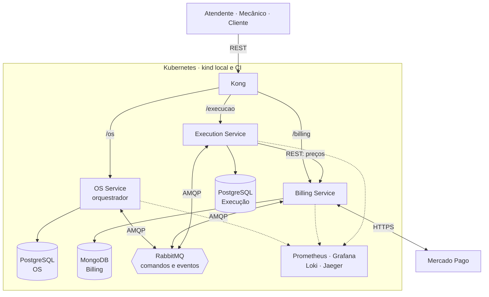

# Tech Challenge — Fase 4: PytStop

O PytStop é o sistema de gestão de uma oficina mecânica. Nas fases 1 a 3 ele foi um monólito; na fase 4 virou três microsserviços ligados por uma saga. Uma ordem de serviço (OS) registra um atendimento, da abertura à entrega do veículo. O OS Service cuida da OS e do cliente, o Billing Service do orçamento e do pagamento, e o Execution Service do diagnóstico, do estoque e do reparo.

Versão preliminar do documento da turma 15SOAT, Pós-Graduação em Arquitetura de Software da FIAP. A versão final depende das provas operacionais e da gravação do vídeo. Prazo do portal: 17/11/2026 às 23:59.

## 1. Participantes

Grupo 158, turma 15SOAT. Os mesmos integrantes das fases 1 a 3:

| Nome | RM | Discord |
|---|---|---|
| João Amaral | RM373448 | joao_13997 |
| Allan Aurélio | RM372116 | all66_ |
| Carlos Silva | RM374191 | carlossilva156 |
| Guilherme Sousa | RM373609 | romen0 |
| Nicolas Gerbi | RM372644 | sethiiz_gerbi |

## 2. Repositórios e execução

| Componente | Repositório | Documentação | CI/CD |
|---|---|---|---|
| OS Service | [https://github.com/fiap-postech-sw-architecture/postech-sw-arch-p4-os-service](https://github.com/fiap-postech-sw-architecture/postech-sw-arch-p4-os-service) | [README](https://github.com/fiap-postech-sw-architecture/postech-sw-arch-p4-os-service/blob/main/README.md), [arquitetura](https://github.com/fiap-postech-sw-architecture/postech-sw-arch-p4-os-service/blob/main/docs/arquitetura.md), [API](https://github.com/fiap-postech-sw-architecture/postech-sw-arch-p4-os-service/tree/main/docs/api) | [workflows](https://github.com/fiap-postech-sw-architecture/postech-sw-arch-p4-os-service/tree/main/.github/workflows), [execuções](https://github.com/fiap-postech-sw-architecture/postech-sw-arch-p4-os-service/actions) |
| Billing Service | [https://github.com/fiap-postech-sw-architecture/postech-sw-arch-p4-billing-service](https://github.com/fiap-postech-sw-architecture/postech-sw-arch-p4-billing-service) | [README](https://github.com/fiap-postech-sw-architecture/postech-sw-arch-p4-billing-service/blob/main/README.md), [arquitetura](https://github.com/fiap-postech-sw-architecture/postech-sw-arch-p4-billing-service/blob/main/docs/arquitetura.md), [API](https://github.com/fiap-postech-sw-architecture/postech-sw-arch-p4-billing-service/tree/main/docs/api) | [workflows](https://github.com/fiap-postech-sw-architecture/postech-sw-arch-p4-billing-service/tree/main/.github/workflows), [execuções](https://github.com/fiap-postech-sw-architecture/postech-sw-arch-p4-billing-service/actions) |
| Execution Service | [https://github.com/fiap-postech-sw-architecture/postech-sw-arch-p4-execution-service](https://github.com/fiap-postech-sw-architecture/postech-sw-arch-p4-execution-service) | [README](https://github.com/fiap-postech-sw-architecture/postech-sw-arch-p4-execution-service/blob/main/README.md), [arquitetura](https://github.com/fiap-postech-sw-architecture/postech-sw-arch-p4-execution-service/blob/main/docs/arquitetura.md), [API](https://github.com/fiap-postech-sw-architecture/postech-sw-arch-p4-execution-service/tree/main/docs/api) | [workflows](https://github.com/fiap-postech-sw-architecture/postech-sw-arch-p4-execution-service/tree/main/.github/workflows), [execuções](https://github.com/fiap-postech-sw-architecture/postech-sw-arch-p4-execution-service/actions) |
| Plataforma | [https://github.com/fiap-postech-sw-architecture/postech-sw-arch-p4-platform](https://github.com/fiap-postech-sw-architecture/postech-sw-arch-p4-platform) | [README](https://github.com/fiap-postech-sw-architecture/postech-sw-arch-p4-platform/blob/main/README.md) | [workflows](https://github.com/fiap-postech-sw-architecture/postech-sw-arch-p4-platform/tree/main/.github/workflows), [execuções](https://github.com/fiap-postech-sw-architecture/postech-sw-arch-p4-platform/actions) |

O [índice da entrega](../../../INDICE-DA-ENTREGA.md) concentra os artefatos exigidos. A [matriz](../matriz-de-rastreabilidade.md) liga os 44 requisitos aos serviços, pull requests (PRs), código e trechos previstos do vídeo. Nesta versão preliminar, os links apontam para `main`; a versão final usará a tag `entrega-fase-4` dos quatro repositórios.

Cada serviço contém código, Dockerfile, manifestos Kubernetes, pipeline de integração e implantação contínuas (CI/CD), testes, documentação de arquitetura, OpenAPI e collection Postman próprios. A plataforma reúne a infraestrutura compartilhada e as provas integradas. Para reproduzir o ambiente, siga o [README da plataforma](../../../README.md#e2e-da-saga) e o `make kind-deploy` de cada serviço.

## 3. Vídeo

O vídeo de até 15 minutos ainda será gravado e publicado. O [roteiro](roteiro-video.md) reserva 14 minutos para fluxo completo, compensações, pipeline com deploy e observabilidade. Inserir o link público ou não listado após a gravação.

## 4. Arquitetura final

O diagrama reproduz a [RFC-004, seção 2](../../arquitetura/rfc/fase4/rfc-004-microsservicos-saga.md), a proposta técnica da arquitetura (RFC, *request for comments*).

No diagrama, REST são chamadas HTTP síncronas, AMQP são as mensagens do RabbitMQ e kind é um cluster Kubernetes em contêineres Docker. No CI, o overlay `kind-ci` roda Prometheus e Jaeger; Grafana e Loki ficam só no kind local.

## 5. Divisão dos serviços e tecnologias

O recorte do monólito segue os três critérios do [ADR-034](../../arquitetura/adr/fase4/034-decomposicao-em-microsservicos.md), um dos registros de decisão de arquitetura (ADRs, *architecture decision records*) da fase. As capacidades que o enunciado sugere definem os serviços. Cada contexto delimitado do monólito vai inteiro para o serviço da capacidade que ele sustenta, com duas exceções do ADR-034: o contexto Ordem de Serviço, que mistura atendimento, orçamento e execução, se reparte entre os três serviços, e o preço da peça sai do estoque para o Billing. Cada serviço é o único dono dos seus dados. A regra que precisa de transação local com lock fica num serviço só, para que a reserva de peças não atravesse a rede.

- O OS Service guarda a OS, o histórico, os clientes, os veículos e os usuários internos, e orquestra a saga.
- O Billing Service guarda preços, orçamentos e pagamentos e fala com o Mercado Pago.
- O Execution Service guarda diagnóstico, estoque, reservas e execução.

Cada serviço também muda num ritmo próprio: o OS Service com o atendimento e a identidade, o Billing com a regra de preço e o provedor de pagamento, a Execução com o trabalho da oficina.

Há um desvio deliberado do enunciado, que põe o envio do orçamento no Billing: o Billing gera o orçamento e o link de decisão, e o e-mail sai do OS Service, dono do contato. Assim, nome, documento e contato do cliente não saem do OS Service. A [RFC-004, seção 3](../../arquitetura/rfc/fase4/rfc-004-microsservicos-saga.md) detalha o recorte.

PostgreSQL 16 preserva as relações e restrições do OS Service e da Execução. MongoDB 7 guarda os documentos de orçamento e pagamento do Billing, com replica set para gravar na mesma transação o documento e a outbox, a coleção das mensagens a publicar. RabbitMQ separa comandos e respostas, com confirmação, retry por atraso e filas de mensagens mortas. Kong é o gateway de API: publica as rotas `/os`, `/billing` e `/execucao`, limita a taxa de requisições e propaga o identificador de correlação. O JSON Web Token (JWT) é assinado com RSA e SHA-256 (RS256): a identidade se valida pela chave pública do OS Service, e a chave privada fica somente no emissor.

Prometheus, Grafana, Loki e Jaeger retomam a observabilidade da fase 3. Os nove dashboards têm JSON e descrição por painel; os de negócio incluem volume diário de OS e tempo médio por status.

O ambiente entregue é o kind, executado localmente e no CI; nuvem persistente é opcional, conforme o [ADR-042](../../arquitetura/adr/fase4/042-cicd-e-deploy-kubernetes.md). As decisões da fase estão nos ADRs [034 a 043](../../arquitetura/adr/fase4/).

## 6. Saga e compensações

A saga é orquestrada, e não coreografada: o OS Service é o orquestrador e comanda os outros dois serviços por mensagens ([ADR-035](../../arquitetura/adr/fase4/035-saga-orquestrada.md)). A escolha segue o tamanho da saga: nove passos em três serviços, esperas humanas, um provedor externo, seis compensações e um ponto sem retorno. O material da disciplina recomenda a coreografia para sagas simples, e esta não é. Com coreografia, os passos ficariam espalhados nos três serviços, sem um lugar que diga em que etapa a OS está, e cada serviço teria de assinar os eventos dos outros dois para tratar prazos e compensações.

O orquestrador fica no OS Service, que inicia a saga, e não num quarto serviço: o fluxo fica num lugar só, e a etapa da saga e o status da OS mudam na mesma transação. A outbox do OS Service publica os comandos, e cada participante grava o efeito e a resposta na própria transação. O orquestrador conhece só a ordem dos passos, as compensações e os prazos; preço, validade e pagamento ficam com os participantes. Se o OS Service cai, as mensagens esperam nas filas duráveis, e a saga segue do ponto gravado quando o Kubernetes recria o pod.

O caminho completo passa por diagnóstico, orçamento, decisão, reserva, pagamento, agendamento, início, finalização e entrega. Falha na reserva cancela o orçamento e descarta o diagnóstico, sem cobrar. Cancelamento pago antes do início cancela a execução, estorna o pagamento, libera a reserva, cancela o orçamento e descarta o diagnóstico, nessa ordem. Após o início físico, o cancelamento responde 409: este é o pivot da saga, o ponto sem retorno.

Uma mensagem duplicada não repete o efeito. Quando os prazos e os reenvios se esgotam sem resolver uma compensação, ela fica para intervenção manual, e o [runbook](../../operacao/runbook-saga.md) descreve a retomada, que exige autenticação. O [teste integrado orientado por comportamento (BDD)](../../../e2e/features/saga_atendimento.feature) verifica caminho feliz, compensações, pivot e recuperação de falhas.

## 7. Testes, qualidade e deploy

O enunciado exige cobertura mínima de 80%; o projeto adota gate de 95% nos serviços. Testes unitários, de integração com bancos reais, BDD e de mutação cobrem os fluxos. Os pipelines de CI/CD verificam tipos, limites arquiteturais, dependências e segredos, varrem as imagens e passam pelo SonarQube; o [resumo do SonarQube](evidencias/coverage.md#sonarqube) traz o quality gate de cada serviço. No CD da plataforma, o OWASP ZAP (*Zed Attack Proxy*) varre a borda. Os relatórios e o estado de cada prova ficam nas [evidências](evidencias/README.md), e as capturas de tela, na seção 9.

O workflow de CD compartilhado fica na plataforma e passou no [CD da `main`](https://github.com/fiap-postech-sw-architecture/postech-sw-arch-p4-platform/actions/runs/39227461810). Os três serviços o chamam, e o CD da `main` de cada um passou com imagem identificada pelo digest (o hash do conteúdo), lista de componentes da imagem (SBOM, *software bill of materials*), implantação no kind, teste de fumaça (smoke) e testes de ponta a ponta (E2E). As [provas dos serviços](evidencias/README.md#cd-compartilhado-dos-serviços) registram os commits dos quatro repositórios em cada execução.

A [collection do fluxo completo](evidencias/newman-resumo.md) passou no CI do [platform #24](https://github.com/fiap-postech-sw-architecture/postech-sw-arch-p4-platform/pull/24) e no [CD da `main`](https://github.com/fiap-postech-sw-architecture/postech-sw-arch-p4-platform/actions/runs/39231733886). A [proteção da `main`](evidencias/protecao-da-main.md) registra o ruleset, os checks obrigatórios e a origem dos commits de cada repositório.

## 8. Evidências e fechamento

A [auditoria](auditoria-e-divida-tecnica.md) lista o que ainda precisa ser provado e a dívida técnica aceita. A prova na sandbox real do Mercado Pago exige as credenciais de teste de um integrante do grupo; o simulador e o ensaio sem cobrança não a substituem.

Antes da submissão: confirmar participantes, concluir as provas de CD e observabilidade, conferir links, gravar e publicar o vídeo, congelar os quatro repositórios com a tag `entrega-fase-4` e regenerar o PDF. A submissão no portal cabe ao grupo.

## 9. Evidências visuais

As capturas vêm de páginas públicas do GitHub, do cluster kind do ensaio, `pytstop-p4-codex`, lido sem alterações, e dos artefatos dos mesmos runs. O cluster roda os commits de 19/10/2026 do [relatório do ensaio](evidencias/observabilidade.md#ambiente-e-commits), e o congelamento pede novas capturas. Cada imagem tem a data e a fonte logo abaixo. O [registro de evidências](evidencias/README.md#capturas-de-tela) lista os arquivos e a origem de cada um.

### 9.1 CD da `main`

O CD da `main` de cada repositório passou em 20/10/2026. O grafo mostra os jobs verdes de CI, segurança, SonarQube, imagem e implantação no kind. O job `remote-skipped` registra que o deploy remoto está desligado, porque o deploy entregue é o kind ([ADR-042](../../arquitetura/adr/fase4/042-cicd-e-deploy-kubernetes.md)). No platform, o grafo tem o CI e os jobs `deploy-kind` e `e2e`.

Fonte: [run 39449191933](https://github.com/fiap-postech-sw-architecture/postech-sw-arch-p4-os-service/actions/runs/39449191933), commit `3ce582b`, 20/10/2026.

Fonte: [run 39449241713](https://github.com/fiap-postech-sw-architecture/postech-sw-arch-p4-billing-service/actions/runs/39449241713), commit `76b5f9b`, 20/10/2026.

Fonte: [run 39449216419](https://github.com/fiap-postech-sw-architecture/postech-sw-arch-p4-execution-service/actions/runs/39449216419), commit `5b1bef4`, 20/10/2026.

Fonte: [run 39449167465](https://github.com/fiap-postech-sw-architecture/postech-sw-arch-p4-platform/actions/runs/39449167465), commit `a12502e`, 20/10/2026.

### 9.2 Trace da saga no Jaeger

O Jaeger do kind guarda os traces só na memória. Os dois primeiros traces são do ensaio de 20/10/2026, às 09:03 (horário de Brasília), no `pytstop-p4-codex`; as capturas saíram no mesmo dia, com o `svc/jaeger` acessado por `kubectl port-forward`. O trace do caminho feliz, de 19/10/2026, já saiu da memória do Jaeger: a cópia higienizada foi aberta na aba Upload de um Jaeger 1.76.0 avulso, em Docker, removido depois da captura. Cada trace atravessa os três serviços.

Fonte: Jaeger 1.76.0, serviço `os-service`, janela de 09:03:10 a 09:03:40 de 20/10/2026.

Fonte: trace `bfe21ce701ea69d6afc008a870d2ce21`, da mesma busca.

Fonte: arquivo [trace-saga-2026-10-19.json](evidencias/trace-saga-2026-10-19.json), trace `af146ea716424dfc2ac5b25960b8e9ae`, do [ensaio de 19/10/2026](evidencias/observabilidade.md#fluxo-e-trace).

### 9.3 Swagger pela borda

O Swagger de cada serviço abre pelo Kong do kind, em `https://localhost/<prefixo>/docs`, com certificado autoassinado. O campo Servers mostra o prefixo do serviço.

Fonte: `https://localhost/os/docs`, kind `pytstop-p4-codex`, 20/10/2026.

Fonte: `https://localhost/billing/docs`, kind `pytstop-p4-codex`, 20/10/2026.

Fonte: `https://localhost/execucao/docs`, kind `pytstop-p4-codex`, 20/10/2026.

### 9.4 Newman e ZAP no CD do platform

O job `e2e` do CD do platform roda o BDD, o Newman e o ZAP no mesmo kind. Os relatórios saem como artefatos do run.

Fonte: [job e2e do run 39449167465](https://github.com/fiap-postech-sw-architecture/postech-sw-arch-p4-platform/actions/runs/39449167465/job/118731446687), 20/10/2026.

Fonte: artefato `e2e-kind` do [run 39449167465](https://github.com/fiap-postech-sw-architecture/postech-sw-arch-p4-platform/actions/runs/39449167465), arquivo `newman/resumo.json`. A tabela é montada com os números do arquivo.

Fonte: artefato `zap-baseline` do mesmo run, arquivos `zap-<serviço>.log` e `zap-<serviço>.json`. A tabela é montada com os números dos arquivos.

### 9.5 Alerta de fila sem consumidor

No ensaio de 19/10/2026, o consumidor do Billing ficou parado por quatro minutos. A regra `pytstop-fila-sem-consumidor` disparou para a fila `billing.comandos` e voltou ao normal depois da restauração. As outras duas filas ficaram normais. O [relatório do ensaio](evidencias/observabilidade.md#alertas-e-recuperação) traz os horários.

Fonte: Grafana do kind `pytstop-p4-codex`, 19/10/2026, 00:56 (horário de Brasília).

Fonte: Grafana do kind `pytstop-p4-codex`, 19/10/2026, 00:58 (horário de Brasília).

### 9.6 Dashboards do Grafana

Os nove dashboards (Atendimento, Orçamentos, Pagamentos, Execução, Saga, Mensageria, Serviços, Bancos e Plataforma) entram aqui depois da captura de 22/10/2026, com três dias de histórico no kind. Captura pendente.
