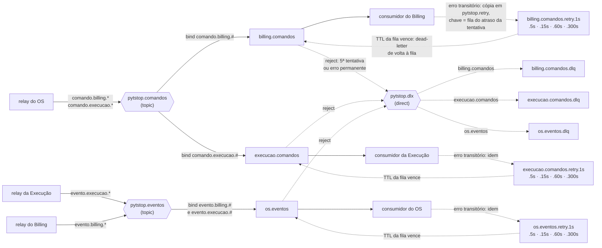

# RabbitMQ: usuários, permissões e filas

> [↑ Raiz do projeto](../README.md)

## Usuário e permissões no RabbitMQ

Cada serviço tem um usuário próprio, criado pelo Job `rabbitmq-usuarios` ([`criar-usuarios.sh`](../k8s/base/rabbitmq/criar-usuarios.sh)) com as senhas do Secret `rabbitmq-credenciais` e as permissões de [`permissoes.json`](../k8s/base/rabbitmq/permissoes.json). Nenhum serviço tem permissão de configure: a topologia inteira vem do [`definitions.json`](../k8s/base/rabbitmq/definitions.json), importado no boot do broker, e o serviço só confere o que precisa com declaração passiva. Assim nenhum comando volta como não roteável porque o consumidor do destino ainda não subiu.

Além do exchange, a permissão de tópico limita as routing keys que cada usuário publica. Sem ela, um serviço poderia publicar evento em nome de outro ou mandar uma cópia ao `pytstop.retry` com a routing key de uma fila de retry de outro serviço e entregar mensagem lá.

Os padrões de nome exato do `permissoes.json` terminam em `\z`, não em `$`: na expressão regular do broker o `$` também casa antes de um `\n` final, e com ele a chave `billing.comandos.retry.1s` seguida de `\n` passava pela permissão do `billing` (RabbitMQ 4.3.6; com `\z`, 403). Os de prefixo, das routing keys de comando e de evento, ficam abertos no fim, porque a chave continua com o nome da ação ou do fato.

Origem conferida ([ADR-036](arquitetura/adr/fase4/036-mensageria-rabbitmq.md)): toda publicação leva na propriedade `user_id` do AMQP (*Advanced Message Queuing Protocol*) o usuário da conexão, e o broker recusa outro valor (`406 PRECONDITION_FAILED`), porque nenhum usuário de serviço tem a tag `impersonator`. O consumidor confere o `user_id` contra o produtor do tipo da mensagem, o `userId` da operação de envio no [`asyncapi.yaml`](../contratos/asyncapi.yaml) (a routing key não serve, porque na cópia de retry ela é o nome da fila de retry). A cópia de retry é republicada pelo próprio consumidor e leva o `user_id` dele, então com `x-tentativa` de 1 em diante ele aceita o próprio usuário; qualquer outro valor é erro permanente e vai para a DLQ. O snippet de [Filas, exchanges e argumentos](#filas-exchanges-e-argumentos) traz as duas regras.

| Usuário | Publica em | Routing keys permitidas | Lê de | Senha (chave do Secret) |
|---|---|---|---|---|
| `os` | `pytstop.comandos`, `pytstop.retry` | `comando.billing.*` e `comando.execucao.*`; no retry, só `os.eventos.retry.1s` a `.300s` | `os.eventos` | `senha-os` |
| `billing` | `pytstop.eventos`, `pytstop.retry` | `evento.billing.*`; no retry, só `billing.comandos.retry.1s` a `.300s` | `billing.comandos` | `senha-billing` |
| `execucao` | `pytstop.eventos`, `pytstop.retry` | `evento.execucao.*`; no retry, só `execucao.comandos.retry.1s` a `.300s` | `execucao.comandos` | `senha-execucao` |
| `admin` | tudo (operação e management) | tudo | tudo | `admin-senha` |

Secret não atravessa namespace: o `make deploy` cria no namespace de cada serviço o Secret `rabbitmq`, com a chave `RABBITMQ_URL` (`amqp://<usuario>:<senha>@rabbitmq.pytstop-plataforma.svc.cluster.local:5672/%2F`; o `%2F` é o vhost padrão `/` codificado, a forma da [especificação de URI AMQP do RabbitMQ](https://www.rabbitmq.com/docs/uri-spec), em que `amqp://host/` seria o vhost vazio) montada com a senha do usuário dele ([Segredos gerados](segredos.md#segredos-gerados)). Esse é o contrato com os serviços: cada processo lê a `RABBITMQ_URL` do Secret, e senha do broker não vai para os manifests do serviço. O Secret é da plataforma: o `make deploy` do `platform` o grava antes dos manifests do serviço, e o serviço não declara Secret com esse nome. Cada namespace recebe o usuário dele: `pytstop-os` o `os`, `pytstop-billing` o `billing` e `pytstop-execucao` (do repositório `execution-service`) o `execucao`.

```yaml
env:
  - name: RABBITMQ_URL
    valueFrom:
      secretKeyRef:
        name: rabbitmq
        key: RABBITMQ_URL
```

## Filas, exchanges e argumentos

Toda a topologia está em [`k8s/base/rabbitmq/definitions.json`](../k8s/base/rabbitmq/definitions.json), importada pelo RabbitMQ no boot (kind, k3s e compose). Os serviços não declaram nada com efeito: só conferem com declaração passiva (`passive=True`). No RabbitMQ 4.3 a declaração passiva também exige permissão no recurso: cada usuário confere a própria fila (permissão de leitura) e os exchanges em que publica (escrita). Fila ou exchange de outro serviço, filas de retry e `.dlq` respondem `403 ACCESS_REFUSED` e fecham o canal, então o check de topologia do boot fica nesta lista:

| Usuário | Pode conferir com declaração passiva |
|---|---|
| `os` | fila `os.eventos`; exchanges `pytstop.comandos` e `pytstop.retry` |
| `billing` | fila `billing.comandos`; exchanges `pytstop.eventos` e `pytstop.retry` |
| `execucao` | fila `execucao.comandos`; exchanges `pytstop.eventos` e `pytstop.retry` |

As policies abaixo servem também para quem precisar recriar a topologia em outro broker. O desenho é o da [RFC-004, seção 5.1](arquitetura/rfc/fase4/rfc-004-microsservicos-saga.md#51-topologia):



| Exchange | Tipo | Para que serve |
|---|---|---|
| `pytstop.comandos` | topic | Comandos do OS (`comando.<serviço de destino>.<ação>`) |
| `pytstop.eventos` | topic | Eventos de Billing e Execução (`evento.<serviço de origem>.<fato>`) |
| `pytstop.retry` | topic | Cópias para nova tentativa; a routing key é o nome da fila de retry do atraso daquela tentativa. É topic, com bindings de chave exata, só para aceitar permissão de tópico; num direct qualquer serviço com escrita no exchange alcançaria a fila de outro |
| `pytstop.dlx` | direct | Dead-letter das filas de trabalho; a routing key é o nome da fila |

| Fila | Consumidor | Bindings | Policy |
|---|---|---|---|
| `billing.comandos` | Billing | `pytstop.comandos` com `comando.billing.#` | `trabalho-billing.comandos`: `dead-letter-exchange=pytstop.dlx`, `dead-letter-routing-key=billing.comandos`, `dead-letter-strategy=at-least-once`, `overflow=reject-publish`, `max-length=10000`, `delivery-limit=5` |
| `execucao.comandos` | Execução | `pytstop.comandos` com `comando.execucao.#` | `trabalho-execucao.comandos`: as mesmas, com `dead-letter-routing-key=execucao.comandos` |
| `os.eventos` | OS | `pytstop.eventos` com `evento.billing.#` e `evento.execucao.#` | `trabalho-os.eventos`: as mesmas, com `dead-letter-routing-key=os.eventos` |
| `<fila>.retry.1s`, `.5s`, `.15s`, `.60s` e `.300s` | ninguém | `pytstop.retry` com routing key igual ao nome da fila de retry | `retry-<fila>` (padrão `^<fila>\.retry\.`): `dead-letter-exchange=""` (default exchange), `dead-letter-routing-key=<fila>`, `dead-letter-strategy=at-least-once`, `overflow=reject-publish`, sem `message-ttl`; o TTL é o argumento `x-message-ttl` de cada fila (1000 a 300000) |
| `<fila>.dlq` | ninguém (análise e `make redrive`) | `pytstop.dlx` com routing key `<fila>` | `dlq`: `message-ttl=604800000` (7 dias: as mensagens carregam dado pessoal, como a placa) |

Todas são quorum, duráveis, não exclusivas e sem auto-delete. O tipo (`x-queue-type`) é argumento de todas, e o TTL (`x-message-ttl`), só das filas de retry. O resto vem de policies, porque argumento de fila é imutável e a importação do boot ignora a mudança numa fila que já existe, enquanto as policies são regravadas a cada boot: mudar uma policy no `definitions.json` muda as filas no próximo restart do broker.

O TTL da fila de retry fica no argumento de propósito: o atraso está no nome da fila, e mudar um atraso é criar outra fila (com a permissão de tópico e os consumidores), nunca mudar o argumento de uma que já existe. E não vai para a `retry-<fila>`, comum às cinco: com policy e argumento, a fila quorum usa o menor dos dois ([ADR-036](arquitetura/adr/fase4/036-mensageria-rabbitmq.md)), e um `message-ttl` ali cortaria os atrasos maiores.

A importação do boot não apaga fila, e fila que já existe fica com os argumentos com que nasceu. Um broker com volume (compose) ou PVC (StatefulSet) que ainda tem a fila de retry única de cada fila de trabalho (`<fila>.retry`, sem o atraso no nome) passa às filas por atraso sem perder cópia assim:

1. Pare os consumidores dos serviços (réplicas em zero no cluster), para nenhuma cópia nova entrar na `<fila>.retry`, e espere as três esvaziarem: em até 300 s, o maior `expiration` que as cópias levavam, todas voltam para a fila de trabalho pela policy que ainda vale. Confira na coluna `messages`:

   No kind (no k3s, troque o contexto em `--context`):

   ```bash
   kubectl --context kind-pytstop-p4 -n pytstop-plataforma exec rabbitmq-0 -c rabbitmq -- rabbitmqctl -q list_queues name messages
   ```

   No compose:

   ```bash
   docker compose -f compose/docker-compose.yml exec rabbitmq rabbitmqctl -q list_queues name messages
   ```

2. Aplique as definitions e as permissões: `make deploy` no kind e no k3s (o ConfigMap novo reinicia o broker, e o Job `rabbitmq-usuarios` roda de novo) ou `make down && make up` no compose (só recriando os containers o broker reimporta as definitions e o `rabbitmq-usuarios` reaplica o `permissoes.json`). Daqui em diante a `<fila>.retry` fica sem policy, porque a `retry-<fila>` passa a casar só as filas por atraso: cópia que ainda estivesse nela expiraria sem dead letter e se perderia (conferido no 4.3.6), e por isso o passo 1 vem antes.

3. Apague as três filas antigas, que até lá aparecem como fila de trabalho sem consumidor nos painéis 2, 4 e 5 do dashboard:

   No kind:

   ```bash
   for fila in billing.comandos.retry execucao.comandos.retry os.eventos.retry; do
     kubectl --context kind-pytstop-p4 -n pytstop-plataforma exec rabbitmq-0 -c rabbitmq -- rabbitmqctl delete_queue "$fila"
   done
   ```

   No compose:

   ```bash
   for fila in billing.comandos.retry execucao.comandos.retry os.eventos.retry; do
     docker compose -f compose/docker-compose.yml exec rabbitmq rabbitmqctl delete_queue "$fila"
   done
   ```

4. Suba os consumidores já publicando nas chaves `<fila>.retry.1s` a `.300s`: a permissão de tópico recusa a chave antiga, o nome da fila de trabalho.

Fila de trabalho ou DLQ com argumento além de `x-queue-type` (dead letter, TTL ou tamanho, que hoje vêm das policies; o `list_queues name arguments` mostra) também não muda na importação: apague-a, com as mensagens dela. Quando o conteúdo do broker não importa, apagar o volume resolve tudo de uma vez: `docker compose -f compose/docker-compose.yml down -v` no compose, ou `make kind-down` e `make kind-up deploy` no kind.

Limites: a cópia volta no atraso da fila de retry em que entrou; a fila de trabalho cheia (10000 mensagens) recusa a publicação, que o relay do produtor retenta; e o broker recusa mensagem acima de 1 MiB (`max_message_size` no `rabbitmq.conf`).

No consumidor do Billing, com pika (o `user_id` de toda publicação é o usuário da conexão; o broker recusa outro valor com `406 PRECONDITION_FAILED`, porque nenhum usuário de serviço tem a tag `impersonator`):

```python
import os

import pika

USUARIO = "billing"  # o user_id das cópias de retry é o do próprio consumidor
FILA = "billing.comandos"
ATRASOS = ["1s", "5s", "15s", "60s", "300s"]  # x-tentativa 1 a 5: <fila>.retry.<atraso>


def origem_valida(propriedades: pika.BasicProperties, produtor: str) -> bool:
    """produtor: usuário que publica o tipo (o userId da operação no AsyncAPI)."""
    tentativa = (propriedades.headers or {}).get("x-tentativa", 0)
    return propriedades.user_id == produtor or (
        tentativa >= 1 and propriedades.user_id == USUARIO
    )


def nova_tentativa(canal, entrega, propriedades, corpo) -> None:
    tentativa = (propriedades.headers or {}).get("x-tentativa", 0) + 1
    if tentativa > len(ATRASOS):
        canal.basic_reject(entrega.delivery_tag, requeue=False)  # vai para a DLQ
        return
    # mandatory + confirm: se a cópia não for roteada ou o broker a recusar,
    # o pika levanta UnroutableError/NackError antes do ack, e a original fica.
    canal.basic_publish(
        exchange="pytstop.retry",
        routing_key=f"{FILA}.retry.{ATRASOS[tentativa - 1]}",  # fila de retry do atraso
        body=corpo,
        properties=pika.BasicProperties(
            message_id=propriedades.message_id,
            correlation_id=propriedades.correlation_id,
            type=propriedades.type,
            user_id=USUARIO,
            content_type="application/json",
            delivery_mode=2,
            headers={**(propriedades.headers or {}), "x-tentativa": tentativa},
        ),
        mandatory=True,
    )
    canal.basic_ack(entrega.delivery_tag)


conexao = pika.BlockingConnection(pika.URLParameters(os.environ["RABBITMQ_URL"]))
canal = conexao.channel()
canal.queue_declare(FILA, passive=True)  # confere, não cria
canal.basic_qos(prefetch_count=10)  # por consumidor; a fila quorum não aceita global
canal.confirm_delivery()  # basic_publish espera o broker confirmar
```

Fluxo de uma mensagem que falha no consumidor:

1. Erro transitório: o consumidor publica uma cópia no `pytstop.retry`, sem `expiration`, com a routing key da fila de retry do atraso da nova tentativa (`x-tentativa` 1 vai para `<fila>.retry.1s`, 2 para `.5s`, 3 para `.15s`, 4 para `.60s` e 5 para `.300s`), o próprio `user_id` e o header `x-tentativa`, espera a confirmação do broker (publisher confirms, `mandatory`) e só então dá ack na original.
2. Quando o TTL (*time to live*) da fila vence, a fila de retry devolve a mensagem para `<fila>` pelo default exchange, com o histórico no header `x-death`. Como todas as cópias de uma fila de retry têm o mesmo TTL, a ordem de chegada é a de expiração, e nenhuma espera atrás de outra mais longa. Esse dead-letter é interno ao broker e não pede permissão do serviço.
3. Depois da 5ª tentativa, ou em erro permanente (validação, schema), o consumidor faz `basic_reject(requeue=False)` e a mensagem vai para `<fila>.dlq` pelo `pytstop.dlx`, onde fica até 7 dias. Corrigida a causa, `make redrive FILA=<fila>` a devolve para `<fila>` (abaixo).
4. Mensagem que derruba o consumidor sem ack (conexão ou canal fechados) volta para a fila e gasta uma entrega. É o caminho da mensagem venenosa, como a que traz um header que o pika não decodifica e derruba a conexão a cada entrega:
   - O limite: a policy da fila de trabalho limita as entregas a 5 (`delivery-limit`; o padrão da fila quorum é 20), e na sexta a mensagem vai para a DLQ com o motivo `delivery_limit`. Com o limite padrão, o consumidor passaria 21 entregas reconectando.
   - O que conta (conferido no 4.3.6): `basic_reject` com `requeue=True` conta entrega, e `basic_nack` com `requeue=True` não conta (a mensagem volta para a fila indefinidamente). Por isso o retry é sempre pelo `pytstop.retry`.
   - A cópia de retry entra na fila como mensagem nova, com a contagem de entregas do broker zerada, e não gasta o limite.

Por que uma fila de retry por atraso: TTL só vence quando a mensagem chega à cabeça da fila. Numa fila de retry única, com `expiration` em cada cópia, uma cópia de 1 s publicada atrás de uma de 8 s só voltou aos 8 s (RabbitMQ 4.3.6); no uso real, a cópia de 300 s da quinta tentativa seguraria por 5 minutos as primeiras tentativas de todas as mensagens atrás dela. Com o TTL fixo em cada fila, a cópia volta no atraso dela. O `make smoke` prova isso no kind, e o `make prova-retry` num RabbitMQ avulso (também no CI), publicando como o usuário `billing` ([`prova_retry.py`](../scripts/prova_retry.py)): a cópia de 1 s publicada depois de uma de 5 s volta em 1 s, e o broker recusa a cópia na fila de retry de outro serviço, na chave antiga e na chave da própria fila seguida de `\n`.

Por que filas quorum e não classic duráveis: a quorum grava em log Raft com fsync antes de confirmar, aceita TTL e faz dead-lettering at-least-once (exige `overflow=reject-publish`). Assim a volta das filas de retry e a ida para a `.dlq` não perdem mensagem; na classic o dead-lettering é at-most-once.

Com um nó não há replicação, mas os clientes não mudam se o broker virar cluster. O custo é um pouco mais de memória e disco por fila, e o prefetch tem de ser por consumidor, porque a quorum não aceita prefetch global.

Redrive: `make redrive FILA=billing.comandos` (ou `execucao.comandos`, `os.eventos`) cria um shovel no próprio broker (plugin `rabbitmq_shovel`, ligado em [`enabled_plugins`](../k8s/base/rabbitmq/enabled_plugins)) que move para a fila as mensagens que estavam na DLQ quando ele começou e se apaga ao terminar. O shovel só tira a mensagem da DLQ depois de a fila confirmar o recebimento, e preserva as propriedades (`user_id`, `message_id`, `x-tentativa`), então o consumidor a trata como a última tentativa. No compose, o mesmo shovel do [`redrive.sh`](../scripts/redrive.sh) roda por `docker compose -f compose/docker-compose.yml exec rabbitmq rabbitmqctl set_parameter shovel`; o comando completo e quando fazer o redrive estão no [runbook da saga](operacao/runbook-saga.md#como).
